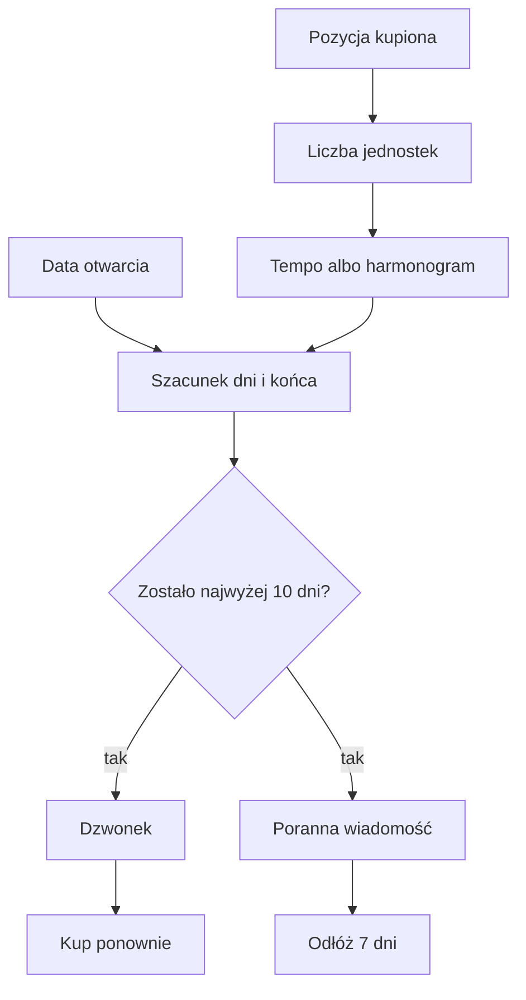

# Przypomnienia zakupowe

## Co to jest

Jeśli wpiszesz, ile produktu zostało w opakowaniu i jak szybko go zużywasz, QBot szacuje, na ile dni wystarczy zapas. Gdy zbliża się przewidywany koniec, przypomnienie może pojawić się w Dzwonku i w porannej wiadomości Telegram.

## Po co

Ustaw przypomnienie dla rzeczy, którą zużywasz regularnie, żeby mieć czas na uzupełnienie zapasu. Gdy rano widzisz „Kończy się”, sprawdź liczbę dni i przewidywaną datę. Wybierz „Kup ponownie” albo odłóż przypomnienie o 7 dni, jeśli masz jeszcze produkt.

## Skąd dane

Potrzebne są: stan „kupione”, liczba jednostek w opakowaniu, liczba opakowań, data otwarcia i tempo zużycia. Możesz podać dzienne zużycie albo powiązać pozycję z harmonogramem suplementu. Wtedy uwzględnia się zaznaczone dni tygodnia i dni oznaczone jako pominięte.

## Jak liczone

1. Odczyt listy zakupów z 18.10.2026 zwrócił 2 bieżące pozycje: jedną planowaną i jedną kupioną. Żadna z tych dwóch aktywnych pozycji nie miała ustawionej liczby jednostek opakowania, więc dla nich nie wyliczono końca zapasu.
2. W tych 2 pozycjach było 0 konfiguracji opakowania i tempa; liczba możliwych do wyliczenia prognoz wynosiła więc 0.
3. Z tego powodu z odczytu z 18.10.2026 nie da się podać prawdziwej daty końca zapasu ani przykładowego bieżącego przypomnienia. Wykres pokazuje ten brak konfiguracji.
4. Domyślne wyprzedzenie kodu wynosi 10 dni. Gdy pozostaje nie więcej niż tyle dni i pozycja nie jest odłożona ani nie ma aktywnego zakupu ponownego, przypomnienie może się pojawić.
5. „Odłóż 7 dni” zapisuje datę ponownego sprawdzenia. „Kup ponownie” tworzy jedną kopię z priorytetem „Pilne”, dopóki kopia istnieje.
6. Poranna wiadomość pokazuje najwyżej 3 pozycje z przyciskami. Dzwonek jest osobną listą powiadomień.

Wzór

Cały zapas = liczba jednostek w opakowaniu × liczba opakowań. Pozostały zapas = cały zapas − zużyte jednostki, nie mniej niż zero. Dni do końca = pełne dni z dzielenia pozostałego zapasu przez dzienne tempo. Przy harmonogramie suplementu dzienne tempo jest wyliczane z liczby dni przyjmowania w tygodniu.

## Gdzie to widać

Przypomnienie zakupowe może pojawić się w Dzwonku strony oraz w porannej wiadomości Telegram. W zakładce Zakupy sprawdzisz ustawienia zapasu. Zrzut [Garażu](../img/ekrany/garaz.png) pokazuje zakładkę Zakupy na górnym pasku, ale nie jej listę ani przypomnienie; wykaz zrzutów jest w [indeksie](../img/ekrany/indeks.md).

## Jak czytać

Data końca jest prognozą, nie pomiarem ilości produktu. Jeżeli suplement został wyłączony, system nie wylicza dla niego tempa. Jeśli zapas nadal jest duży, możesz odłożyć powiadomienie; w przeciwnym razie „Kup ponownie” dodaje zakup do listy „Do kupienia”.

## Decyzje i historia

Przypomnienia są ręcznie potwierdzane przez użytkownika. System nie czyta automatycznie poczty w celu wykrycia zakupu. Dla suplementów źródłem tempa jest jego harmonogram, a nie tylko liczba wpisana w polu dziennego zużycia.

## Ograniczenia i pułapki

- Nie dodano tu przykładu z bieżącej rzeczywistej prognozy: aktywne pozycje z odczytu 18.10.2026 nie miały skonfigurowanego opakowania.
- Jeśli nie uzupełnisz daty otwarcia, system może użyć daty zakupu.
- Dzień bez potwierdzenia dawki suplementu jest liczony jako przyjęty.
- Wyliczenie zależy od prawidłowej liczby jednostek, opakowań, daty i harmonogramu.
- Nie odczytano historii doręczenia do telefonu; opis mówi, gdzie kod przygotowuje wpis, a nie potwierdza odbiór wiadomości.

## Wpływa na / Zależy od

**Wpływa na:** wpis w Dzwonku, linię porannej wiadomości i utworzenie nowej pozycji na liście zakupów.

**Zależy od:** zakupu, daty otwarcia, wielkości opakowania, zużycia, harmonogramu suplementu oraz odłożenia przypomnienia.

## Powiązane hasła

- [Zakupy](zakupy.md)
- [Suplementy](../zdrowie/suplementy.md)
- [Centrum powiadomień](../system/centrum-powiadomien.md)

## Zrodla

- `/opt/qbot/app/qbot_zakupy_api.py` — `forecast`, `is_due`, `due_items`, `notif_items`, `rebuy`, `snooze`.
- `/opt/qbot/app/qbot_trener_notify.py` — pozycje zakupowe w wiadomości porannej.
- `/opt/qbot/app/telegram_reply_processor.py` — obsługa przycisków Telegram.
- `/opt/qbot/app/docs/ZAKUPY.md` — domyślne 10 dni, odłożenie o 7 dni i limit 3 pozycji.
- Odczyt aktywnych pozycji z `garage.db` i GET listy zakupów z 18.10.2026.
