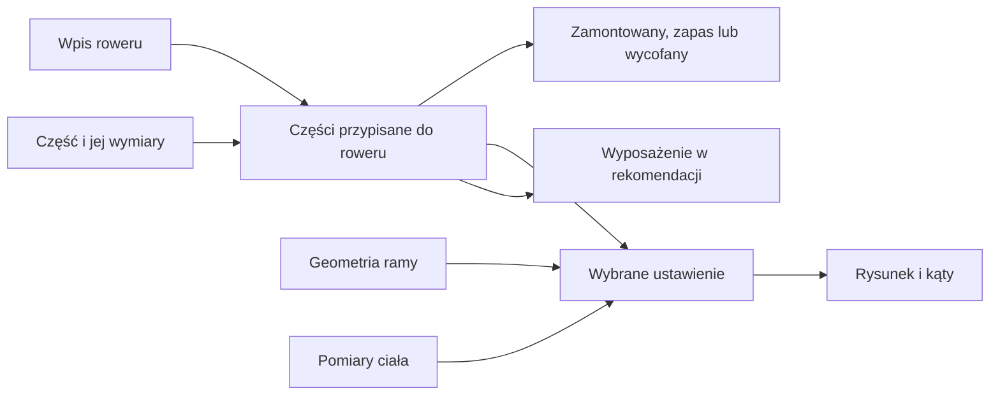

# Rowery i komponenty

## Co to jest

W Garażu możesz zapisać rower, a pod nim jego części. Dla części można uzupełnić kategorię, pozycję, markę, model, stan, masę, przebieg i wybrane wymiary. Wymiary mogą być użyte przez zakładkę Fitting.

## Po co

Prowadź wpisy tak, żeby łatwo rozpoznać część i miejsce montażu. Przy wymianie zaznacz, co jest zamontowane, a co zostało w zapasie. Jeśli część ma wpływać na rysunek pozycji, uzupełnij jej wymiary; nie polegaj na założeniu, gdy możesz wpisać rzeczywisty pomiar.

## Skąd dane

Odczyt Garażu z 18.10.2026 zawierał 4 aktywne rowery i 68 aktywnych komponentów. Wśród części było 54 wpisów oznaczonych jako zamontowane i 14 jako zapas. Cztery dodatkowe rekordy części były nieaktywne. Zrzut ekranu i zalogowany odczyt listy także pokazywały 68 aktywnych wpisów.

## Jak liczone

1. Wpisz rower i podstawowe dane. Przykładowo Grizl z 18.10.2026 ma zapisany rozmiar S, masę 7,85 kg i typ gravel.
2. Dodaj komponent i przypisz go do roweru. W tym samym odczycie Monster był odrębnym rowerem, Canyon Grand Canyon, z przydomkiem „Monster”.
3. Uzupełnij pozycję i status. Dwa błotniki Mucky Nutz MugGuard Front i Rear były zapisane przy Monsterze, w pozycji „rama” i ze statusem „zapas”.
4. Jeśli część ma znaczenie dla wymiarów, dopisz jej parametry. Przykładowa korba Graila miała zapisane 160 mm.
5. Gdy użyjesz części w ustawieniu fittingu, model bierze jej wymiary; brakujące wartości zastępuje tymczasowymi założeniami i pokazuje je pod rysunkiem.
6. Usunięcie roweru jest blokowane, gdy pozostają do niego przypisane części albo ustawienia fittingu. Najpierw trzeba uporządkować powiązane wpisy.

## Gdzie to widać

W zakładce Rower są karty rowerów i tabela części. Na [zrzucie Garażu](../img/ekrany/garaz.png) widać karty Grizla, Monstera, Graila i Roweru Gośki. W tabeli możesz znaleźć wiersz części i po prawej użyć „Edytuj” albo „Wycofaj”. Wykaz obrazów jest w [indeksie zrzutów](../img/ekrany/indeks.md).

## Jak czytać

„Zamontowany” i „zapas” to wpisane stany. Nie są bezpośrednim pomiarem z roweru. Pusta masa oznacza brak danych, nie masę 0 g. Jeśli wymiary części są niepełne, ekran Fitting może użyć wartości zastępczej. Sprawdź podpis „Założenia” zanim porównasz rysunki.

## Decyzje i historia

Na ekranie kategorie są opisane po polsku, a wewnętrzny zapis może używać innych nazw. Nie ma to wpływu na wpis widoczny dla właściciela. Dane części kół są powiązane z zestawem kołowym; osobny tekst wyjaśnia [koła i opony](kola-opony.md).

## Ograniczenia i pułapki

- Niektóre wpisy dotyczące wyposażenia są uniwersalne, a inne przypisane do jednego roweru.
- Część może mieć wagę rzeczywistą albo szacowaną; źródło ma znaczenie.
- Notatka w opisie roweru jest specyfikacją, nie warsztatową historią napraw.
- Zrzut przedstawia stan z chwili wykonania i nie dowodzi aktualnego montażu każdej rzeczy.

## Wpływa na / Zależy od

**Wpływa na:** rysunek Fittingu, rozpoznawanie roweru, opis zestawu oraz wybór roweru i opon.

**Zależy od:** wpisu roweru, przypisanych części, wymiarów i statusów.

## Powiązane hasła

- [Garaż](index.md)
- [Sprzęt](sprzet.md)
- [Fitting](fitting.md)
- [Koła i opony](kola-opony.md)
- [Rozpoznawanie roweru](rozpoznawanie-roweru.md)

## Zrodla

- `/opt/qbot/app/docs/GARAZ.md` — rowery, części, wymiary i powiązania.
- `/opt/qbot/app/web_public/garaz-tabs.js` — widok rowerów, części i ich edycja.
- `/opt/qbot/app/web_public/garaz-fit.js` — użycie wymiarów w rysunku.
- Odczyt `garage.db` z 18.10.2026 — rowery, komponenty i ich statusy.
- `img/ekrany/garaz.png` — widok kart rowerów i tabeli komponentów.
