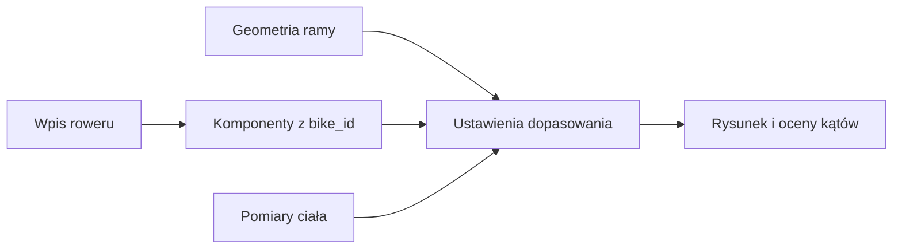

# Rowery i komponenty

## Co to jest

Garaż przechowuje rowery oraz przypisane do nich części. Dla części można zapisać wymiary, a dla roweru geometrię ramy i historię ustawień dopasowania.

## Jak działa

Wpis komponentu ma `bike_id`, więc należy do jednego roweru. Niektóre wymiary są wykorzystywane przez ekran Fitting do narysowania pozycji. W braku danych ekran może użyć wartości domyślnych i pokazać je jako założenia.

Przykład z odczytu `garage.db`: tabela `bikes` zawiera rower o ID 1 „Canyon Grizl CF SL 2025” oraz ID 5 „Canyon Grail CF 7 Speed”. To konkretne wpisy, nie rekomendacja wyboru.

> DO SPRAWDZENIA: Aktualnej liczby rowerów i kompletności pomiarów nie ustalano; przykład pokazuje tylko dwa odczytane rekordy.
## Po co

Pomaga zrozumieć, jak QBot używa tej części Garażu.

## Skąd dane

Dane pochodzą z `garage.db` albo z tabel `qbot_v2` wskazanych poniżej.

## Jak liczone

Szczegóły zależą od konkretnej funkcji; sprawdzone kroki podano w opisie.

## Gdzie to widać

Garaż (`/garaz.html`) albo Analiza trasy, karta Sprzęt.

## Jak czytać

Wynik opiera się na zapisanych danych. Nie zastępuje sprawdzenia roweru ani własnej decyzji.

## Decyzje i historia

Opis zestawiono z kodem i dokumentacją.

## Ograniczenia i pułapki

Brak lub nieaktualność danych w Garażu może zmienić wynik.

## Wpływa na / Zależy od

Wplywa na: [Rozpoznawanie roweru](rozpoznawanie-roweru.md), [Wybór roweru](wybor-roweru.md).

Zależy od: listy rowerów i ich komponentów w `garage.db`.

## Powiązane hasła

- [Garaż](index.md)

## Zrodla

- [Koła i opony](kola-opony.md)
- [Wybór roweru](wybor-roweru.md)
- `/opt/qbot/app/docs/GARAZ.md` — `bikes`, `components`, `bike_geometry`, `fitting`, `rider_body`; `/opt/qbot/web/public/garaz-fit.js` — `window.QFit`.
