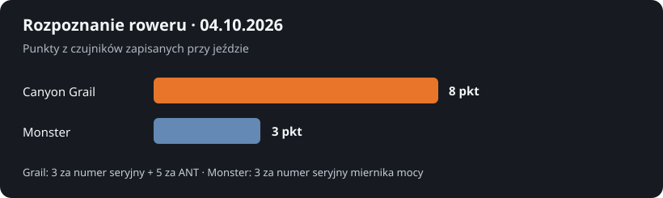
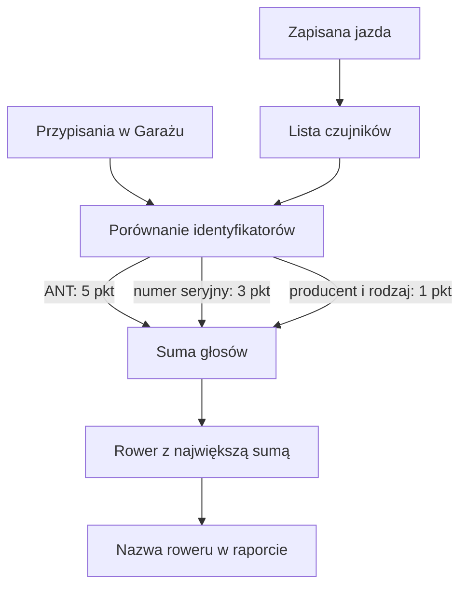

# Rozpoznawanie roweru w jeździe

## Co to jest

Po imporcie jazdy QBot porównuje zapisane w niej czujniki z przypisaniami znanymi z Garażu. Wynik pomaga pokazać nazwę roweru w raporcie i dopasować do niego wyposażenie. [FIT](../slowniczek.md#fit) to plik aktywności, który może zawierać listę urządzeń użytych podczas jazdy. [ANT](../slowniczek.md#numer-ant) to identyfikator urządzenia używany przez czujniki rowerowe.

## Po co

Jeśli masz kilka rowerów albo przekładasz koła i miernik mocy, sprawdź nazwę roweru przy raporcie jazdy. Gdy nazwa jest nieoczekiwana, nie zakładaj od razu, że cała jazda ma błędne dane: pojedynczy czujnik może być przypisany do innego roweru. W Garażu warto poprawić mapowanie tylko wtedy, gdy sam czujnik jest na stałe przypisany do innego roweru.

## Skąd dane

Wpisy urządzeń pochodzą z importu aktywności. Osobna mapa łączy identyfikatory czujników z nazwami rowerów i części. W kodzie są trzy sposoby dopasowania: numer ANT, numer seryjny albo zgodność producenta i rodzaju czujnika. Każdy aktywny czujnik daje głos rowerowi, a kod zwraca rower z największą sumą głosów.

## Jak liczone

1. Odczytana jazda z 04.10.2026 zawierała czujnik prędkości Garmin, miernik mocy Favero i przerzutkę SRAM AXS.
2. Numer seryjny czujnika prędkości wskazał Canyon Grail: 3 punkty. Numer urządzenia SRAM AXS wskazał ten sam rower: 5 punktów.
3. Miernik Favero wskazał Canyon Grand Canyon, czyli Monster: 3 punkty. To możliwy konflikt, bo miernik mocy bywa przekładany między rowerami.
4. Suma dla Graila wyniosła 3 + 5 = 8 punktów, a dla Monstera 3 punkty. Wynikiem z odczytu był Canyon Grail.
5. Reguły wagi są stałe: numer ANT daje 5 punktów, numer seryjny 3 punkty, a zgodność samego producenta i rodzaju urządzenia 1 punkt.

Wzór

Dla każdego dopasowanego czujnika dodaje się punkty do wskazanego roweru: 5 za numer ANT, 3 za numer seryjny i 1 za producenta oraz rodzaj. Wynik to rower z największą sumą. Reguła dopasowania w danym przypadku kończy się po pierwszym trafieniu dla czujnika, więc ten sam czujnik nie dostaje kilku punktów za różne sposoby dopasowania.

## Gdzie to widać

Nazwę przypisaną do jazdy widać w raporcie jazdy i w jego części opisującej sprzęt, jeśli dana karta jest dostępna dla tej aktywności. Na ekranie Garażu możesz sprawdzić wpisy rowerów i komponentów; do tego służy także zrzut [Garażu](../img/ekrany/garaz.png), który pokazuje karty rowerów oraz tabelę części. Zrzut nie pokazuje szczegółów pojedynczej jazdy.

## Jak czytać

Jeśli identyfikator prędkości wskazuje Graila, ale pomiar mocy wskazuje Grizla, sprawdź czy miernik mocy nie był przełożony. Wynik jest wyborem większości punktów, a nie gwarancją, że wszystkie czujniki były na tym samym rowerze. Zgodność po samym producencie i rodzaju jest najsłabszym sygnałem.

## Decyzje i historia

Numer ANT ma większą wagę niż numer seryjny, a ten większą niż sam rodzaj urządzenia. To ogranicza pomyłki, gdy miernik mocy jest przekładany między rowerami. Mapa przypisań oraz dane urządzeń są osobnymi zapisami.

## Ograniczenia i pułapki

- Nie każdy plik aktywności zawiera komplet urządzeń.
- Czujnik przełożony na inny rower może wskazywać poprzedni rower.
- Kilka czujników może wskazać różne rowery; wyświetlany jest wynik głosowania.
- Numer seryjny opisuje urządzenie, ale sam nie dowodzi, na którym rowerze zamontowano je w konkretnym dniu.
- Odczyt pojedynczej jazdy nie potwierdza, że każda aktywność została rozpoznana poprawnie.

## Wpływa na / Zależy od

**Wpływa na:** nazwę roweru przypisaną do jazdy oraz elementy raportu, które korzystają z tego przypisania.

**Zależy od:** urządzeń zapisanych z aktywnością i poprawnych przypisań w Garażu.

## Powiązane hasła

- [Sprzęt w Garażu](sprzet.md)
- [Rowery i komponenty](rowery-komponenty.md)
- [Wybór roweru do trasy](wybor-roweru.md)
- [Raport jazdy](../raport-jazdy/index.md)

## Zrodla

- `/opt/qbot/app/qbot3/rides/activity_devices.py` — `store_devices`, `bike_for_ride`, punktacja i tabele `qbot_v2.activity_device`, `qbot_v2.bike_sensor`.
- `/opt/qbot/app/qbot3/rides/bike_odometer.py` — użycie przypisania roweru.
- Odczyt bazy z 18.10.2026 — urządzenia jazdy `24603122930` i przypisania czujników.
- `img/garaz-rozpoznanie-20261004.svg` — wykres punktów dla odczytanej jazdy.
- `slowniczek.md` — definicje ANT i FIT.
