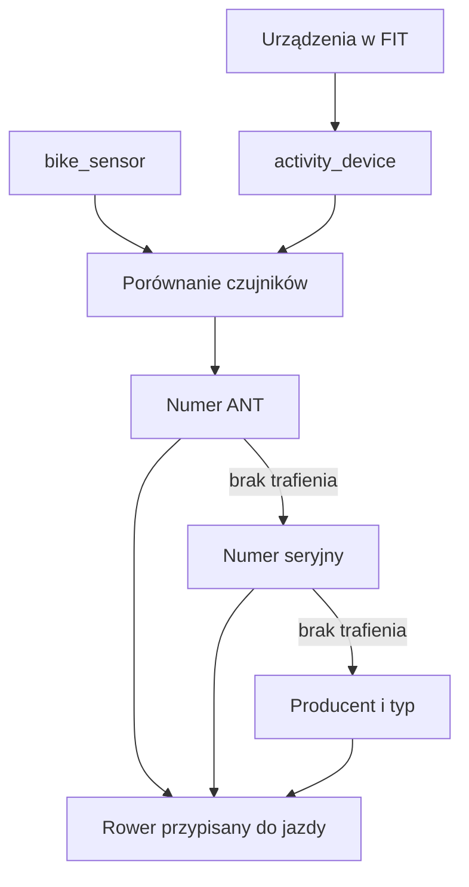

# Rozpoznawanie roweru w jeździe

## Co to jest

QBot próbuje przypisać rower do zapisanej jazdy na podstawie informacji o czujnikach w pliku FIT i mapowania czujników na rowery. Dopasowanie jest automatyczne i może być niepewne, gdy czujniki są przekładane.

## Jak liczone

1. Przy imporcie jazdy QBot zapisuje urządzenia z sekcji `device_info` pliku FIT w `qbot_v2.activity_device`.
2. Porównuje je z mapą `qbot_v2.bike_sensor`.
3. Najpierw sprawdza numer ANT, potem numer seryjny, a następnie producenta i typ urządzenia.
4. Kod przyznaje większą wagę numerowi ANT (+5) niż numerowi seryjnemu (+3), bo pedały Assioma mogą być przekładane między rowerami.

Kod źródłowy podaje przykład: AXS Grizla ma numer ANT 10625, a Graila 27856. To przykładowe mapowania w kodzie, nie potwierdzenie konkretnej jazdy z bazy.

> DO SPRAWDZENIA: Przykładu przypisania roweru w rzeczywistym raporcie jazdy nie pobrano z bazy.
## Po co

Pomaga zrozumieć, jak QBot używa tej części Garażu.

## Skąd dane

Dane pochodzą z `garage.db` albo z tabel `qbot_v2` wskazanych poniżej.

## Jak liczone

Szczegóły zależą od konkretnej funkcji; sprawdzone kroki podano w opisie.

## Gdzie to widać

Garaż (`/garaz.html`) albo Analiza trasy, karta Sprzęt.

## Jak czytać

Wynik opiera się na zapisanych danych. Nie zastępuje sprawdzenia roweru ani własnej decyzji.

## Decyzje i historia

Opis zestawiono z kodem i dokumentacją.

## Ograniczenia i pułapki

Brak lub nieaktualność danych w Garażu może zmienić wynik.

## Wpływa na / Zależy od

Wplywa na: nazwę roweru przypisaną do jazdy i jej raport.

Zależy od: czujników zapisanych z FIT oraz mapowania `qbot_v2.bike_sensor`.

## Powiązane hasła

- [Garaż](index.md)

## Zrodla

- [Sprzęt](sprzet.md)
- [Raport jazdy](../raport-jazdy/index.md)
- `/opt/qbot/app/qbot3/rides/activity_devices.py` — `parse_fit_devices`, `store_devices`, `bike_for_ride`; tabele `qbot_v2.activity_device`, `qbot_v2.bike_sensor`.
