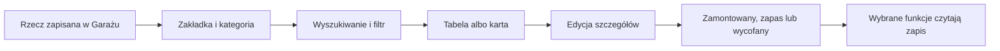

# Sprzęt w Garażu

## Co to jest

To katalog sprzętu, rowerów, części i odzieży. Możesz wyszukać wpis, zawęzić listę do roweru, zmienić widoczne pola albo poprawić szczegóły rzeczy.

Na zrzucie z 18.10.2026 filtr znajduje się nad kartami rowerów, przycisk „Kolumny” obok niego, a licznik 68 jest przy prawej krawędzi nad tabelą. W widocznych wierszach można odróżnić „zapas” od „zamontowany”.

## Po co

Używaj katalogu jako spisu tego, co posiadasz i jak jest opisane. Przed zakupem możesz sprawdzić markę i model; po montażu uaktualnij status oraz pozycję. Wpis czujnika może pomóc nazwać rower w raporcie, a koła z oponami mogą być opisane przy planowaniu trasy.

## Skąd dane

Właściciel wpisuje i aktualizuje dane. Zalogowany odczyt listy z 18.10.2026 zwracał 68 aktywnych komponentów i 27 dostępnych kategorii części. W tym samym dniu baza zawierała 72 wpisy części łącznie: 68 aktywnych i 4 nieaktywne. Dlatego licznik interfejsu i liczba aktywnych danych są zgodne.

## Jak działa

1. Wybierz zakładkę odpowiadającą rodzajowi rzeczy. Lista kategorii zależy od wybranej części Garażu.
2. Wyszukaj nazwę, markę lub model albo wybierz rower. Na zrzucie widać opcję „wszystkie rowery”; po zawężeniu łatwiej sprawdzić części jednego roweru.
3. Użyj „Kolumny”, aby zmienić pola widoczne w tabeli. To tylko zmiana widoku; nie zmienia masy, przebiegu ani statusu części.
4. Przy wpisie sprawdź rower, kategorię, pozycję i status. Dwa błotniki MugGuard przy Monsterze miały w odczycie z 18.10.2026 status „zapas”, więc nie były zapisane jako aktualnie używane.
5. Po wymianie części użyj edycji albo wycofania. Element wycofany można odszukać po włączeniu widoku wycofanych.
6. Wybierz odzież oddzielnie od części rowerowych. Doradca ubioru korzysta tylko z ubrań dopuszczonych dla danej propozycji.

## Gdzie to widać

W tabeli części widoczne są nazwa roweru, kategoria, marka, model, pozycja, status, waga i przebieg, o ile pola te są dostępne. Karty rowerów są nad tabelą. Szczegóły o oponach, Fittingu i notatkach mają osobne zakładki. Zrzut desktopowy oraz mobilny opisuje [indeks ekranów](../img/ekrany/indeks.md).

## Jak czytać

„Zamontowany” i „zapas” są stanami wpisanymi do katalogu. Jeśli przy wadze lub przebiegu widać kreskę, pole nie ma wartości wyświetlanej. Wybór kolumn nie dodaje ani nie usuwa danych. Użyj „Pokaż wycofane”, gdy szukasz rzeczy wyłączonej z bieżącego użycia.

## Decyzje i historia

Kategorie na ekranie są tłumaczone na język polski. Różne rodzaje rzeczy mają różne kolumny i własne filtry. Zapis statusu oddziela element aktualnie używany od zapasu, ale nie jest odczytem z czujnika.

## Ograniczenia i pułapki

- Katalog pokazuje ręcznie utrzymywane informacje; nie wykrywa każdej zmiany sprzętu.
- Nie każda funkcja czyta każdą kategorię.
- Zrzut jest migawką ekranu z 18.10.2026.
- Zalogowany odczyt potwierdził stronę i listy, ale nie wykonano kliknięć wszystkich formularzy.

## Wpływa na / Zależy od

**Wpływa na:** wyszukiwanie części, przypisanie roweru, dane kołowe oraz wybrane propozycje wyposażenia i odzieży.

**Zależy od:** wpisów dodanych przez właściciela, ich statusu oraz filtrów wybranych na ekranie.

## Powiązane hasła

- [Garaż](index.md)
- [Rowery i komponenty](rowery-komponenty.md)
- [Koła i opony](kola-opony.md)
- [Rozpoznawanie roweru](rozpoznawanie-roweru.md)
- [Doradca ubioru](doradca-ubioru.md)
- [Strażnicy QBota](../straznicy/index.md) — objaśnia kontrole tła, które mogą korzystać z danych o czujnikach i jazdach.

## Zrodla

- `/opt/qbot/app/docs/GARAZ.md` — zakres danych.
- `/opt/qbot/app/web_public/garaz-tabs.js` — zakładki i tabela części.
- `/opt/qbot/app/web_public/garaz-columns.js` — wybór widocznych kolumn.
- `/opt/qbot/app/web_public/garaz-search.js` — wyszukiwanie.
- Odczyt `garage.db` oraz zalogowany GET z 18.10.2026 — liczby aktywnych i wszystkich części.
- `img/ekrany/garaz.png`, `img/ekrany/indeks.md` — widok i spis zrzutów.
