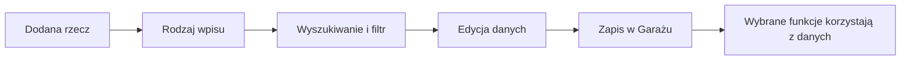

# Sprzęt w Garażu

## Co to jest

To katalog rowerów, części, odzieży i wyposażenia. Zapisane rzeczy możesz wyszukiwać, filtrować, edytować i pokazywać w tabelach.

## Po co

Katalog pozwala uporządkować to, co posiadasz, i przekazać wybrane dane do innych funkcji. Przykładowo przypisanie czujnika pomaga nazwać rower w raporcie, a zapisane koła i opony pomagają opisać wyposażenie trasy. Sama obecność rzeczy w katalogu nie oznacza, że każda funkcja z niej skorzysta.

## Skąd dane

Wpisy są przechowywane lokalnie w bazie Garażu. Użytkownik uzupełnia markę, model, kategorię, rozmiar, stan, cenę i inne dostępne pola. Tabela pozwala wybierać widoczne kolumny; domyślny zestaw zależy od rodzaju rzeczy. Ustawienia kolumn są zachowywane.

## Jak działa

1. Wybierz zakładkę i wpisz nazwę lub model w wyszukiwarkę tej zakładki.
2. W tabeli sprawdź kategorię, markę i model. Dostępne kolumny zależą od typu wpisu.
3. Użyj przycisku edycji, aby poprawić dane. Dla części rowerowej sprawdź też przypisany rower i pozycję.
4. Jeśli element jest wycofany, włącz widok wycofanych; nie traktuj zapasu jako części zamontowanej.

Na zrzucie Garażu z 18.10.2026 przy rowerze Monster dwa błotniki MugGuard mają status „zapas”, a Quick Release Aero Bars przy Grizlu mają status „zamontowany” i pozycję „kokpit”. To pozwala odróżnić zapas od montażu bez interpretowania kreski w kolumnie jako zera.

## Gdzie to widać

Na ekranie [Garażu](index.md): rowery i komponenty są widoczne w tabeli, a przyciski „Edytuj” i „Wycofaj” znajdują się przy wpisie. Kolumny można zmienić przyciskiem „Kolumny”. Niektóre typy, takie jak fitting, mają osobne zakładki.

## Jak czytać

„Zamontowany” oznacza stan wpisu, a nie odczyt z czujnika. „Zapas” oznacza rzecz nieużywaną aktualnie na rowerze. „Wycofaj” ukrywa element z bieżącego użycia; w widoku wycofanych nadal można go odszukać. Kreska przy wadze lub przebiegu oznacza brak widocznej wartości.

Przy odzieży zapisane oceny i cechy mogą być wejściem dla doradcy ubioru. Przy komponentach ważne są między innymi przypisanie do roweru i pozycja. Szczegóły: [rowery i komponenty](rowery-komponenty.md) oraz [doradca ubioru](doradca-ubioru.md).

## Ograniczenia i pułapki

- Wpis może mieć puste albo nieaktualne dane.
- Zmiana widocznych kolumn nie zmienia danych rzeczy.
- Rzeczy wycofane i zapasowe nie powinny być mylone z aktualnym montażem.
- Niektóre funkcje korzystają z zestawu danych szerzej, niż wskazywałby filtr ekranu; dokumentacja Garażu odnotowuje ograniczenie kalkulatora ciśnienia i opisu dla Alberta, które nie filtrują komponentów po rowerze.

> DO SPRAWDZENIA: Sprawdzić aktualny zakres kategorii i zasady filtrowania w każdej zakładce na bieżącej stronie.

## Wpływa na / Zależy od

**Wpływa na:** rozpoznawanie roweru, wybór wyposażenia oraz dobór ubioru — w zakresie danych faktycznie czytanych przez daną funkcję.

**Zależy od:** wpisów i aktualizacji wykonanych przez właściciela.

## Powiązane hasła

- [Garaż](index.md)
- [Rowery i komponenty](rowery-komponenty.md)
- [Koła i opony](kola-opony.md)
- [Rozpoznawanie roweru](rozpoznawanie-roweru.md)
- [Wybór roweru](wybor-roweru.md)

## Zrodla

- `img/ekrany/garaz.png` — tabela komponentów i karty rowerów.
- `/opt/qbot/app/docs/GARAZ.md` — model danych i ograniczenia.
- `/opt/qbot/app/web_public/garaz-columns.js` — kolumny i zapis preferencji.
- `/opt/qbot/app/web_public/garaz-search.js` — pola wyszukiwania dla zakładek.
- `/opt/qbot/app/qbot3/routes/outfit_advisor.py` — kandydaci ubioru.
