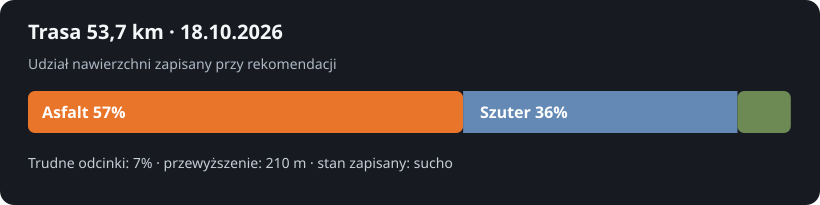
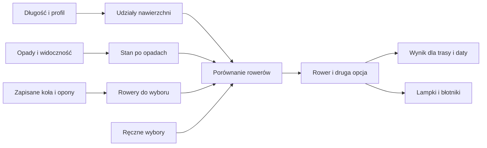

# Wybór roweru do trasy

## Co to jest

W karcie Sprzęt Analizy trasy QBot podaje rower pasujący do planu oraz drugi wariant. Możesz wskazać rower ręcznie. System zapisuje tę decyzję dla trasy i dnia.

## Po co

Przy krótkiej, suchej trasie z dużą ilością asfaltu rozsądny może być szybszy rower. Przy dużej ilości piachu, błocie lub śniegu znaczenie mają szersze opony i rodzaj roweru. Sprawdź opis opon i warunków przed wyjazdem, zwłaszcza gdy zmienił się stan pogody od czasu poprzedniej rekomendacji.

## Skąd dane

Do wyboru trafiają długość, przewyższenie, przewidywany czas, udział rodzajów nawierzchni i ryzykowne odcinki. Stan po opadach jest obliczany z opadów z kilku punktów na trasie w poprzednich dniach i podczas jazdy. Do tego dołączane są aktywne rowery oraz opony z Garażu. Ostatnie ręczne wybory mogą służyć jako wskazówka.

## Jak liczone

1. Odczytana rekomendacja dla Rembertowa z 18.10.2026 ma długość 53,7 km, przewyższenie 210 m i szacowany czas 2,86 godziny.
2. W tej samej rekomendacji udział nawierzchni wynosi 57% asfaltu, 36% szutru i 7% trudnych odcinków. Wykres poniżej pokazuje te trzy udziały.
3. Stan zapisany przy tej propozycji to „sucho”. W powiązanym odczycie ubioru widniały opady: 0,0 mm w ostatnich 24 i 48 godzinach oraz 4,5 mm w ciągu 7 dni; ostatni deszcz był około 66 godzin przed startem. Kod przekazuje również informację o oponach każdego roweru.
4. Wynik zapisany w bazie wskazuje Canyon Grail CF 7 Speed. Jako drugi wariant podaje Canyon Grizl CF SL 2025, gdyby ważniejszy był zapas na szutrze i trudnych odcinkach.
5. W danych tej propozycji Grail ma zapisane opony 50 mm: G-One Pro RX z przodu i G-One Pro R z tyłu. Uzasadnienie wskazuje, że 7% trudnych odcinków nie uzasadniało wyboru Monstera na tę trasę.
6. Ręczny wybór zapisany dla innej trasy z 11.10.2026 wskazuje Graila na trasie 81,1 km w stanie mokrym. Jest to wcześniejszy wybór użytkownika, a nie automatyczna reguła, że Grail zawsze wygrywa.

Propozycję roweru przygotowuje [AI](../slowniczek.md#ai-sztuczna-inteligencja) na podstawie tych danych. Jej uzasadnienie jest oceną, a nie pomiarem.

Lampki i błotniki są osobnymi podpowiedziami. Lampki są wymagane przy starcie przed wschodem, przy mecie po zachodzie lub mniej niż 30 minut przed zachodem, albo przy widoczności poniżej 1 km. Przy widoczności od 1 km do poniżej 3 km są zalecane. Błotniki są zalecane, gdy stan to „mokro” lub „błoto”.

Wzór

„Błoto” wymaga co najmniej 25% nieutwardzonej trasy i jednego z warunków: 8 mm w 24 godziny, 15 mm w 48 godzin albo 25 mm w 7 dni oraz co najmniej 5 mm w 48 godzin. „Mokro” oznacza co najmniej 3 mm w 24 godziny, 8 mm w 48 godzin albo deszcz w czasie jazdy wynoszący co najmniej 1 mm lub 50% prawdopodobieństwa. „Wilgotno” oznacza co najmniej 10 mm w 7 dni albo 0,5 mm w 24 godziny. Pozostałe przypadki są „suche”.

## Gdzie to widać

W Analizie trasy otwórz kartę Sprzęt, a w niej część o rowerze i akcesoriach. Główny [zrzut Garażu](../img/ekrany/garaz.png) pokazuje zapisane rowery i ich części, ale nie samą rekomendację trasową. Wykaz zrzutów znajdziesz w [indeksie ekranów](../img/ekrany/indeks.md).

## Jak czytać

Jeśli propozycja pokazuje opony, porównaj je z faktycznym montażem. Gdy wybierasz ręcznie inny rower, system zapisuje Twój wybór i może uwzględnić podobne wcześniejsze decyzje. Traktuj opis jako pomoc w decyzji, nie jako kontrolę stanu technicznego.

## Decyzje i historia

Zasady właściciela mają pierwszeństwo przed ogólnym dopasowaniem. Monster jest przeznaczony na zimę i naprawdę trudne warunki; kod odrzuca go dla zwykłych tras około 80 km i dłuższych. Aktualny kod nie przekazuje bieżących zadań serwisowych jako kryterium wyboru roweru. Starszy opis w dokumencie faworytów wymieniał je jako wejście; tutaj obowiązuje sprawdzony kod.

## Ograniczenia i pułapki

- Wynik zależy od danych przekazanych do porównania.
- Zły lub nieaktualny wpis o oponie może dać mylący opis.
- Przy automatycznym wykryciu kół brak czujnika prędkości lub nieznany czujnik nie zmienia zapisanej konfiguracji.
- Przykład z 18.10.2026 dokumentuje jedną trasę i jedną propozycję; nie dowodzi, że te same udziały lub wybór dotyczą innych tras.
- Nie udało się potwierdzić kliknięć wszystkich przycisków w przeglądarce. Potwierdzono zalogowany odczyt strony Garażu i danych listy, nie pełny test interakcji Analizy trasy.

## Wpływa na / Zależy od

**Wpływa na:** propozycję roweru, opis opon, lampki i błotniki dla wybranej trasy.

**Zależy od:** planu, pogody, nawierzchni, danych Garażu oraz — gdy są dostępne — poprzednich wyborów ręcznych.

## Powiązane hasła

- [Koła i opony](kola-opony.md)
- [Rowery i komponenty](rowery-komponenty.md)
- [Doradca ubioru](doradca-ubioru.md)
- [Analiza trasy](../trasy/analiza-trasy.md)

## Zrodla

- `/opt/qbot/app/qbot3/routes/gear_kit.py` — `past_weather`, `surface_state`, `choose_bike`, `manual_history`, `accessories`.
- `/opt/qbot/app/qbot3/garage_wheels.py` — historia i automatyczne przypisanie zestawu kół.
- `/opt/qbot/app/docs/OUTFIT_FAVORITES.md` — opis decyzji i różnica względem aktualnego kodu.
- Odczyt `qbot_v2.route_kit` z 18.10.2026 — `komoot-2251353307`.
- `img/garaz-nawierzchnia-20261018.svg` — wykres udziałów nawierzchni z tego odczytu.
