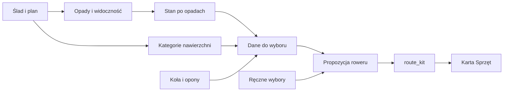

# Wybór roweru do trasy

## Co to jest

W karcie Sprzęt Analizy trasy QBot proponuje rower z Garażu oraz drugi wybór. Można też wskazać rower ręcznie.

## Jak liczone

Kod pobiera kategorię nawierzchni trasy, jej stan po opadach, długość, przewyższenie, czas i opony założone na koła. Dokument `OUTFIT_FAVORITES.md` wspomina zadania serwisowe jako wejście, ale aktualny kod `gear_kit.py` mówi, że bieżące zadania serwisowe nie wpływają na wybór; w tym punkcie pierwszeństwo ma kod. Osobne reguły Michała mówią, że Monster jest przeznaczony na zimę i naprawdę ciężkie warunki; kod zabrania wybierać go na zwykłe trasy około 80 km i dłuższe. Bieżące zadania serwisowe nie wpływają na rekomendację. Ręczne wybory z poprzednich tras są przekazywane jako wskazówka dla kolejnych.

Lampki są wymagane, gdy start jest przed wschodem, meta po zachodzie lub mniej niż 30 minut przed nim, albo widoczność spada poniżej 1 km. Poniżej 3 km są zalecane. Błotniki są zalecane przy stanie mokrym lub błotnistym.

Wynik `route_kit` jest zapisywany dla trasy i daty. Wartość `recznie: true` oznacza wybór Michała. Stan nawierzchni jest liczony na podstawie opadów z kilku punktów trasy w ostatnich siedmiu dniach oraz prognozy na czas jazdy.

> DO SPRAWDZENIA: Nie odczytano konkretnej rekomendacji `route_kit` z bazy, dlatego brak przykładu liczbowego dla trasy.
## Po co

Pomaga zrozumieć, jak QBot używa tej części Garażu.

## Skąd dane

Dane pochodzą z `garage.db` albo z tabel `qbot_v2` wskazanych poniżej.

## Jak liczone

Szczegóły zależą od konkretnej funkcji; sprawdzone kroki podano w opisie.

## Gdzie to widać

Garaż (`/garaz.html`) albo Analiza trasy, karta Sprzęt.

## Jak czytać

Wynik opiera się na zapisanych danych. Nie zastępuje sprawdzenia roweru ani własnej decyzji.

## Decyzje i historia

Opis zestawiono z kodem i dokumentacją.

## Ograniczenia i pułapki

Brak lub nieaktualność danych w Garażu może zmienić wynik.

## Wpływa na / Zależy od

Wplywa na: zapis rekomendacji w `qbot_v2.route_kit` i widok Sprzęt dla trasy.

Zależy od: trasy, prognozy, danych Garażu i wcześniejszych ręcznych wyborów.

## Powiązane hasła

- [Garaż](index.md)

## Zrodla

- [Koła i opony](kola-opony.md)
- [Analiza trasy](../trasy/analiza-trasy.md)
- [Doradca ubioru](doradca-ubioru.md)
- `/opt/qbot/app/qbot3/routes/gear_kit.py` — `past_weather`, `surface_state`, `BIKE_RULES`, zapis `qbot_v2.route_kit`; `/opt/qbot/app/qbot_web.py` — endpointy `/api/report/kit`.
