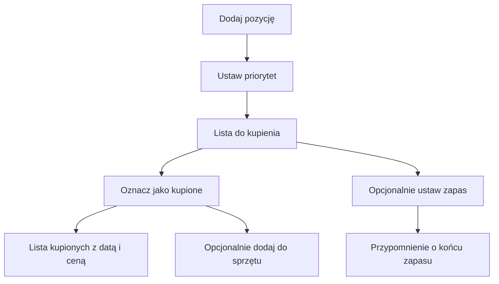

# Zakupy w Garażu

## Co to jest

Zakładka Zakupy rozdziela rzeczy planowane od kupionych. Można zapisać nazwę, link, cenę, priorytet i opcjonalne dane potrzebne do przypominania o zapasie.

## Po co

Użyj jej, by zebrać części, ubrania i inne rzeczy do kupienia, a po zakupie zachować zapłaconą cenę i datę. Dla rzeczy zużywalnych można włączyć przypomnienie. Szczegóły obliczania zapasu opisuje [osobne hasło](przypomnienia-zakupowe.md).

## Skąd dane

Pozycję dodajesz ręcznie albo podajesz link, z którego formularz może pobrać dostępne informacje. Priorytety to „Pilne”, „Wkrótce” i „Kiedyś”. Po oznaczeniu jako kupione zapisuje się data i zapłacona cena. Dla rzeczy rowerowej interfejs może zaproponować dodanie jej do odpowiedniej części Garażu.

## Jak działa

1. Dodaj nazwę i, jeśli masz, link do produktu. Możesz użyć „Pobierz dane”; jeśli sklep blokuje serwer, projekt przewiduje przycisk w przeglądarce.
2. Wybierz kategorię i priorytet.
3. Gdy kupisz rzecz, oznacz ją jako kupioną i wpisz zapłaconą cenę. Pozycja trafia do listy kupionych.
4. Dla rzeczy zużywalnej wpisz wielkość opakowania i tempo zużycia albo połącz pozycję z harmonogramem suplementu.
5. Jeśli wyszukiwanie ceny jest dostępne, uruchamiaj je na żądanie. Wyniki są ofertami sprawdzanymi pod kątem produktu; koszt dostawy nie jest wliczany.

Przykład liczbowy z konfiguracji opisywanej w dokumentacji: priorytet „Pilne” ma wartość 1, „Wkrótce” 2, „Kiedyś” 3. Jest to kolejność sortowania, nie ocena jakości produktu.

## Gdzie to widać

W zakładce Zakupy na stronie [Garaż](index.md). Strona projektu opisuje też „Dodaj do QBota”, przycisk przeglądarki, który przekazuje dane produktu do formularza zakupów.

## Jak czytać

Priorytet określa kolejność na liście, nie pilność techniczną serwisu. Cena zapisana po zakupie jest ceną zapłaconą. Wyszukiwanie najniższej ceny jest uruchamiane na kliknięcie; sprawdzone oferty mogą nie obejmować dostawy, a oferty oznaczone jako niesprawdzone wymagają samodzielnego potwierdzenia.

## Ograniczenia i pułapki

- Pobranie danych sklepu może nie zadziałać; dostępność zależy od strony sprzedawcy.
- Podobna nazwa nie gwarantuje zgodnego wariantu produktu. Kod wymaga zgodności nazwy i, jeśli jest dostępny, kodu produktu.
- Nie potwierdzono bieżących pozycji zakupowych w bazie ani widoku po zalogowaniu.
- Brak wpisu nie dowodzi, że rzeczy nie kupiono — lista działa na podstawie ręcznego zapisu.

> DO SPRAWDZENIA: Odczytać aktualne pozycje listy i jeden zapis kupionej rzeczy, aby dodać przykład z datą i ceną.

## Wpływa na / Zależy od

**Wpływa na:** listę planów, historię zakupów, ewentualne przypomnienia i — po osobnym zatwierdzeniu — katalog sprzętu.

**Zależy od:** ręcznych wpisów, pobranych danych produktu oraz ustawień zapasu.

## Powiązane hasła

- [Przypomnienia zakupowe](przypomnienia-zakupowe.md)
- [Sprzęt](sprzet.md)
- [Suplementy](../zdrowie/suplementy.md)
- [Centrum powiadomień](../system/centrum-powiadomien.md)

## Zrodla

- `/opt/qbot/app/docs/ZAKUPY.md` — priorytety, etapy zakupów i szukanie ceny.
- `/opt/qbot/app/qbot_zakupy_api.py` — obsługa listy zakupów.
- `/opt/qbot/app/web_public/garaz-zakupy.js` — zakładka zakupów.
