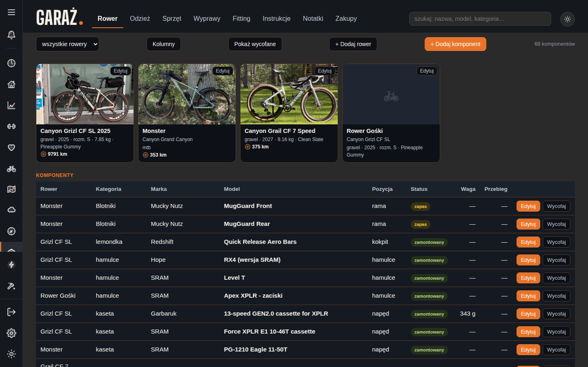
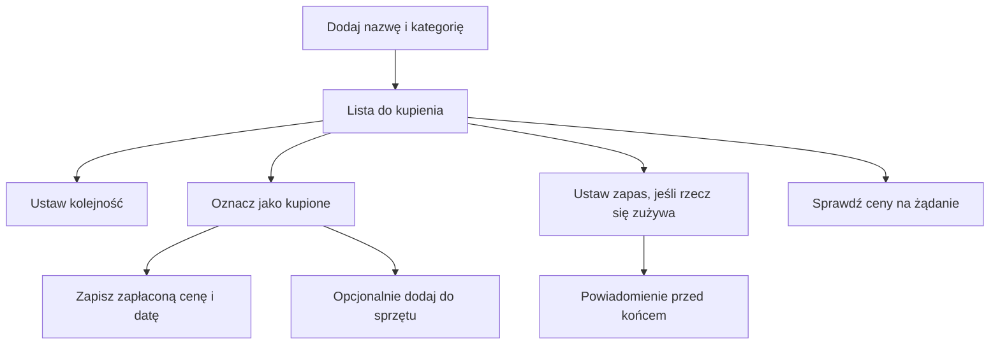

# Zakupy w Garażu

## Co to jest

Zakładka Zakupy prowadzi listę rzeczy do kupienia i listę rzeczy kupionych. Możesz wpisać nazwę, kategorię, priorytet, cenę, link i notatkę. Dla rzeczy zużywalnych możesz też ustawić zapas i przypomnienie.

## Po co

Zapisz zakup, żeby pamiętać, czego szukasz i jaki wariant jest właściwy. Po zakupie zachowaj rzeczywistą cenę i datę. Jeśli produkt jest rowerową częścią, po zakupie możesz dodać go do odpowiedniego miejsca w Garażu. Opcjonalna prognoza zapasu dotyczy rzeczy zużywanych, na przykład suplementu.

## Skąd dane

Właściciel może wpisać pozycję ręcznie albo wkleić link. Formularz może spróbować uzupełnić informacje ze strony sklepu; gdy sklep nie pozwala na odczyt z serwera, dostępny jest osobny przycisk przeglądarki. Odczyt listy z 18.10.2026 zwrócił 2 aktywne pozycje.

## Jak działa

1. Dodaj nazwę produktu i wybierz jedną z sześciu kategorii: części, odzież, wyposażenie, suplementy, sprzęt zdrowotny lub inne.
2. Wybierz priorytet: „Pilne” sortuje się jako 1, „Wkrótce” jako 2, a „Kiedyś” jako 3. To kolejność na liście, nie ocena jakości ani bezpieczeństwa.
3. W aktywnej liście z 18.10.2026 znajdował się przymiar do łańcucha Bitul CH012 z ceną 129,00 zł, priorytetem „Kiedyś” i stanem „Do kupienia”. Wpis ceny miał datę 13.10.2026.
4. Po zakupie oznacz rzecz jako kupioną. Odczyt z 18.10.2026 pokazał ramiona korby SRAM Force XPLR E1 DUB Wide: zakup z 16.10.2026 za 599,16 zł. W notatce zapisano wariant 160 mm.
5. Jeśli chcesz porównać oferty, uruchom wyszukiwanie ceny na żądanie. System sprawdza zgodność nazwy i wariantu; sprawdzone oferty nie zawierają kosztu dostawy. Nie traktuj starej ceny wpisanej przy produkcie jako aktualnej oferty.
6. Dla zużywalnego produktu wpisz wielkość opakowania, datę otwarcia i tempo zużycia albo wybierz harmonogram suplementu. Szczegóły wyliczenia terminu są opisane w [przypomnieniach zakupowych](przypomnienia-zakupowe.md).

## Gdzie to widać

W Garażu wybierz zakładkę Zakupy. Na dołączonym obrazie widać jej etykietę na górnym pasku, obok Notatek, ale nie widać zawartości listy, bo aktywna jest zakładka Rower. Lista zrzutów jest w [indeksie ekranów](../img/ekrany/indeks.md).

## Jak czytać

„Do kupienia” i „Kupione” rozdzielają plan od zakupu zakończonego. Cena zapłacona jest zapisem historycznym. „Pilne”, „Wkrótce” i „Kiedyś” pomagają ustawić kolejność. Wynik wyszukania najniższej ceny jest tylko chwilowym porównaniem ofert, a nie stałą ceną produktu.

## Decyzje i historia

Zakupy można potwierdzić ręcznie przyciskiem „Kupione”. Automatyczne czytanie skrzynki pocztowej zostało odrzucone 13.10.2026. W przypadku produktu rowerowego aplikacja proponuje uzupełnienie Garażu, ale sam wpis zakupowy nie powinien być mylony z potwierdzonym montażem.

## Ograniczenia i pułapki

- Strona sklepu może blokować pobranie informacji albo pokazywać inny wariant produktu.
- Nazwa i liczby wariantu, np. 160 mm, mają znaczenie przy sprawdzaniu zgodności oferty.
- Koszt dostawy nie jest wliczany w porównanie cen.
- Zalogowany odczyt z 18.10.2026 pokazał jedną planowaną i jedną kupioną pozycję. Nie potwierdza to, że wszystkie zakupy są zapisane.
- Zrzut pokazuje etykietę zakładki, nie widok aktualnej listy zakupów.

## Wpływa na / Zależy od

**Wpływa na:** listę planowanych i zakończonych zakupów, propozycję dodania części do Garażu oraz — jeśli skonfigurowano zapas — przypomnienia.

**Zależy od:** ręcznych wpisów, ewentualnego uzupełnienia ze strony sklepu i poprawnego potwierdzenia zakupu.

## Powiązane hasła

- [Przypomnienia zakupowe](przypomnienia-zakupowe.md)
- [Sprzęt w Garażu](sprzet.md)
- [Suplementy](../zdrowie/suplementy.md)
- [Centrum powiadomień](../system/centrum-powiadomien.md)

## Zrodla

- `/opt/qbot/app/docs/ZAKUPY.md` — kategorie, priorytety, etapy i decyzje.
- `/opt/qbot/app/qbot_zakupy_api.py` — lista, stany i zapis pozycji.
- `/opt/qbot/app/web_public/garaz-zakupy.js` — ekran zakupów.
- Odczyt `garage.db` i zalogowany GET listy zakupów z 18.10.2026 — pozycje 6 i 8.
- `img/ekrany/garaz.png`, `img/ekrany/indeks.md` — etykieta zakładki i spis zrzutów.
