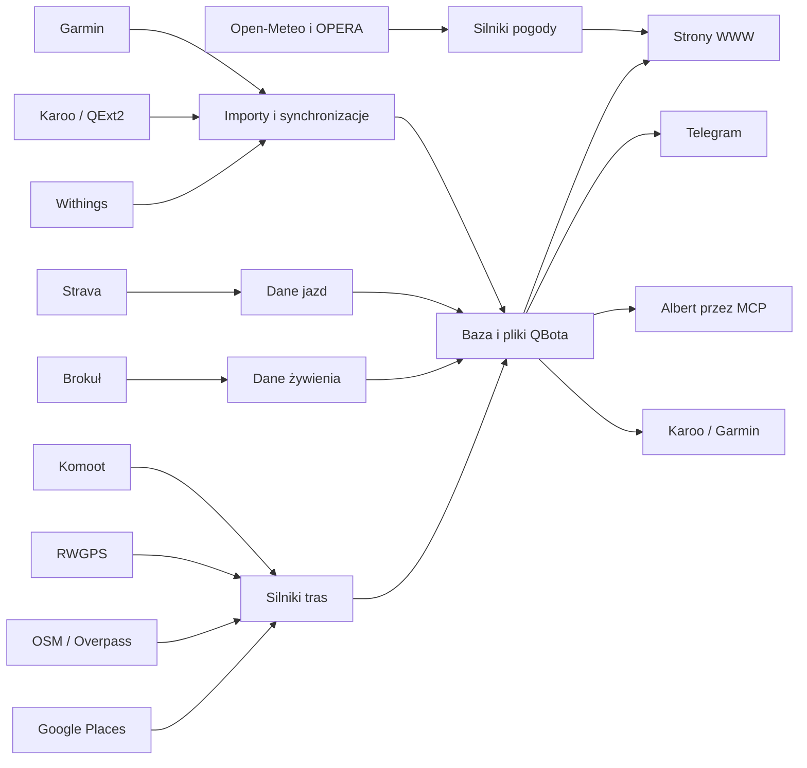

# Mapa serwisu QBota

## Co to jest

QBot składa się z aplikacji WWW, kanałów rozmowy i procesów działających w tle. Strony pokazują dane z bazy albo wyniki przygotowane przez silniki QBota; część informacji pochodzi z usług zewnętrznych.

## Po co

Ta mapa pomaga znaleźć właściwy ekran i zrozumieć, skąd może pochodzić widoczna informacja.

## Strony WWW i menu

Menu jest budowane przez `nav.js`. „Testowe” oznacza osobną dolną grupę menu. Strony pomocnicze nie są automatycznie pozycjami menu.

| Strona | Co pokazuje | Skąd dane | Dział wiki / hasło |
|---|---|---|---|
| `dashboard.html` — Dziś | Energia, Trener, Pogoda; na telefonie aplikacji może być pierwszym ekranem | API QBot; szczegóły źródeł nie są wspólne dla całego ekranu | [Forma](forma/index.md), [Trener](trener/index.md), [Pogoda](pogoda/index.md) |
| `index.html` — Start | Kafelki startowe, wyprawy i ostatnie miejsca | API QBot i zapisane dane | [System](system/index.md), [Trasy](trasy/index.md) |
| `forma.html` — Forma | Wykresy formy; zakładka „Statystyki” | API Formy i zapis QBota | [Forma](forma/index.md), [Wykresy Formy](forma/wykresy.md) |
| `trening.html` — Trening | Kalendarz i plan Trenera | API Trenera, kalendarz QBota, dane treningowe i pogoda | [Trener](trener/index.md), [Kalendarz treningu](trener/kalendarz.md) |
| `zdrowie.html` — Zdrowie | Podsumowanie zdrowia i jedzenia | API zdrowia, dzienniki QBota i importy | [Zdrowie](zdrowie/index.md), [Jedzenie](zdrowie/dziennik.md), [Obwody](zdrowie/obwody.md), [Obwody](zdrowie/obwody.md) |
| `raport-jazdy.html` — Raport jazdy | Szczegóły wykonanej jazdy | zapis jazdy i plik FIT, wyniki analiz | [Raport jazdy](raport-jazdy/index.md), [Analiza jazdy](raport-jazdy/analiza-jazdy.md) |
| `raport-trasy.html` — Analiza trasy | Raport planowanej trasy | trasa i wyniki silników trasowych | [Trasy](trasy/index.md), [Analiza trasy](trasy/analiza-trasy.md) |
| `pogoda.html` — Pogoda | Prognoza, radar i pogoda na trasie | Open-Meteo, model opadu i radar OPERA | [Pogoda](pogoda/index.md), [Radar](pogoda/radar.md) |
| `planer-wyprawy.html` — Planer wyprawy | Planowanie wyprawy i jej etapów | zapisane trasy oraz wybrane dane zewnętrzne | [Trasy](trasy/index.md), [Planer wyprawy](trasy/planer-wyprawy.md) |
| `garaz.html` — Garaż | Sprzęt i zakupy | zapis QBota | [Garaż](garaz/index.md) |
| `mq2.html` — MQ2 (menu testowe) | Porównanie sygnatur ModelQ i Xert | baza ModelQ oraz dane Xert | [ModelQ](modelq/index.md), [ModelQ i Xert](modelq/xert.md) |
| `naprawa-trasy.html` — Naprawa trasy (menu testowe) | Narzędzie do naprawy danych trasy | dane trasowe QBota | [Trasy](trasy/index.md) |

W menu znajdują się też `setup.html` („Setup”) oraz przycisk „Wyloguj”; nie są pozycjami w głównej tablicy `PROD`. `forma.html` ma jedną zakładkę opisaną w HTML jako „Statystyki”; pozostałe widoki mogą być zwykłymi sekcjami strony. `trening.html` buduje część zakładek skryptami, dlatego pełna, aktualna lista ich nazw wymaga sprawdzenia skryptów interfejsu.

### Pozostałe pliki HTML

| Plik | Rola sprawdzona w kodzie |
|---|---|
| `trener.html`, `kalendarz.html` | Przekierowują do `trening.html` (kalendarz wskazuje zakładkę miesiąca). |
| `jedzenie.html` | Przekierowuje do `zdrowie.html`. |
| `strava.html` | Ekran łączenia/statusu Stravy; przy braku połączenia kieruje do `/api/strava/connect`. |
| `raport-print.html` | Wewnętrzny widok renderowania/zrzutu raportu. |
| `raport-dzien.html` | Analiza dnia. |
| `raport-gosc.html` | Widok zaproszenia na jazdę. |
| `wyprawa-oczekiwanie.html` | Ekran oczekiwania na raport wyprawy. |
| `planer-wyprawy-druk.html` | Wydruk planu wyprawy. |
| `planer-wyposazenia.html` | Planer wyposażenia. |
| `pogoda-wyprawy.html` | Pogoda dla wyprawy. |
| `pogoda-makieta.html`, `okno-makieta.html` | Makiety interfejsu. |
| `trener-fragment.html` | Fragment Trenera osadzany w innym widoku. |
| `cwiczenia.html` | Baza ćwiczeń. |
| `sciaga.html` | Ściąga treningu. |
| `setup.html` | Ustawienia i dostęp do konta. |
| `status.html` | Status funkcji. |
| `zdjecia.html` | Kalibracja zdjęć. |
| `pogoda-foto/podglad.html` | Widok pomocniczy zdjęć pogodowych. | Szczegóły źródła i użycia niepotwierdzone. | [Pogoda](pogoda/index.md) |
| `qbot-dodaj.html` | Przekierowuje do Garażu, do zakupów. |

Lista dotyczy plików `.html` w głównym katalogu `public`; podkatalogi, na przykład `pogoda-foto`, mogą mieć własne widoki.

## Kanały

| Kanał | Co robi | Dział wiki / hasło |
|---|---|---|
| WWW | Strony i formularze rozmawiają z API `qbot-web`. | [System](system/index.md), [Strony WWW](system/strony-www.md) |
| Telegram | Rozmowy, powiadomienia i potwierdzenia; część obsługi tras prowadzi do przygotowania analizy w tle. | [Albert](albert/index.md), [Telegram](albert/telegram.md) |
| Albert przez MCP | Publiczne MCP udostępnia `qbot_query`; Albert dobiera dostępne narzędzia po stronie serwera. | [Albert](albert/index.md), [MCP](albert/mcp.md) |
| Karoo / QExt2 | Dane i aktywności z urządzenia trafiają przez integrację Hammerhead/Karoo do dalszego importu. QExt2 jest osobnym projektem. | [QExt2](qext2/index.md), [Droga jazdy do QBota](qext2/przeplyw-jazdy.md) |
| Strava | Import aktywności i publikowanie wybranych opisów/roweru są oddzielnymi funkcjami. | [Połączenia](polaczenia/index.md), [Strava](polaczenia/strava.md) |

## Automaty

Częstotliwości poniżej pochodzą z crontaba roota i plików timerów na hoście. Cron działa według czasu serwera; komentarz w crontabie nie zawsze jest dowodem aktywnego wpisu. Niektóre źródła mają dodatkowe harmonogramy wewnątrz aplikacji.

| Automat | Jak często | Co robi | Dział wiki |
|---|---:|---|---|
| Synchronizacja Hammerhead → Garmin | co 10 min | Uruchamia skrypt synchronizacji aktywności dla kont. | [Karoo i QExt2](qext2/przeplyw-jazdy.md) |
| Import FIT z QExt2 | co 30 min | Importuje nowe pliki FIT do ModelQ. | [ModelQ](modelq/index.md), [QExt2](qext2/index.md) |
| Pipeline ModelQ | codziennie 04:45 | Uruchamia dzienny pipeline ModelQ. | [ModelQ](modelq/index.md) |
| Sprzątanie artefaktów | codziennie 03:17 | Usuwa przeterminowane artefakty. | [System](system/automaty.md) |
| Przetwarzanie odpowiedzi Telegrama | co 2 min | Obsługuje kolejkę odpowiedzi i callbacków. | [Telegram](albert/telegram.md) |
| Przypomnienia | co minutę | Uruchamia `reminder_daemon.py`. | [Telegram](albert/telegram.md) |
| Raport jazdy | co 30 min | Uruchamia `ride_report.py`. | [Raport jazdy](raport-jazdy/index.md) |
| Przegląd tygodnia | niedziela 19:00 | Uruchamia `weekly_review.py`. | [Trener](trener/index.md) |
| Withings → Garmin | co 15 min | Sprawdza pomiary; po nowym pomiarze odświeża import wagi. | [Zdrowie](zdrowie/index.md) |
| Powiadomienia Trenera | co 15 min | Uruchamia `qbot_trener_notify.py tick`. | [Trener](trener/index.md) |
| Strażnik importów Garmin | co 15 min | Sprawdza działanie importów Garmin. | [Zdrowie](zdrowie/index.md) |
| Snapshot profilu Xert | codziennie 00:15 | Zapisuje migawkę profilu Xert. | [ModelQ](modelq/index.md) |
| Watcher Komoot | co 5 min | Sprawdza, czy pojawiła się nowa lub zmieniona trasa. | [Trasy](trasy/index.md) |
| Backup bazy | codziennie około 03:20 | Timer systemd uruchamia usługę kopii bazy. | [System](system/automaty.md) |
| Prognoza dla gości | codziennie 07:00 i 18:00 | Timer systemd uruchamia przygotowanie prognozy. | [Pogoda](pogoda/index.md) |
| Watchdog żywienia | codziennie 08:00 | Timer systemd uruchamia kontrolę żywienia. | [Zdrowie](zdrowie/index.md) |
| Audyt tygodniowy | poniedziałek 02:30 | Timer systemd uruchamia audyt. | [System](system/automaty.md) |
| Radar OPERA | pętla w `qbot-web`, pobieranie co 5 min | Pobiera klatki radaru i aktualizuje dane opadowe. | [Radar](pogoda/radar.md) |
| Publikowanie Strava | wątek w `qbot-web`, pętla co 20 min | Sprawdza oczekujące publikacje i aktualizuje opis/rower. | [Strava](polaczenia/strava.md) |

Nie udało się potwierdzić z crontaba aktywnych harmonogramów dla importów Garmin snu/treningu/składu ciała; widoczne komentarze opisują zamierzone pory, ale nie zawierają poleceń. Nie opisuję ich jako działających automatów.

## Źródła danych zewnętrzne

| Źródło | Co pobiera lub do czego służy | Potwierdzona częstość | Dział wiki |
|---|---|---|---|
| Garmin | Aktywności i dane zdrowotne/treningowe; także odbiorca synchronizacji Hammerhead i Withings. | Strażnik co 15 min; harmonogramy poszczególnych importów niepotwierdzone. | [Zdrowie](zdrowie/index.md), [Garmin](polaczenia/garmin.md) |
| Hammerhead / Karoo | Aktywności FIT i dane urządzenia, dalej synchronizowane do Garmina i ModelQ. | Synchronizacja co 10 min; import FIT co 30 min. | [QExt2](qext2/index.md) |
| Withings | Pomiary masy i składu ciała; przekazuje je dalej do Garmina. | Sprawdzenie co 15 min. | [Zdrowie](zdrowie/index.md), [Withings](polaczenia/withings.md) |
| RWGPS | Trasy, ślady i punkty trasy używane w analizie. | Pobranie przy obsłudze trasy; stały interwał niepotwierdzony. | [Trasy](trasy/index.md), [RWGPS](polaczenia/rwgps.md) |
| Komoot | Trasy i wycieczki wykrywane przez watcher. | Sprawdzanie co 5 min. | [Trasy](trasy/index.md), [Komoot](polaczenia/komoot.md) |
| Strava | Aktywności i publikacja opisu/roweru dla powiązanych jazd. | Publikator sprawdza kolejkę co 20 min; importu nie potwierdzono. | [Strava](polaczenia/strava.md) |
| intervals.icu | Kod zawiera odczyt dziennego wellness dla daty jazdy. | > DO SPRAWDZENIA: częstotliwość i aktywny harmonogram pobierania. | [Zdrowie](zdrowie/index.md), [Intervals.icu](polaczenia/intervals-icu.md) |
| Open-Meteo | Prognoza pogody oraz archiwalne dane pogodowe dla analiz. | Wywołania zależne od strony/zapytania; wspólna częstotliwość niepotwierdzona. | [Pogoda](pogoda/index.md) |
| Radar EUMETNET OPERA | Obrazy opadu, ruch opadu i krótkoterminowa informacja dla punktu. | Nowe klatki pobierane co 5 min. | [Pogoda](pogoda/radar.md) |
| OpenStreetMap / Overpass | Tagi dróg i obiekty wzdłuż trasy, między innymi nawierzchnia i punkty. | Przy analizie trasy; brak cyklicznego pobierania. | [Trasy](trasy/analiza-trasy.md) |
| Google Places | Sklepy i punkty usługowe w analizie trasy. | Przy analizie trasy; pamięć podręczna może ograniczać ponowne zapytania. | [Trasy](trasy/analiza-trasy.md) |
| Brokuł | Menu i posiłki z konta usługi. | Automat kontrolny co 15 min; pobieranie zależy od stanu konta. | [Zdrowie](zdrowie/dziennik.md) |
| Xert | Dane profilu wykorzystywane przy porównaniu z ModelQ. | Migawka profilu raz dziennie o 00:15. | [ModelQ](modelq/xert.md) |

> DO SPRAWDZENIA: nie potwierdzono aktywnego harmonogramu dla intervals.icu ani regularnego importu Stravy. W kodzie występują integracje, ale sam fakt istnienia kodu nie dowodzi aktywnego pobierania.

## Jak dane przepływają

> DO SPRAWDZENIA: diagram pokazuje główne ścieżki potwierdzone w kodzie i dokumentacji. Pełna lista zapisów zwrotnych do każdej usługi wymaga osobnego sprawdzenia integracji.

## Wpływa na / Zależy od

- Strony WWW zależą od API `qbot-web` oraz od dostępności bazy i usług, które dostarczają dane.
- Raport jazdy zależy od importu aktywności i dostępności pliku FIT.
- Trener korzysta z planu treningu, kalendarza oraz prognozy pogody.
- Analiza trasy zależy od danych trasy; wzbogacenie o mapę i punkty zależy od usług zewnętrznych.
- Automat może odświeżyć dane widoczne później na stronie lub w Telegramie.

## Powiązane hasła

- [Albert](albert/index.md)
- [Forma](forma/index.md)
- [ModelQ](modelq/index.md)
- [Pogoda](pogoda/index.md)
- [Raport jazdy](raport-jazdy/index.md)
- [Trasy](trasy/index.md)
- [Zdrowie](zdrowie/index.md)
- [QExt2](qext2/index.md)
- [Połączenia](polaczenia/index.md)
- [Automaty](system/automaty.md)

## Zrodla

- `/opt/qbot/web/public/nav.js` — tablice `PROD`, `TEST`, przekierowanie telefonu.
- `/opt/qbot/web/public/*.html` — tytuły stron, przekierowania, sekcje `data-qtab`.
- `/opt/qbot/app/docs/CONTEXT.md` — aktualny opis stron, Trenera, ModelQ, MCP i raportu.
- `/opt/qbot/app/docs/architecture/QBOT_ARCHITEKTURA_QBOT3.md` — publiczny MCP i runtime Alberta.
- `/opt/qbot/app/docs/DECISIONS.md` — watcher Komoot i synchronizacje integracji.
- `/opt/qbot/app/qbot_web.py` — API WWW, radar, pogoda i uruchamiane wątki.
- `/opt/qbot/app/qbot_strava_publish.py` — `LOOP_S` i publikowanie Strava.
- `/opt/qbot/app/scripts/run_hammerhead_garmin_sync.sh` — synchronizacja co 10 min (wywołanie z crona).
- `/opt/qbot/app/scripts/run_withings_garmin_sync.sh` — synchronizacja Withings.
- `/etc/crontab` / crontab roota — wpisy automatyzacji odczytane na hoście.
- `/etc/systemd/system/qbot-*.timer` — harmonogramy usług systemd.
