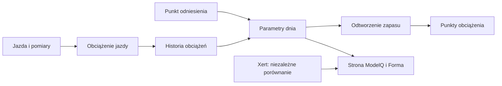

# Bezpieczniki ModelQ

## Co to jest

Bezpieczniki regularnie sprawdzają, czy próg lub zapas długo nie tkwi przy ograniczeniu, czy kotwica nie jest stara i czy próg mocno nie odbiega od Xerta. Wysyłają informację; same nie zmieniają sygnatury.

## Po co

Pomagają zauważyć, że estymata przez długi czas korzysta z maksymalnego dopuszczonego dryfu albo że wymaga przeglądu.

## Skąd dane

Bieżącej sygnatury, zapisanych kotwic i porównawczego punktu Xerta.

## Jak liczone

1. **Sprawdź rytm.** Kontrola granic i wieku kotwicy działa w poniedziałki; porównanie Xerta jest miesięczne, w pierwszy poniedziałek.
2. **Policz czas na granicy.** TP/HIE muszą pozostawać przy granicy co najmniej 14 dni, by powstał alert.
3. **Sprawdź wiek kotwicy.** Alert o starej kotwicy pojawia się po przekroczeniu 90 dni. Własna kotwica 14.10.2026 miała w dniu kontroli 18.10.2026 tylko 4 dni.
4. **Porównaj TP z Xertem.** Różnica ponad 5% może zaproponować przegląd. 18.10.2026: 240,7 W wobec 230 W, czyli około 4,7% Xerta — poniżej tego progu.
5. **Pamiętaj o deduplikacji.** Ten sam typ komunikatu nie jest ponawiany częściej niż raz na 7 dni.

Wzor

W tym haśle wzór nie jest potrzebny do odczytania przykładu. Najważniejsze są kolejność działań i rzeczywiste wartości pokazane wyżej.

## Gdzie to widać

Telegram. Ekran ModelQ nie pokazuje historii alertów.

## Jak czytać

Jeśli otrzymasz komunikat o kotwicy albo granicy, potraktuj go jako prośbę o przegląd; nie jest to polecenie przepisania parametrów.

## Decyzje i historia

Bieżący opis opiera się na sprawdzeniu z 18.10.2026. Starszy opis techniczny zawiera wcześniejsze współczynniki i wartości; przy różnicy obowiązują aktualne reguły działania.

## Ograniczenia i pułapki

Kod wysyłki wymaga dostępnego kanału Telegram. Nie sprawdzono aktywnych rekordów historii ani rzeczywistych doręczeń alertów.

## Powiązane hasła

[kotwice](kotwice.md), [TP](tp.md), [HIE](hie.md), [Xert](xert.md), [ModelQ](index.md)

## Wpływa na / Zależy od

- **Wpływa na:** przegląd sygnatury, ale bez samodzielnego zapisu zmian
- **Zależy od:** Bieżącej sygnatury, zapisanych kotwic i porównawczego punktu Xerta

## Zrodla

- `/opt/qbot/app/fitmodel/modelq_guard.py` — dni kontroli, limity i warunki powiadomień.
- `/opt/qbot/app/fitmodel/daily_job.py` — włączenie kroku do przebiegu dziennego.

- `/opt/qbot/app/fitmodel/modelq2/` — kod obliczeń ModelQ.
- `/opt/qbot/web/public/mq2.html`, `mq2-render.js` — ekran i wykresy.
- `qbot_v2.modelq2_signature`, `modelq2_ride`, `modelq2_anchor`, `modelq2_xert_bench` — krótkie odczyty 18.10.2026.
- `/opt/qbot/app/docs/DECISIONS.md` — decyzje z 14.10.2026 i 15.10.2026.
