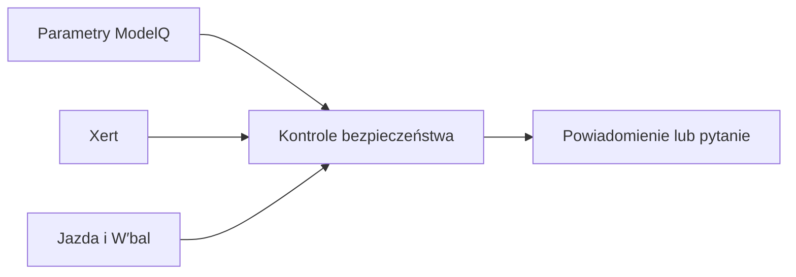

# Bezpieczniki ModelQ

## Co to jest

ModelQ ma kilka kontroli, które wysyłają przypomnienie lub pytanie, gdy próg albo zapas wymaga przeglądu. Szczegółowy opis progów, harmonogramu, przykładu z bazy i reakcji znajduje się w haśle [Kontrole bezpieczeństwa ModelQ](../straznicy/modelq.md).

## Po co

Ta strona jest krótkim wejściem z działu ModelQ. Dla zrozumienia konkretnego alertu przejdź do nowego hasła Strażników, aby nie powielać opisu reguł.

## Skąd dane

Kontrole korzystają z bieżącej sygnatury, kotwic, danych z Xerta i wyniku W′bal z jazdy.

## Jak liczone

Pełne kroki i wzory: [Kontrole bezpieczeństwa ModelQ](../straznicy/modelq.md).

## Gdzie to widać

Telegram. Wiadomości nie są archiwizowane na stronie ModelQ.

## Jak czytać

Powiadomienie prosi o przegląd, nie zmienia parametrów samodzielnie. Zobacz [Kontrole bezpieczeństwa ModelQ](../straznicy/modelq.md).

## Decyzje i historia

Historia wdrożenia i aktualne przykłady są opisane w [haśle Strażników](../straznicy/modelq.md).

## Ograniczenia i pułapki

Nie należy traktować braku alertu jako gwarancji poprawności parametrów. Szczegóły ograniczeń znajdują się w haśle docelowym.

## Wpływa na / Zależy od

- **Wpływa na:** przypomnienia o przeglądzie, bez samodzielnej korekty ModelQ.
- **Zależy od:** danych ModelQ, Xerta oraz jazd.

## Powiązane hasła

- [Kontrole bezpieczeństwa ModelQ](../straznicy/modelq.md)
- [TP](tp.md)
- [HIE](hie.md)
- [Kotwice](kotwice.md)
- [Xert](xert.md)

## Zrodla

- [Kontrole bezpieczeństwa ModelQ](../straznicy/modelq.md) — pełny opis dla właściciela.
- `/opt/qbot/app/fitmodel/modelq_guard.py`, `wbal_feel.py`, `tp_recheck.py` — źródła mechanizmów.
