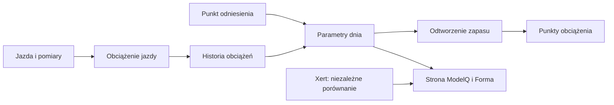

# CP i W′ — dwie etykiety, dwa znaczenia

## Co to jest

W ModelQ próg nazywa się TP. CP (critical power, parametr z krzywej mocy) bywa dawną nazwą pola, które przechowuje TP. W′ (zapas pracy ponad progiem; [słowniczek](../modelq/cp-wprime.md)) jest energią i w ModelQ odpowiada mu HIE.

## Po co

To rozróżnienie zapobiega pomyleniu progu w watach z zapasem w kilodżulach.

## Skąd dane

Sygnatura dzienna i jej publikacja dla innych części QBota.

## Jak liczone

1. **Odczytaj próg.** 18.10.2026 TP wynosi 240,7 W. To wartość mocy.
2. **Odczytaj pojemność zapasu.** Tego samego dnia HIE wynosi 19,97 kJ, czyli około 19 970 J. To energia.
3. **Zauważ etykiety historyczne.** Niektóre pola nadal mają nazwę CP lub W′, ale są mapowane na TP albo HIE.
4. **Śledź zapas podczas jazdy.** W′bal oznacza, ile z HIE model szacuje jako pozostałe w danej chwili.
5. **Nie utożsamiaj jednostek.** W (wat) i J/kJ (dżul/kilodżul) mierzą różne rzeczy.

Wzor

W tym haśle wzór nie jest potrzebny do odczytania przykładu. Najważniejsze są kolejność działań i rzeczywiste wartości pokazane wyżej.

## Gdzie to widać

Strona ModelQ pokazuje TP i HIE oddzielnie. Wartość progu może być wyświetlana także w Formie albo przekazywana urządzeniom.

## Jak czytać

Jeśli widzisz CP w historycznym widoku, sprawdź kontekst i jednostkę: W oznacza próg, kJ oznacza HIE/zapas.

## Decyzje i historia

Bieżący opis opiera się na sprawdzeniu z 18.10.2026. Starszy opis techniczny zawiera wcześniejsze współczynniki i wartości; przy różnicy obowiązują aktualne reguły działania.

## Ograniczenia i pułapki

To hasło dotyczy nazw w ModelQ. Inne modele mogą używać CP jako niezależnego parametru krzywej. Nie przenoś znaczenia etykiety z jednego miejsca do drugiego bez sprawdzenia.

## Powiązane hasła

[TP](tp.md), [HIE](hie.md), [W′bal](wprime-bal.md), [ModelQ](index.md), [słowniczek](../slowniczek.md)

## Wpływa na / Zależy od

- **Wpływa na:** poprawne odczytanie progu, zapasu i nazw w raporcie
- **Zależy od:** Sygnatura dzienna i jej publikacja dla innych części QBota

## Zrodla

- `/opt/qbot/app/fitmodel/modelq2/` — kod obliczeń ModelQ.
- `/opt/qbot/web/public/mq2.html`, `mq2-render.js` — ekran i wykresy.
- `qbot_v2.modelq2_signature`, `modelq2_ride`, `modelq2_anchor`, `modelq2_xert_bench` — krótkie odczyty 18.10.2026.
- `/opt/qbot/app/docs/DECISIONS.md` — decyzje z 14.10.2026 i 15.10.2026.
