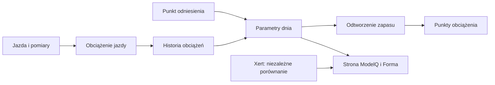

# HIE — zapas wysiłku ponad progiem

## Co to jest

HIE (pojemność wysiłku ponad progiem; [słowniczek](../slowniczek.md#hie)) opisuje modelowy zapas energii. Jest podawane w kilodżulach i stanowi pełny zapas na początku odtworzenia jazdy.

## Po co

Pomaga zrozumieć, czemu krótkie mocne odcinki uszczuplają zapas, a spokojniejsze odcinki pozwalają mu częściowo wracać.

## Skąd dane

Własna kotwica i obciążenie intensywne. Kod ogranicza wpływ zmian obciążenia; Xert nie jest aktualnym źródłem HIE ModelQ.

## Jak liczone

1. **Zacznij od kotwicy.** 14.10.2026 HIE wynosi 20,0 kJ. Gdy obciążenie intensywne jest niedostępne albo zerowe, kod zachowuje wartość kotwicy.
2. **Porównaj część intensywną.** Przy dostępnych danych kod porównuje obciążenie High dnia z obciążeniem High kotwicy. Nie używa całej sumy obciążeń.
3. **Zastosuj małą czułość.** Stosunek obciążeń High podnosi do potęgi 0,11. Dzięki temu kilkukrotna zmiana obciążenia przekłada się na znacznie mniejszy ruch HIE.
4. **Ogranicz wynik.** HIE może się znaleźć między 90% a 110% kotwicy. Przy 20,0 kJ jest to 18,0–22,0 kJ.
5. **Odczytaj zapisane dni.** 16.10.2026 HIE wynosi 19,99 kJ, 17.10 — 19,94 kJ, a 18.10 — 19,97 kJ.

Wzor

HIE przed ograniczeniem = HIE kotwicy × (obciążenie High dnia ÷ obciążenie High kotwicy)^0,11. Jeśli brak dodatniego obciążenia High kotwicy lub dnia, model zachowuje kotwicę. Wynik ogranicza do 90–110% kotwicy.

Wykres przykładowych TP z 16–18.10.2026 pokazuje rzeczywistą serię dzienną: 

## Gdzie to widać

Kafelek HIE i wykres HIE na stronie ModelQ. W Formie wartość jest publikowana też jako W′.

Na ekranie szukaj kafla „Dziś”, tabeli okien 90/30/7/1 dzień oraz wykresu niżej. Etykiety i położenie pokazuje zrzut z 18.10.2026. Zobacz też [indeks zrzutów ekranu](../img/ekrany/indeks.md).

## Jak czytać

Jeśli HIE rośnie, model przypisuje większy zapas do intensywnej pracy. Nie znaczy to, że mięśnie zostały bezpośrednio zmierzone. Przy mocnym wysiłku oceniaj też przebieg jazdy i własne odczucie.

## Decyzje i historia

Bieżący opis opiera się na sprawdzeniu z 18.10.2026. Starszy opis techniczny zawiera wcześniejsze współczynniki i wartości; przy różnicy obowiązują aktualne reguły działania.

## Ograniczenia i pułapki

To parametr modelu zależny od kotwicy i obciążenia. Wykrycie W′bal bliskiego zera nie jest od niego niezależnym pomiarem. Własny odczyt z 18.10.2026 wynosi 19,97 kJ; porównawczy Xert 24,0 kJ.

## Powiązane hasła

[kotwice](kotwice.md), [TP](tp.md), [PP](pp.md), [W′bal](wprime-bal.md), [XSS](xss.md), [Xert](xert.md), [słowniczek](../slowniczek.md)

## Wpływa na / Zależy od

- **Wpływa na:** przebieg W′bal, wyliczenie XSS oraz pochodne LTP i PP
- **Zależy od:** Własna kotwica i obciążenie intensywne

## Zrodla

- `/opt/qbot/app/fitmodel/modelq2/` — kod obliczeń ModelQ.
- `/opt/qbot/web/public/mq2.html`, `mq2-render.js` — ekran i wykresy.
- `qbot_v2.modelq2_signature`, `modelq2_ride`, `modelq2_anchor`, `modelq2_xert_bench` — krótkie odczyty 18.10.2026.
- `/opt/qbot/app/docs/DECISIONS.md` — decyzje z 14.10.2026 i 15.10.2026.
