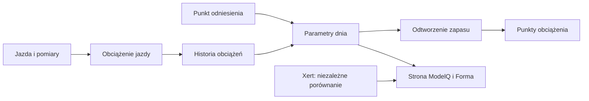

# Import jazdy do ModelQ

## Co to jest

Import jazdy zapisuje podsumowanie i próbki potrzebne do odtworzenia obciążenia. Nazwa tego hasła nie oznacza, że każda aktywność pochodzi z pliku FIT.

## Po co

Jeśli jazda ma próbki mocy, ModelQ może odtworzyć zmianę zapasu i policzyć punkty obciążenia dla przejazdu.

## Skąd dane

Aktywności zapisane w bazie, w tym próbki czasu i mocy. ModelQ podczas obliczeń czyta zapisane próbki, a nie otwiera po kolei archiwalnych plików FIT.

## Jak liczone

1. **Zapisz przejazd.** Podsumowanie opisuje jazdę, a strumień sekundowy zawiera pomiary.
2. **Sprawdź dostępność mocy.** Dla jazdy 16.10.2026 wynik ma źródło `power` i 41,0% minimum zapasu.
3. **Dobierz sygnaturę sprzed jazdy.** Dla 16.10.2026 użyto TP 238,6 W i HIE 19,99 kJ.
4. **Odtwórz kolejne sekundy i policz wynik.** Jazda otrzymała 63,6 Low, 5,85 High, 0,329 Peak; suma 69,7.
5. **Oddziel wyjątek miernika.** Aktywna kwarantanna mocy kieruje jazdę do obliczenia z tętna; w takim przypadku zapas mocy nie jest odtwarzany.

Wzor

W tym haśle wzór nie jest potrzebny do odczytania przykładu. Najważniejsze są kolejność działań i rzeczywiste wartości pokazane wyżej.

## Gdzie to widać

Pośrednio w Formie, raporcie jazdy i wykresach obciążenia. Liczba próbek nie jest osobnym kaflem na stronie ModelQ.

Na ekranie szukaj kafla „Dziś”, tabeli okien 90/30/7/1 dzień oraz wykresu niżej. Etykiety i położenie pokazuje zrzut z 18.10.2026. Zobacz też [indeks zrzutów ekranu](../img/ekrany/indeks.md).

## Jak czytać

Jeśli jazda nie ma wyniku, sama obecność jej podsumowania nie dowodzi, że ma wystarczający strumień mocy. Wynik z tętna jest oznaczony inaczej i nie powinien być czytany jak W′bal.

## Decyzje i historia

Bieżący opis opiera się na sprawdzeniu z 18.10.2026. Starszy opis techniczny zawiera wcześniejsze współczynniki i wartości; przy różnicy obowiązują aktualne reguły działania.

## Ograniczenia i pułapki

Przykład z 16.10.2026 potwierdza pojedynczą jazdę. W tym etapie nie sprawdzono całej historii importów ani każdej klasy aktywności.

## Powiązane hasła

[W′bal](wprime-bal.md), [XSS](xss.md), [ModelQ](index.md), [plik FIT w raporcie](../raport-jazdy/plik-fit.md), [słowniczek](../slowniczek.md)

## Wpływa na / Zależy od

- **Wpływa na:** wynik konkretnej jazdy, jej XSS oraz dzienne obciążenie
- **Zależy od:** Aktywności zapisane w bazie, w tym próbki czasu i mocy

## Zrodla

- `/opt/qbot/app/fitmodel/modelq2/` — kod obliczeń ModelQ.
- `/opt/qbot/web/public/mq2.html`, `mq2-render.js` — ekran i wykresy.
- `qbot_v2.modelq2_signature`, `modelq2_ride`, `modelq2_anchor`, `modelq2_xert_bench` — krótkie odczyty 18.10.2026.
- `/opt/qbot/app/docs/DECISIONS.md` — decyzje z 14.10.2026 i 15.10.2026.
