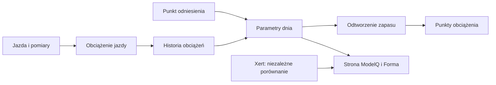

# ModelQ — od pomiaru do sygnatury

## Co to jest

ModelQ opisuje TP (próg mocy; [słowniczek](../modelq/tp.md)), HIE (zapas na wysiłek ponad progiem; [słowniczek](../slowniczek.md#hie)) i PP (parametr mocy szczytowej; [słowniczek](../slowniczek.md#pp)). Z danych z jazd tworzy parametry na każdy dzień; [Xert jako sprawdzian](xert.md) pokazuje osobne wartości do porównania.

## Po co

Pomaga odczytać, co oznaczają kafelki i wykres na stronie, oraz odróżnić własny wynik od sprawdzianu zewnętrznego.

## Skąd dane

ModelQ korzysta z zapisanych próbek mocy co sekundę. Parametry dnia wynikają z historii obciążeń i zatwierdzonych punktów odniesienia.

## Jak liczone

1. **Sprawdź dzień.** 18.10.2026 zapisano próg 240,7 W, zapas HIE 19,97 kJ i moc szczytową 988,7 W.
2. **Zobacz obciążenie tej jazdy.** Tego dnia zapisano 157,7 XSS (punkty obciążenia; [słowniczek](../slowniczek.md#xss)): 152,6 Low + 4,96 High + 0,172 Peak.
3. **Porównaj dzień z poprzednim.** 17.10.2026 TP wynosił 238,0 W, HIE 19,94 kJ, PP 988,5 W. To dzienne wyliczenia, nie osobne testy.
4. **Otwórz wykres.** Linia pokazuje ModelQ, kropki Xert; tabela podaje średnie dla okien czasu.
5. **Nie przenoś różnicy do własnego wyniku.** 18.10.2026 Xert ma TP 230 W, HIE 24,0 kJ i PP 1090 W; są to dane porównawcze.

Wzor

W tym haśle wzór nie jest potrzebny do odczytania przykładu. Najważniejsze są kolejność działań i rzeczywiste wartości pokazane wyżej.

## Gdzie to widać

Strona ModelQ, widoczna w zrzucie niżej. W Formie część dziennych wyników pokazuje wykres obciążenia i kafle progu/formy.

Na ekranie szukaj kafla „Dziś”, tabeli okien 90/30/7/1 dzień oraz wykresu niżej. Etykiety i położenie pokazuje zrzut z 18.10.2026. Zobacz też [indeks zrzutów ekranu](../img/ekrany/indeks.md).

## Co widzisz na ekranie → hasło

| Na ekranie | Gdzie szukać | Wyjaśnienie |
|---|---|---|
| TP — próg mocy | Kafel „Dziś”, tabela i wykres | [TP](tp.md) |
| HIE — zapas ponad progiem | Kafel „Dziś”, tabela i wykres | [HIE](hie.md) |
| PP — moc szczytowa | Kafel „Dziś”, tabela i wykres | [PP](pp.md) |
| LTP — próg niższy | Kafel „Dziś” i wykres | [LTP](ltp.md) |
| CTL (obciążenie długie), ATL (krótkie), TSB (różnica obciążeń) | Drugi rząd kafli „Dziś” | [Forma, zmęczenie i świeżość](../forma/ctl-atl-tsb.md) oraz [słowniczek](../slowniczek.md) |
| Średnie dla 90, 30, 7 dni i 1 dnia | Tabela okien | [Xert jako sprawdzian](xert.md) |
| Przełączniki TP, HIE, PP, LTP i Forma | Przyciski pod wykresem | [parametry](tp.md), [XSS](xss.md), [Forma](../forma/ctl-atl-tsb.md) |
| Linia ModelQ, kropki Xerta, czerwony diament | Legenda wykresu | [Xert](xert.md) |
| AKTUALIZACJA | Zielony przycisk nad kaflami | Wywołuje ponowne przeliczenie ModelQ; ekran pokazuje wynik pobrany z usługi. |

## Hasła działu

- [TP](tp.md), [HIE](hie.md), [PP](pp.md), [LTP](ltp.md)
- [CP i W′](cp-wprime.md), [W′bal](wprime-bal.md), [XSS](xss.md), [XSS z tętna](xss-z-tetna.md)
- [Kotwice i kalibracja](kotwice.md), [Import jazdy](import-fit.md), [Xert jako sprawdzian](xert.md)
- [Bezpieczniki](bezpieczniki.md), [odczucie po jeździe](odczucie-po-jezdzie.md), [przegląd TP](przeglad-tp.md), [przełom mocy](przelom-cp.md)

## Jak czytać

Jeśli chcesz ocenić codzienny wynik, patrz na kolumnę MQ2 i dzień sygnatury. Xert pomaga zauważyć rozbieżność. Sam wykres nie nakazuje zmiany kotwicy ani treningu.

## Decyzje i historia

Bieżący opis opiera się na sprawdzeniu z 18.10.2026. Starszy opis techniczny zawiera wcześniejsze współczynniki i wartości; przy różnicy obowiązują aktualne reguły działania.

## Ograniczenia i pułapki

Dzienna wartość nie jest pomiarem laboratoryjnym. Próbka mocy może być błędna, a parametry zależą od kotwic i wcześniejszych obciążeń. Kafel LTP pokazuje wartość wygładzoną 191,2 W, a dopisek „dzienne” podaje 190,8 W. Baza potwierdza obie wartości w osobnych polach dla 18.10.2026.

## Powiązane hasła

[TP](tp.md), [HIE](hie.md), [PP](pp.md), [LTP](ltp.md), [W′bal](wprime-bal.md), [XSS](xss.md), [kotwice i kalibracja](kotwice.md), [Xert](xert.md), [import jazdy](import-fit.md), [słowniczek](../slowniczek.md)

## Wpływa na / Zależy od

- **Wpływa na:** dzienne obciążenie Formy, elementy raportu jazdy, próg dostępny innym funkcjom
- **Zależy od:** ModelQ korzysta z zapisanych próbek mocy co sekundę

## Zrodla

- `/opt/qbot/app/fitmodel/modelq2/progression.py` — budowa dziennego szeregu.
- `/opt/qbot/app/fitmodel/modelq2/publish.py` — publikacja do Formy.
- `/opt/qbot/web/public/mq2.html`, `mq2-render.js` — kafle, tabela i wykres.
- `qbot_v2.modelq2_signature`, `modelq2_ride`, `modelq2_xert_bench` — odczyty 18.10.2026.
