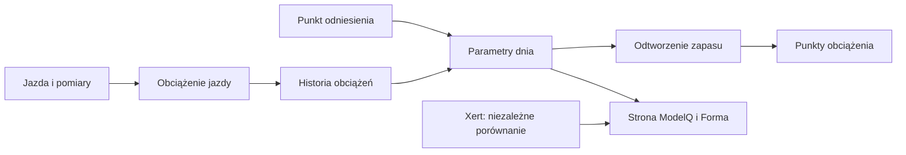

# Kotwice i kalibracja ModelQ

## Co to jest

Kotwica to zapisany punkt odniesienia TP, HIE i PP, od którego model rozwija parametry następnych dni. Własne kotwice i starsze punkty historyczne mogą mieć różne pochodzenie.

## Po co

Kotwice ograniczają stopniową zmianę parametrów. Jeśli wynik dochodzi do ograniczenia przez długi czas, bezpiecznik może zaproponować przegląd.

## Skąd dane

Zapisanych punktów odniesienia oraz dziennego obciążenia; dla aktualnego okresu ważna jest własna kotwica z 14.10.2026.

## Jak liczone

1. **Odczytaj własny punkt.** 14.10.2026 zapisano TP 238,8 W, HIE 20,0 kJ, PP 988,8 W.
2. **Sprawdź pochodzenie.** Starsze punkty z 2026-06-20 i 2026-03-29 są opisane jako przepisane z Xerta i zamrożone.
3. **Wybierz najbliższy dzień.** Kod wybiera dla każdego dnia kotwicę najbliższą czasowo.
4. **Zastosuj osobne reguły.** TP zmienia się z opóźnionym obciążeniem; HIE reaguje słabo na High; PP reaguje jeszcze łagodniej.
5. **Odczytaj wynik po czterech dniach.** 18.10.2026 sygnatura wynosi TP 240,7 W, HIE 19,97 kJ, PP 988,7 W.

Wzor

W tym haśle wzór nie jest potrzebny do odczytania przykładu. Najważniejsze są kolejność działań i rzeczywiste wartości pokazane wyżej.

Wykres przykładowych TP z 16–18.10.2026 pokazuje rzeczywistą serię dzienną: 

## Gdzie to widać

Strona ModelQ pokazuje bieżącą sygnaturę i jej historię. Źródło i data kotwicy są szczegółem zaplecza, nie zawsze osobnym kaflem.

Na ekranie szukaj kafla „Dziś”, tabeli okien 90/30/7/1 dzień oraz wykresu niżej. Etykiety i położenie pokazuje zrzut z 18.10.2026. Zobacz też [indeks zrzutów ekranu](../img/ekrany/indeks.md).

## Jak czytać

Jeśli wartość długo stoi przy granicy, nie traktuj granicy jak nowego testu. To dobry powód do przeglądu, ale nowa kotwica wymaga sprawdzonych przesłanek i decyzji.

## Decyzje i historia

Bieżący opis opiera się na sprawdzeniu z 18.10.2026. Starszy opis techniczny zawiera wcześniejsze współczynniki i wartości; przy różnicy obowiązują aktualne reguły działania.

## Ograniczenia i pułapki

Xertowe kotwice są historyczne. Bieżący benchmark Xert nie jest wejściem dzisiejszego wyniku. Kalibracja na podstawie pojedynczej jazdy może błędnie przesunąć wiele kolejnych dni.

## Powiązane hasła

[TP](tp.md), [HIE](hie.md), [PP](pp.md), [Xert](xert.md), [bezpieczniki ModelQ](bezpieczniki.md), [ModelQ](index.md)

## Wpływa na / Zależy od

- **Wpływa na:** wszystkie dzienne parametry sygnatury i zależne obliczenia
- **Zależy od:** Zapisanych punktów odniesienia oraz dziennego obciążenia; dla aktualnego okresu ważna jest własna kotwica z 14

## Zrodla

- `/opt/qbot/app/fitmodel/modelq2/` — kod obliczeń ModelQ.
- `/opt/qbot/web/public/mq2.html`, `mq2-render.js` — ekran i wykresy.
- `qbot_v2.modelq2_signature`, `modelq2_ride`, `modelq2_anchor`, `modelq2_xert_bench` — krótkie odczyty 18.10.2026.
- `/opt/qbot/app/docs/DECISIONS.md` — decyzje z 14.10.2026 i 15.10.2026.
