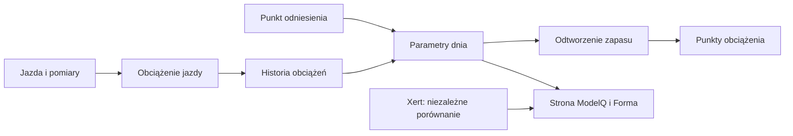
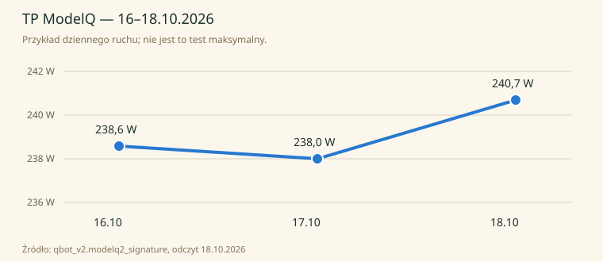
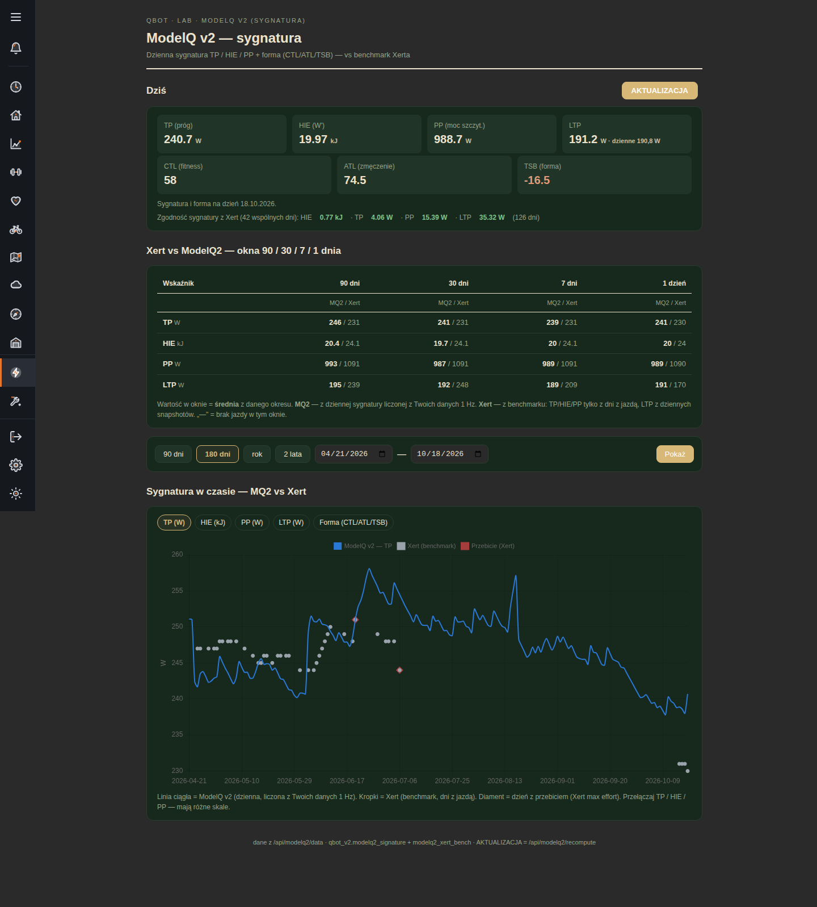

# LTP — wygładzony próg tlenowy

## Co to jest

LTP (niższy próg mocy wyprowadzony z parametrów ModelQ; [słowniczek](../slowniczek.md#ltp)) jest obliczany z TP i HIE. W publikacji jest dodatkowo wygładzany, aby pojedynczy dzień nie powodował dużego skoku.

## Po co

Pomaga śledzić wolniejszy trend niż sam dzienny próg. Przy porównaniu dwóch dni odróżnij surową wartość sygnatury od wygładzonej publikacji.

## Skąd dane

TP i HIE każdego dnia. Surowe LTP pojawia się w sygnaturze; wygładzona seria jest przekazywana do Formy.

## Jak liczone

1. **Przelicz surową wartość z dnia.** Użyj TP i HIE z 18.10.2026; szczegółowe działanie zapisano we wzorze poniżej.
2. **Pobierz kolejne dni.** Kod przechodzi po dziennej historii surowego LTP.
3. **Wygładź zmianę.** Używany jest wykładniczy filtr o okresie 28 dni; dzienna zmiana ma więc mniejszy wpływ niż w surowej liczbie.
4. **Odczytaj właściwe miejsce.** Baza sygnatury ma 190,8 W dziennie, a publikowana wartość wygładzona wynosi 191,2 W. Zrzut pokazuje je równocześnie: większą liczbę w kaflu i dzienną w dopisku.

Wzor

Dla 18.10.2026: 240,7 W − 19 970 J ÷ 400 = 190,775 W, czyli 190,8 W po zaokrągleniu. Potem publikowana seria wygładza kolejne dni.

Wykres przykładowych TP z 16–18.10.2026 pokazuje rzeczywistą serię dzienną: 

## Gdzie to widać

Kafelek LTP oraz wykres sygnatury. Zwróć uwagę, że opis ekranu podaje „LTP”, ale porównanie może używać innej serii niż surowa wartość.

Na ekranie szukaj kafla „Dziś”, tabeli okien 90/30/7/1 dzień oraz wykresu niżej. Etykiety i położenie pokazuje zrzut z 18.10.2026. Zobacz też [indeks zrzutów ekranu](../img/ekrany/indeks.md).

## Jak czytać

Jeśli LTP zmienia się łagodnie, porównuj tygodnie, nie pojedyncze skoki HIE. Przy odczycie sprawdź, czy patrzysz na kafel czy konkretną serię wykresu.

## Decyzje i historia

Bieżący opis opiera się na sprawdzeniu z 18.10.2026. Starszy opis techniczny zawiera wcześniejsze współczynniki i wartości; przy różnicy obowiązują aktualne reguły działania.

## Ograniczenia i pułapki

Wartość 191,2 W jest wygładzoną publikacją; 190,8 W to wynik dnia. Wygładzanie dotyczy publikacji; wewnętrzny próg używany do jazdy pozostaje surowy.

## Powiązane hasła

[TP](tp.md), [HIE](hie.md), [ModelQ](index.md), [słowniczek](../slowniczek.md)

## Wpływa na / Zależy od

- **Wpływa na:** wykres mocy w Formie i odbiorców wygładzonego LTP
- **Zależy od:** TP i HIE każdego dnia

## Zrodla

- `/opt/qbot/app/fitmodel/modelq2/` — kod obliczeń ModelQ.
- `/opt/qbot/web/public/mq2.html`, `mq2-render.js` — ekran i wykresy.
- `qbot_v2.modelq2_signature`, `modelq2_ride`, `modelq2_anchor`, `modelq2_xert_bench` — krótkie odczyty 18.10.2026.
- `/opt/qbot/app/docs/DECISIONS.md` — decyzje z 14.10.2026 i 15.10.2026.
