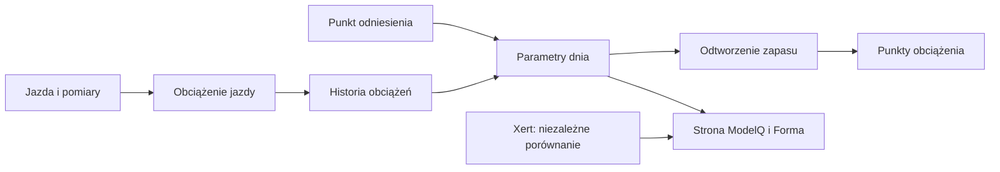

# Odczucie po jeździe z niskim zapasem

## Co to jest

Po wybranych jazdach z niskim szacowanym W′bal system może zapytać, czy wysiłek rzeczywiście był bliski wyczerpania. Odpowiedź pomaga zestawić estymatę z odczuciem właściciela.

## Po co

Jeśli model pokazuje zapas bliski zera, a jazda nie była odczuwana jako graniczna, taka informacja może wskazać potrzebę przeglądu HIE.

## Skąd dane

Wyniku odtworzenia W′bal oraz odpowiedzi wysłanej w Telegramie. Próg wyzwalający pytanie w kodzie to minimum do 5%.

## Jak liczone

1. **Sprawdź minimum.** 11.10.2026 miała minimum 6,3%; to powyżej obecnego progu 5%, więc nie spełnia warunku automatycznego pytania.
2. **Poczekaj na wybór jazdy przez automat.** Brak wcześniejszej odpowiedzi dla tej jazdy jest wymagany.
3. **Odpowiedz jednym z wariantów Telegrama.** Odpowiedź zapisuje się do historii tej jazdy.
4. **Oceniaj serię, nie jeden przypadek.** W kodzie seria trzech odpowiedzi „miałem zapas” przy niskim wskazaniu może uruchomić propozycję przeglądu HIE.
5. **Decyzja o korekcie pozostaje osobna.** Odpowiedź nie zmienia natychmiast parametrów ModelQ.

Wzor

W tym haśle wzór nie jest potrzebny do odczytania przykładu. Najważniejsze są kolejność działań i rzeczywiste wartości pokazane wyżej.

## Gdzie to widać

Telegram po uruchomieniu kroku dziennego. Nie jest to kafel strony ModelQ.

## Jak czytać

Jeśli model pokazuje niski zapas, a Ty czułeś zapas, wybierz zgodną odpowiedź. Pojedynczy wybór jest informacją, nie automatyczną kalibracją.

## Decyzje i historia

Bieżący opis opiera się na sprawdzeniu z 18.10.2026. Starszy opis techniczny zawiera wcześniejsze współczynniki i wartości; przy różnicy obowiązują aktualne reguły działania.

## Ograniczenia i pułapki

W tym etapie nie odczytano tabeli odpowiedzi ani dziennika wysyłek. Przykład 11.10 ma zapisane minimum w wyniku jazdy, ale nie potwierdza otrzymania pytania.

> DO SPRAWDZENIA: czy konkretne pytanie po jeździe zostało doręczone i jaka była odpowiedź.

## Powiązane hasła

[W′bal](wprime-bal.md), [HIE](hie.md), [bezpieczniki ModelQ](bezpieczniki.md), [ModelQ](index.md)

## Wpływa na / Zależy od

- **Wpływa na:** sygnał do propozycji przeglądu po powtarzających się odpowiedziach
- **Zależy od:** Wyniku odtworzenia W′bal oraz odpowiedzi wysłanej w Telegramie

## Zrodla

- `/opt/qbot/app/fitmodel/wbal_feel.py` — wybór jazd, próg i obsługa odpowiedzi.
- `/opt/qbot/app/fitmodel/daily_job.py` — włączenie pytania do przebiegu dziennego.

- `/opt/qbot/app/fitmodel/modelq2/` — kod obliczeń ModelQ.
- `/opt/qbot/web/public/mq2.html`, `mq2-render.js` — ekran i wykresy.
- `qbot_v2.modelq2_signature`, `modelq2_ride`, `modelq2_anchor`, `modelq2_xert_bench` — krótkie odczyty 18.10.2026.
- `/opt/qbot/app/docs/DECISIONS.md` — decyzje z 14.10.2026 i 15.10.2026.
