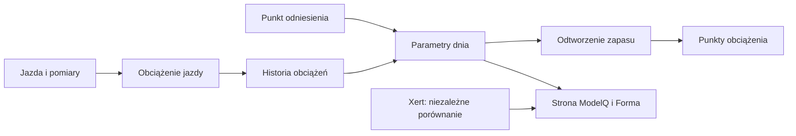

# PP — moc szczytowa sygnatury

## Co to jest

PP (moc szczytowa sygnatury; [słowniczek](../slowniczek.md#pp)) opisuje górny zakres mocy w ModelQ. Jest parametrem krzywej sygnatury, a nie najwyższym odczytem z jednej jazdy.

## Po co

Ułatwia odróżnienie długiego wysiłku od krótkich mocnych zrywów. Wpływa na obliczenie dostępnej mocy i część podziału obciążenia.

## Skąd dane

Punktem wyjścia jest PP w kotwicy. Późniejsza zmiana jest mała i związana ze zmianą HIE.

## Jak liczone

1. **Odczytaj kotwicę.** 14.10.2026 PP wynosi 988,8 W.
2. **Weź względną zmianę HIE.** Aktualny stosunek względem kotwicy wpływa na PP tylko w 10% swojej zmiany.
3. **Ogranicz ruch do 93–107% kotwicy.** To zabezpiecza przed nagłym odjazdem parametru.
4. **Sprawdź kolejność.** PP musi być większe od TP.
5. **Porównaj zapisane dni.** PP to 988,5 W 17.10.2026 i 988,7 W 18.10.2026.

Wzor

W tym haśle wzór nie jest potrzebny do odczytania przykładu. Najważniejsze są kolejność działań i rzeczywiste wartości pokazane wyżej.

Wykres przykładowych TP z 16–18.10.2026 pokazuje rzeczywistą serię dzienną: 

## Gdzie to widać

Kafelek PP oraz wykres mocy szczytowej na stronie ModelQ.

Na ekranie szukaj kafla „Dziś”, tabeli okien 90/30/7/1 dzień oraz wykresu niżej. Etykiety i położenie pokazuje zrzut z 18.10.2026. Zobacz też [indeks zrzutów ekranu](../img/ekrany/indeks.md).

## Jak czytać

Jeśli PP prawie się nie zmienia, jest to zgodne z rolą stabilnego parametru sygnatury. Nie oznacza, że Twoja najwyższa moc w każdej jeździe była taka sama.

## Decyzje i historia

Bieżący opis opiera się na sprawdzeniu z 18.10.2026. Starszy opis techniczny zawiera wcześniejsze współczynniki i wartości; przy różnicy obowiązują aktualne reguły działania.

## Ograniczenia i pułapki

Nie jest to osobisty rekord sekundowy. Benchmark Xerta dla 18.10.2026 wynosi 1090 W; to osobna seria i nie zmienia PP ModelQ.

## Powiązane hasła

[TP](tp.md), [HIE](hie.md), [kotwice](kotwice.md), [Xert](xert.md), [ModelQ](index.md), [słowniczek](../slowniczek.md)

## Wpływa na / Zależy od

- **Wpływa na:** granica MPA i podział intensywnej pracy w XSS
- **Zależy od:** Punktem wyjścia jest PP w kotwicy

## Zrodla

- `/opt/qbot/app/fitmodel/modelq2/` — kod obliczeń ModelQ.
- `/opt/qbot/web/public/mq2.html`, `mq2-render.js` — ekran i wykresy.
- `qbot_v2.modelq2_signature`, `modelq2_ride`, `modelq2_anchor`, `modelq2_xert_bench` — krótkie odczyty 18.10.2026.
- `/opt/qbot/app/docs/DECISIONS.md` — decyzje z 14.10.2026 i 15.10.2026.
