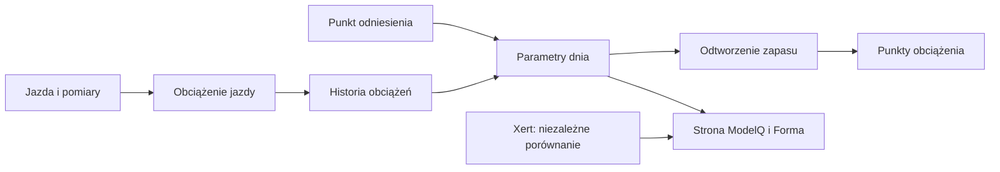

# Przegląd TP

## Co to jest

Automatyczny przegląd TP zbiera dane po osiągnięciu zadanego warunku czasu lub liczby jazd. Raport ma ponownie ocenić estymatę; nie zmienia ModelQ samodzielnie.

## Po co

Jeśli progi były niepewne z powodu infekcji lub miernika, analiza może poczekać na czyste dane i wystarczającą liczbę odcinków.

## Skąd dane

Odcinków mocy względnej, historii jazd, ostatniego wpisu choroby oraz poprzednich odniesień.

## Jak liczone

1. **Sprawdź warunek rozpoczęcia.** Domyślnie zbrojenie rozpoczyna się 04.10.2026; jeden z progów to 21 dni, 8 jazd, 15 godzin lub 400 km.
2. **Poczekaj na czyste okno.** Analiza patrzy na 28 dni; po infekcji czeka 14 dni.
3. **Sprawdź liczbę odcinków.** Wymagane jest co najmniej 8 czystych odcinków.
4. **Wylicz dolną granicę.** W przebiegu jazd ModelQ szuka najniższego progu, przy którym zapas nie schodzi niżej niż −1 kJ.
5. **Pokaż raport do oceny.** Kod opisuje raport Telegram i zapis stanu; nie uznawaj samego wyzwalacza za nową kotwicę.

Wzor

W tym haśle wzór nie jest potrzebny do odczytania przykładu. Najważniejsze są kolejność działań i rzeczywiste wartości pokazane wyżej.

## Gdzie to widać

Raport Telegram. Nie jest częścią kafla TP.

## Jak czytać

Jeśli raport jeszcze czeka, powodem może być infekcja w oknie lub zbyt mało czystych odcinków. Czekanie jest zamierzone, bo wynik po chorobie może być zaniżony.

## Decyzje i historia

Bieżący opis opiera się na sprawdzeniu z 18.10.2026. Starszy opis techniczny zawiera wcześniejsze współczynniki i wartości; przy różnicy obowiązują aktualne reguły działania.

## Ograniczenia i pułapki

Nie sprawdzono bieżącego pliku stanu ani tego, czy raport został wysłany. Podane progi pochodzą z bieżących wartości domyślnych w kodzie.

## Powiązane hasła

[TP](tp.md), [kotwice](kotwice.md), [odczucie po jeździe](odczucie-po-jezdzie.md), [ModelQ](index.md)

## Wpływa na / Zależy od

- **Wpływa na:** materiał do przeglądu TP, lecz nie automatyczna zmiana
- **Zależy od:** Odcinków mocy względnej, historii jazd, ostatniego wpisu choroby oraz poprzednich odniesień

## Zrodla

- `/opt/qbot/app/fitmodel/tp_recheck.py` — wyzwalacze, kontrola choroby, liczby segmentów i analiza.
- `/opt/qbot/app/fitmodel/daily_job.py` — uruchomienie kroku przeglądu.

- `/opt/qbot/app/fitmodel/modelq2/` — kod obliczeń ModelQ.
- `/opt/qbot/web/public/mq2.html`, `mq2-render.js` — ekran i wykresy.
- `qbot_v2.modelq2_signature`, `modelq2_ride`, `modelq2_anchor`, `modelq2_xert_bench` — krótkie odczyty 18.10.2026.
- `/opt/qbot/app/docs/DECISIONS.md` — decyzje z 14.10.2026 i 15.10.2026.
