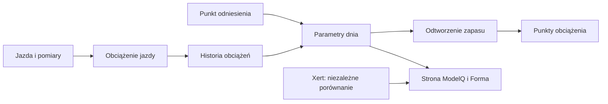

# Przełom mocy — propozycja po rekordzie

## Co to jest

Po wykryciu wyniku sugerującego nowy poziom mocy system może przygotować propozycję zmiany parametrów i poprosić o decyzję w Telegramie. CP (historyczna etykieta progu; [słowniczek](../modelq/tp.md)) w tym widoku odnosi się do progu ModelQ.

## Po co

Pozwala ocenić nowe maksimum bez automatycznego podnoszenia parametrów po jednym mocnym odcinku.

## Skąd dane

Krzywej mocy i bieżących parametrów ModelQ. Zmiana wymaga potwierdzenia.

## Jak liczone

1. **Wykryj kandydata.** Porównanie obejmuje najlepszą moc z 2, 5, 10 i 20 minut z mocą przewidywaną przez sygnaturę ModelQ. Dodatkowo jazda musi przejść filtry jakościowe.
2. **Zapisz propozycję.** Kandydat zawiera datę jazdy, parametry przed i proponowane parametry oraz dowód.
3. **Wyślij numerowaną prośbę.** Wiadomość Telegram udostępnia decyzję „TAK” lub „NIE” przez ograniczony czas.
4. **Przyjmij decyzję.** Zatwierdzenie może zaktualizować parametry; odrzucenie zamyka propozycję bez zmiany.
5. **Nie myl z CP jako etykietą.** W tej nazwie przełom odnosi się do nowego wyniku z krzywej, a nie do każdej kolumny nazwanej CP. Podwyżka w jednym zdarzeniu ma limit 3% TP i 15% HIE.

Wzor

Model porównuje moc jazdy z krzywą przewidywaną przez bieżący próg i zapas. Minimalna przewaga wynosi 1%; propozycja jest ograniczona do wzrostu najwyżej o 3% progu i 15% zapasu. Bieżący odczyt bazy nie zwrócił żadnych zapisanych propozycji, więc nie ma przykładu decyzji do pokazania.

## Gdzie to widać

Telegram. Strona ModelQ pokazuje sygnaturę po publikacji, niekoniecznie oczekującą propozycję.

## Jak czytać

Jeśli dostaniesz propozycję, sprawdź opis i datę jazdy przed wyborem. Sam rekord nie oznacza zatwierdzenia.

## Decyzje i historia

Bieżący opis opiera się na sprawdzeniu z 18.10.2026. Starszy opis techniczny zawiera wcześniejsze współczynniki i wartości; przy różnicy obowiązują aktualne reguły działania.

## Ograniczenia i pułapki

Odczytano listę propozycji w bazie: nie ma tam rekordów. Dlatego nie da się pokazać przykładu rzeczywistej decyzji ani potwierdzić dostarczenia wiadomości Telegram. Kod przewiduje 48 godzin na odpowiedź. Propozycja nie zmienia parametrów, dopóki nie zostanie zatwierdzona.

## Powiązane hasła

[CP i W′](cp-wprime.md), [TP](tp.md), [kotwice](kotwice.md), [ModelQ](index.md)

## Wpływa na / Zależy od

- **Wpływa na:** parametry po zatwierdzeniu przez użytkownika
- **Zależy od:** Krzywej mocy i bieżących parametrów ModelQ

## Zrodla

- `/opt/qbot/app/fitmodel/cp_breakthrough.py` — kandydat, prośba Telegram i obsługa decyzji.
- `/opt/qbot/app/fitmodel/daily_job.py` — uruchomienie kontroli przełomu.

- `/opt/qbot/app/fitmodel/modelq2/` — kod obliczeń ModelQ.
- `/opt/qbot/web/public/mq2.html`, `mq2-render.js` — ekran i wykresy.
- `qbot_v2.modelq2_signature`, `modelq2_ride`, `modelq2_anchor`, `modelq2_xert_bench` — krótkie odczyty 18.10.2026.
- `/opt/qbot/app/docs/DECISIONS.md` — decyzje z 14.10.2026 i 15.10.2026.
