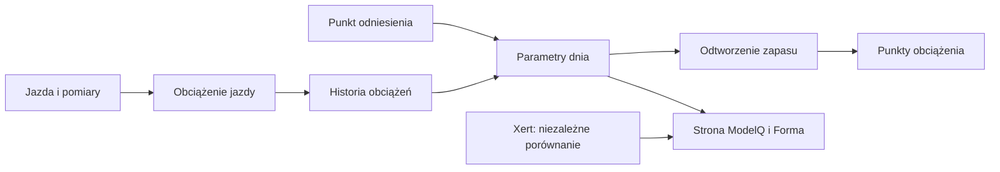

# TP — próg mocy

## Co to jest

TP (próg mocy używany w ModelQ; [słowniczek](../modelq/tp.md)) jest jednym z trzech głównych parametrów sygnatury. Oddziela pracę poniżej progu od wysiłku powyżej niego.

## Po co

Gdy porównujesz jazdę z progiem, możesz ocenić, czy dłuższy wysiłek był blisko granicy, czy wymagał zużywania dodatkowego zapasu.

## Skąd dane

Próg dnia pochodzi z najbliższego punktu odniesienia i historii długoterminowego obciążenia. Kod korzysta z obciążenia sprzed 14 dni.

## Jak liczone

1. **Znajdź punkt odniesienia.** Własna kotwica z 14.10.2026 ma TP 238,8 W.
2. **Porównaj obciążenie odroczone.** Kod bierze różnicę obciążenia długoterminowego dla dnia i kotwicy, obie przesunięte o 14 dni.
3. **Zastosuj czułość.** Każdy punkt różnicy daje zmianę 0,45 W. Przykładowo różnica 4 punktów daje 1,8 W (4 × 0,45).
4. **Zastosuj ograniczenia.** Wynik nie może spaść poniżej 90% ani wzrosnąć powyżej 112% wartości kotwicy.
5. **Odczytaj wynik dnia.** 18.10.2026 sygnatura wynosi 240,7 W; poprzedniego dnia 238,0 W. To różnica między dniami, nie wynik nowego testu.

Wzor

W tym haśle wzór nie jest potrzebny do odczytania przykładu. Najważniejsze są kolejność działań i rzeczywiste wartości pokazane wyżej.

Wykres przykładowych TP z 16–18.10.2026 pokazuje rzeczywistą serię dzienną: 

## Gdzie to widać

Kafelek TP i wiersz TP w tabeli okien ekranu ModelQ. W niektórych miejscach interfejs lub starsze pola mają etykietę CP/FTP; w ModelQ oznaczają wartość TP.

Na ekranie szukaj kafla „Dziś”, tabeli okien 90/30/7/1 dzień oraz wykresu niżej. Etykiety i położenie pokazuje zrzut z 18.10.2026. Zobacz też [indeks zrzutów ekranu](../img/ekrany/indeks.md).

## Jak czytać

Jeśli rano TP zmienił się o kilka watów, traktuj to jako ruch estymaty opartej na historii. Nie zmieniaj samodzielnie planu na podstawie jednego dnia.

## Decyzje i historia

Bieżący opis opiera się na sprawdzeniu z 18.10.2026. Starszy opis techniczny zawiera wcześniejsze współczynniki i wartości; przy różnicy obowiązują aktualne reguły działania.

## Ograniczenia i pułapki

Model nie potwierdza progu niezależnym testem każdego dnia. Wartość ogranicza kotwica. Pole nazywane CP w części bazy/stron przechowuje tutaj TP.

## Powiązane hasła

[kotwice](kotwice.md), [HIE](hie.md), [CP i W′](cp-wprime.md), [W′bal](wprime-bal.md), [XSS](xss.md), [ModelQ](index.md), [słowniczek](../slowniczek.md)

## Wpływa na / Zależy od

- **Wpływa na:** wyliczenia zapasu W′bal, XSS, publikowany próg oraz część raportów
- **Zależy od:** Próg dnia pochodzi z najbliższego punktu odniesienia i historii długoterminowego obciążenia

## Zrodla

- `/opt/qbot/app/fitmodel/modelq2/` — kod obliczeń ModelQ.
- `/opt/qbot/web/public/mq2.html`, `mq2-render.js` — ekran i wykresy.
- `qbot_v2.modelq2_signature`, `modelq2_ride`, `modelq2_anchor`, `modelq2_xert_bench` — krótkie odczyty 18.10.2026.
- `/opt/qbot/app/docs/DECISIONS.md` — decyzje z 14.10.2026 i 15.10.2026.
