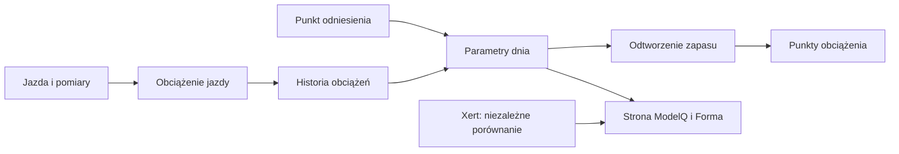

# TP — próg mocy

## Co to jest

TP (próg mocy używany w ModelQ; [słowniczek](../slowniczek.md#tp)) jest jednym z trzech głównych parametrów sygnatury. ModelQ nie wyznacza tu FTP. W części ekranów lub starszych nazw technicznych może występować CP, ale wynik ModelQ opisujemy jako próg.

## Po co

Gdy porównujesz jazdę z progiem, możesz ocenić, czy dłuższy wysiłek był blisko granicy, czy wymagał zużywania dodatkowego zapasu.

## Skąd dane

Próg dnia pochodzi z najbliższego punktu odniesienia i historii długoterminowego obciążenia. Kod korzysta z obciążenia sprzed 14 dni.

## Jak liczone

1. **Weź kotwicę.** 14.10.2026 zapisany próg wynosi 238,8 W, a obciążenie długie 58,4.
2. **Przesuń porównanie o 14 dni.** Dla dnia wyliczenia i kotwicy model porównuje obciążenie długie z daty sprzed 14 dni. Jeśli tej historii brakuje, używa wartości z dnia i kotwicy.
3. **Zmień próg umiarkowanie.** Różnica obciążenia jest mnożona przez 0,45 W na punkt. To współczynnik kodu, nie wynik pomiaru tego dnia.
4. **Ogranicz dryf.** Wynik pozostaje między 90% a 112% kotwicy. Dla kotwicy 238,8 W oznacza to około 214,9–267,5 W.
5. **Sprawdź zapisany wynik.** 18.10.2026 TP wynosi 240,7 W; 17.10.2026 wynosił 238,0 W. Zmiana dzienna nie oznacza testu progowego.

Wzor

Wartość przed ograniczeniem = TP kotwicy + 0,45 × (obciążenie długie sprzed 14 dni w dniu wyniku − obciążenie długie sprzed 14 dni w dniu kotwicy). Jeśli brak historii sprzed 14 dni, kod używa obciążenia z bieżącego dnia i kotwicy. Na końcu wynik jest ograniczany do 90–112% TP kotwicy.

Wykres przykładowych TP z 16–18.10.2026 pokazuje rzeczywistą serię dzienną: 

## Gdzie to widać

Kafelek TP i wiersz TP w tabeli okien ekranu ModelQ. W niektórych miejscach interfejs lub starsze pola mają etykietę CP/FTP; w ModelQ oznaczają wartość TP.

Na ekranie szukaj kafla „Dziś”, tabeli okien 90/30/7/1 dzień oraz wykresu niżej. Etykiety i położenie pokazuje zrzut z 18.10.2026. Zobacz też [indeks zrzutów ekranu](../img/ekrany/indeks.md).

## Jak czytać

Jeśli rano TP zmienił się o kilka watów, traktuj to jako ruch estymaty opartej na historii, a nie osobny test. 18.10.2026 ekran pokazywał 240,7 W. W tabeli 90 dni widniała średnia ModelQ 246 W, bo to średnia okna, a nie wartość tego dnia. Nie zmieniaj planu wyłącznie na podstawie różnicy między tymi polami.

## Decyzje i historia

Bieżący opis opiera się na sprawdzeniu z 18.10.2026. Starszy opis techniczny zawiera wcześniejsze współczynniki i wartości; przy różnicy obowiązują aktualne reguły działania.

## Ograniczenia i pułapki

Model nie potwierdza progu niezależnym testem każdego dnia. Wartość ogranicza kotwica. Pole nazywane CP w części bazy/stron przechowuje tutaj TP.

## Powiązane hasła

[kotwice](kotwice.md), [HIE](hie.md), [CP i W′](cp-wprime.md), [W′bal](wprime-bal.md), [XSS](xss.md), [ModelQ](index.md), [słowniczek](../slowniczek.md)

## Wpływa na / Zależy od

- **Wpływa na:** wyliczenia zapasu W′bal, XSS, publikowany próg oraz część raportów
- **Zależy od:** Próg dnia pochodzi z najbliższego punktu odniesienia i historii długoterminowego obciążenia

## Zrodla

- `/opt/qbot/app/fitmodel/modelq2/` — kod obliczeń ModelQ.
- `/opt/qbot/web/public/mq2.html`, `mq2-render.js` — ekran i wykresy.
- `qbot_v2.modelq2_signature`, `modelq2_ride`, `modelq2_anchor`, `modelq2_xert_bench` — krótkie odczyty 18.10.2026.
- `/opt/qbot/app/docs/DECISIONS.md` — decyzje z 14.10.2026 i 15.10.2026.
