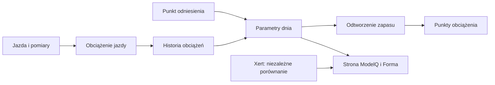

# W′bal — szacowany zapas podczas jazdy

## Co to jest

W′bal (pozostała część zapasu W′; [słowniczek](../slowniczek.md#w′bal)) jest odtwarzany z sekundowych pomiarów mocy. Model zaczyna jazdę z pełnym HIE, zużywa część zapasu powyżej TP i odbudowuje go poniżej progu.

## Po co

Pomaga zrozumieć sekwencję mocnych odcinków. Jeśli rano widzisz niskie minimum na długiej jeździe, może to oznaczać, że model odtworzył silne wykorzystanie zapasu; zestaw to z własnym odczuciem.

## Skąd dane

Moc co sekundę oraz sygnatura używana dla jazdy. Odtworzenie stosuje średnią kroczącą z 3 sekund i specjalną regułę odbudowy.

## Jak liczone

1. **Ustal początek.** Dla jazdy z 16.10.2026 zapisany HIE wynosił 19,99 kJ; odtworzenie startuje z 100% zapasu.
2. **Wygładź pomiar.** Do stanu zapasu trafia średnia mocy z ostatnich 3 sekund.
3. **Jeśli moc jest ponad TP, odejmij nadwyżkę.** Każda sekunda powyżej 238,6 W zużywa energię odpowiadającą różnicy mocy.
4. **Jeśli moc jest na TP lub niżej, odbudowuj.** Im spokojniejsza moc, tym szybszy powrót według krzywej modelu; przerwa co najmniej 30 s jest traktowana osobno.
5. **Zachowaj wynik najmniejszy.** Jazda 16.10.2026 miała minimum 41,0% i zakończyła się 69,7 XSS.

Wzor

W tym haśle wzór nie jest potrzebny do odczytania przykładu. Najważniejsze są kolejność działań i rzeczywiste wartości pokazane wyżej.

Wykres przykładowych TP z 16–18.10.2026 pokazuje rzeczywistą serię dzienną: 

## Gdzie to widać

Minimum zapasu jest dostępne w szczegółach wyniku ModelQ/raportu. W Formie ekran zbiorczy pokazuje obciążenie, a nie pełny przebieg sekundowy W′bal.

Na ekranie szukaj kafla „Dziś”, tabeli okien 90/30/7/1 dzień oraz wykresu niżej. Etykiety i położenie pokazuje zrzut z 18.10.2026. Zobacz też [indeks zrzutów ekranu](../img/ekrany/indeks.md).

## Jak czytać

Jeśli minimum spada w okolice zera, odczytaj je jako sygnał modelu o dużym wykorzystaniu zapasu, a nie diagnozę organizmu. Odpoczynek i moc poniżej progu zwiększają szacowany zapas.

## Decyzje i historia

Bieżący opis opiera się na sprawdzeniu z 18.10.2026. Starszy opis techniczny zawiera wcześniejsze współczynniki i wartości; przy różnicy obowiązują aktualne reguły działania.

## Ograniczenia i pułapki

Nie każda jazda ma poprawne waty. Przy aktywnej kwarantannie miernika ModelQ liczy obciążenie z tętna i nie wyznacza W′bal z tej jazdy. Przerwy, braki próbek i dokładność miernika wpływają na odtworzenie.

## Powiązane hasła

[HIE](hie.md), [TP](tp.md), [XSS](xss.md), [import jazdy](import-fit.md), [odczucie po jeździe](odczucie-po-jezdzie.md), [słowniczek](../slowniczek.md)

## Wpływa na / Zależy od

- **Wpływa na:** minimum obliczane dla jazdy, podział XSS oraz pytanie o odczucie przy niskim zapasie
- **Zależy od:** Moc co sekundę oraz sygnatura używana dla jazdy

## Zrodla

- `/opt/qbot/app/fitmodel/modelq2/` — kod obliczeń ModelQ.
- `/opt/qbot/web/public/mq2.html`, `mq2-render.js` — ekran i wykresy.
- `qbot_v2.modelq2_signature`, `modelq2_ride`, `modelq2_anchor`, `modelq2_xert_bench` — krótkie odczyty 18.10.2026.
- `/opt/qbot/app/docs/DECISIONS.md` — decyzje z 14.10.2026 i 15.10.2026.
