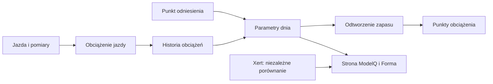

# Xert jako sprawdzian

## Co to jest

Xert dostarcza osobny zestaw porównawczy dla ModelQ. Decyzja z 15.10.2026 mówi, że bieżący wynik Xerta nie ustala parametrów QBota.

## Po co

Porównanie pomaga zauważyć różnicę, którą można później sprawdzić. Samo odchylenie nie zmienia modelu.

## Skąd dane

Osobno zapisanych dziennych punktów Xerta i sygnatury ModelQ.

## Jak liczone

1. **Odczytaj sygnaturę QBota.** 18.10.2026: TP 240,7 W, HIE 19,97 kJ, PP 988,7 W.
2. **Odczytaj porównanie Xerta z tego dnia.** TP 230 W, HIE 24,0 kJ, PP 1090 W, LTP 170,1 W.
3. **Porównaj parametry parami.** Przykładowo TP różni się o 10,7 W; HIE Xerta jest o 4,03 kJ większe.
4. **Sprawdź okno na wykresie.** Tabela podaje średnie dla okresów 90, 30, 7 i 1 dzień.
5. **Zostaw decyzję osobno.** Bezpiecznik może poprosić o przegląd progu; porównanie nie nadpisuje kotwicy.

Wzor

W tym haśle wzór nie jest potrzebny do odczytania przykładu. Najważniejsze są kolejność działań i rzeczywiste wartości pokazane wyżej.

## Gdzie to widać

Wykres i tabela na stronie ModelQ. Linia ciągła to ModelQ, szare kropki to benchmark Xerta; czerwony diament oznacza dzień z oznaczonym rekordem maksymalnego wysiłku Xerta.

Na ekranie szukaj kafla „Dziś”, tabeli okien 90/30/7/1 dzień oraz wykresu niżej. Etykiety i położenie pokazuje zrzut z 18.10.2026. Zobacz też [indeks zrzutów ekranu](../img/ekrany/indeks.md).

## Jak czytać

Jeśli wartości różnią się, potraktuj to jako temat do sprawdzenia. Wiersz „zgodność sygnatury z Xert” pokazuje wybrane różnice, a nie automatyczną ocenę jakości jazdy.

## Decyzje i historia

Bieżący opis opiera się na sprawdzeniu z 18.10.2026. Starszy opis techniczny zawiera wcześniejsze współczynniki i wartości; przy różnicy obowiązują aktualne reguły działania.

## Ograniczenia i pułapki

W bazie są też historyczne wpisy oznaczone jako nieważne. Dodatkowo starsze kotwice były przepisane z Xerta, ale własna kotwica 14.10.2026 nie jest z niego wzięta.

## Powiązane hasła

[ModelQ](index.md), [kotwice](kotwice.md), [TP](tp.md), [słowniczek](../slowniczek.md)

## Wpływa na / Zależy od

- **Wpływa na:** wykres porównawczy i okresowy komunikat kontrolny; nie zmienia sygnatury
- **Zależy od:** Osobno zapisanych dziennych punktów Xerta i sygnatury ModelQ

## Zrodla

- `/opt/qbot/web/public/mq2.html`, `mq2-render.js` — rysowanie serii i znaczenie symboli.
- `/opt/qbot/app/fitmodel/modelq_guard.py` — miesięczny próg przypomnienia o rozjeździe TP.
- `qbot_v2.modelq2_xert_bench`, `modelq2_signature` — odczyt 18.10.2026.
- `/opt/qbot/app/docs/DECISIONS.md` — decyzja 15.10.2026.
