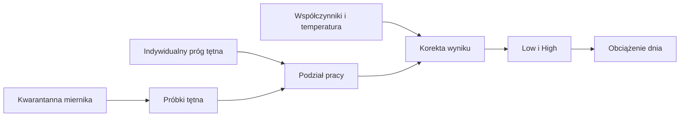

# XSS z tętna — awaryjny wynik jazdy

## Co to jest

Gdy miernik mocy jest oznaczony jako niewiarygodny, obciążenie jazdy może być oszacowane z HR (tętna; [słowniczek](../slowniczek.md#hr)) zamiast z mocy. Wynik jest przybliżeniem i nie zawiera Peak.

## Po co

Dzięki temu jazda w kwarantannie miernika nadal może zasilić obciążenie treningowe. Jednocześnie system nie udaje, że ma wiarygodny przebieg mocy ani zapasu W′bal.

## Skąd dane

Zapisane próbki tętna i prędkości, progu tętna z danego dnia oraz parametrów kalibracji. Tylko próbki podczas ruchu są uwzględniane; dziury dłuższe niż 5 sekund są pomijane.

## Jak liczone

1. **Wybierz jazdę w aktywnej kwarantannie.** Ta ścieżka dotyczy błędnego miernika, a nie każdej jazdy bez mocy.
2. **Odrzuć niewiarygodne próbki.** Pomija się bardzo niskie tętno, postój i zbyt długą przerwę w danych.
3. **Porównaj tętno z indywidualnym progiem.** Część do progu trafia do Low, wyższa część do High.
4. **Zastosuj osobne współczynniki.** Kod koryguje oba koszyki na podstawie wcześniejszych jazd oraz może uwzględnić temperaturę.
5. **Odczytaj przykład.** 20.08.2026 jazda `24045426445` miała 9 890 próbek; wynik to 145,0 Low + 0,53 High + 0 Peak = 145,5 XSS. Źródło zapisano jako HR.

Wzor

Dla każdej próbki kod waży pracę kwadratem stosunku tętna do indywidualnego progu, mnoży przez czas i osobny współczynnik Low albo High. Następnie stosuje korektę temperatury, jeśli dostępna. Konkretne współczynniki pochodzą z kalibracji zapisanej dla QBota.

## Gdzie to widać

Wynik trafia do obciążenia ModelQ i może wpływać na wykres Formy. Sam ekran ModelQ nie prezentuje go jako osobnego kafla.

## Jak czytać

Jeśli źródło wyniku to HR, traktuj XSS jako przybliżenie obciążenia, nie równoważny pomiar z watów. Brak Peak jest celowy: samo tętno nie rejestruje dobrze krótkich sprintów.

## Decyzje i historia

Ścieżka awaryjna utrzymuje jazdę w sumie obciążeń, ale wyłącza jej moc z korekty sygnatury. Dzięki temu niepewne wskazania miernika nie podnoszą progu ani HIE.

## Ograniczenia i pułapki

Upał, odwodnienie i opóźniona reakcja tętna wpływają na wynik. Wartości nie należy porównywać z XSS policzonym z mocy tak, jakby były identycznym pomiarem. Dla jazdy z tętna W′bal pozostaje pusty.

## Powiązane hasła

- [XSS](xss.md)
- [W′bal](wprime-bal.md)
- [Import jazdy](import-fit.md)
- [Słowniczek](../slowniczek.md)

## Wpływa na / Zależy od

- **Wpływa na:** składowe Low/High obciążenia dnia.
- **Zależy od:** tętna, prędkości, indywidualnego progu i zapisanej kalibracji.

## Zrodla

- `/opt/qbot/app/fitmodel/modelq2/hr_xss.py` — próg, filtry, kalibracja i obliczenie.
- `/opt/qbot/app/fitmodel/modelq2/publish.py` — wybór ścieżki mocy albo tętna.
- `qbot_v2.activity_record`, `modelq2_ride` — przykład 20.08.2026.
