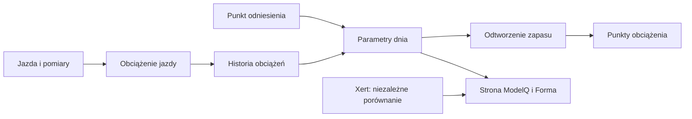
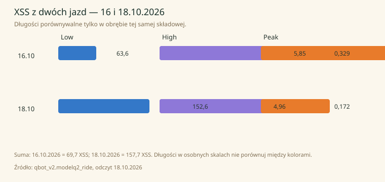

# XSS — punkty obciążenia jazdy

## Co to jest

XSS (punkty obciążenia treningowego; [słowniczek](../slowniczek.md#xss)) to wynik jazdy podzielony na Low, High i Peak. Suma pomaga opisać obciążenie przekazywane do historii treningowej.

## Po co

Pozwala porównać obciążenie z różnych dni i oddziela spokojniejszą pracę od ponadprogowej i szczytowej. Nie jest liczbą minut.

## Skąd dane

Zwykle moc sekundowa i sygnatura TP/HIE/PP. Dla jazd z miernikiem w kwarantannie kod używa odrębnej estymaty z tętna.

## Jak liczone

1. **Odtwórz zapas i zmęczenie.** Jazda 16.10.2026 była liczona z mocy i sygnatury tego dnia.
2. **Przydzielaj pracę do Low.** Praca do progu daje Low; jedna godzina świeżej jazdy na progu odpowiada 100 punktom Low.
3. **Dodaj nadwyżkę do High lub Peak.** Im bliżej mocy szczytowej, tym większy udział Peak; zmęczenie powiększa ważoną nadwyżkę.
4. **Dodaj części.** 16.10.2026: Low 63,6 + High 5,85 + Peak 0,329 = 69,779, zapisane jako 69,7 XSS.
5. **Pamiętaj o dniu.** 18.10.2026 jazda miała 152,6 + 4,96 + 0,172 = 157,732, zapisane jako 157,7 XSS.

Wzor

W tym haśle wzór nie jest potrzebny do odczytania przykładu. Najważniejsze są kolejność działań i rzeczywiste wartości pokazane wyżej.

Wykres przykładowych TP z 16–18.10.2026 pokazuje rzeczywistą serię dzienną: 

## Gdzie to widać

Wykres Formy i Trenera pokazuje obciążenie zbiorcze; ekran ModelQ pokazuje porównanie sygnatur, a niekoniecznie sumę każdej składowej jazdy.

Na ekranie szukaj kafla „Dziś”, tabeli okien 90/30/7/1 dzień oraz wykresu niżej. Etykiety i położenie pokazuje zrzut z 18.10.2026. Zobacz też [indeks zrzutów ekranu](../img/ekrany/indeks.md).

## Jak czytać

Jeśli po krótkiej, ostrej jeździe XSS jest wysokie, sprawdź High i Peak. Jeśli dominuje Low, większość punktów pochodzi z pracy do progu. Zawsze porównuj podobne okresy.

## Decyzje i historia

Bieżący opis opiera się na sprawdzeniu z 18.10.2026. Starszy opis techniczny zawiera wcześniejsze współczynniki i wartości; przy różnicy obowiązują aktualne reguły działania.

## Ograniczenia i pułapki

Wynik z tętna dla jazdy z kwarantanny nie ma W′bal i nie ma składowej Peak. XSS ModelQ ma inną metodę niż starsze historyczne pola o tej samej nazwie.

## Powiązane hasła

[W′bal](wprime-bal.md), [TP](tp.md), [import jazdy](import-fit.md), [ModelQ](index.md), [Formę](../forma/ctl-atl-tsb.md), [słowniczek](../slowniczek.md)

## Wpływa na / Zależy od

- **Wpływa na:** długoterminowe i krótkoterminowe obciążenie, formę i elementy planu Trenera
- **Zależy od:** Zwykle moc sekundowa i sygnatura TP/HIE/PP

## Zrodla

- `/opt/qbot/app/fitmodel/modelq2/` — kod obliczeń ModelQ.
- `/opt/qbot/web/public/mq2.html`, `mq2-render.js` — ekran i wykresy.
- `qbot_v2.modelq2_signature`, `modelq2_ride`, `modelq2_anchor`, `modelq2_xert_bench` — krótkie odczyty 18.10.2026.
- `/opt/qbot/app/docs/DECISIONS.md` — decyzje z 14.10.2026 i 15.10.2026.
