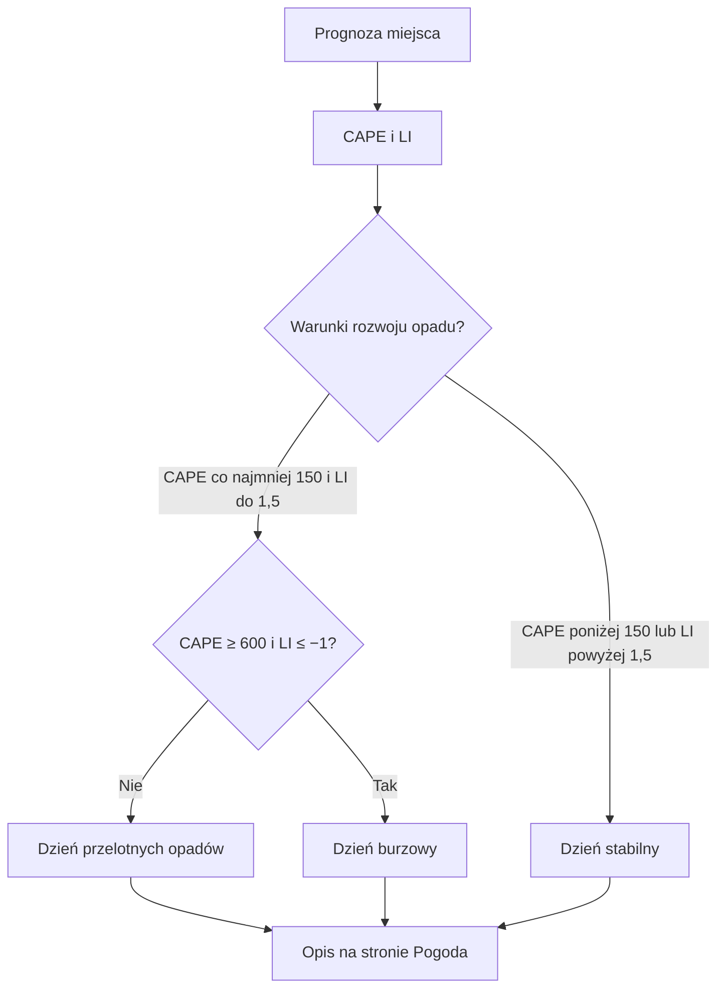

# Charakter dnia

## Co to jest

Charakter dnia to krótki opis, czy pogoda ma być stabilna, przelotna czy burzowa. Pomaga zdecydować, czy wystarczy sprawdzać radar przed wyjściem, czy trzeba liczyć się z nagłym rozwojem chmur.

## Po co

Jeśli opis mówi „dzień przelotnych opadów”, czysty radar rano nie daje pewności suchej jazdy. Jeśli dzień jest stabilny, ryzyko gwałtownych zmian jest mniejsze, ale nadal sprawdzaj prognozę dla planowanej godziny.

## Skąd dane

Opis bazuje na prognozie punktowej dla wskazanej lokalizacji. Dla rozwoju opadów konwekcyjnych uwzględnia energię chwiejności atmosfery ([CAPE](../slowniczek.md#cape)) i wskaźnik stabilności ([LI](../slowniczek.md#li)). To wskaźniki możliwości rozwoju chmur, a nie pomiar opadu przy rowerze.

## Jak liczone

1. Dla wybranego miejsca pobierane są godzinowe wartości CAPE i LI w godzinach 08–20. Każda data jest oceniana osobno.
2. Z godzin dnia wybierane jest największe CAPE i najmniejsze LI. Są to dwie osobne wartości skrajne; nie muszą pochodzić z tej samej godziny.
3. Jeśli największe CAPE wynosi co najmniej 600 J/kg, a najmniejsze LI nie przekracza −1,0, etykieta brzmi „burzowy”. W przeciwnym razie para progów 150 J/kg i 1,5 daje etykietę „przelotny”. Pozostałe dni są „stabilne”.
4. Osobna lista godzin do krótkiego okna używa łagodniejszych warunków: CAPE co najmniej 100 J/kg i LI nie większe niż 2. To okno nie zmienia etykiety dnia.

W dokumentacji projektu opisano przykład kalibracyjny z 14.10.2026: CAPE 210 J/kg i LI 0,3. Spełnia on próg przelotny, ale nie próg burzowy. Nie jest to odczyt z bazy, więc nie używam go jako przykładu z życia konkretnej prognozy. W krótkim odczycie bazy z 18.10.2026 nie znaleziono archiwum godzinowych par CAPE/LI do odtworzenia dnia.

Wzór

- Dzień burzowy: CAPE ≥ 600 i LI ≤ −1,0.
- Dzień przelotnych opadów: CAPE ≥ 150 i LI ≤ 1,5.
- W innym przypadku: pogoda stabilna.

Warto pamiętać, że wybrane skrajne wartości nie muszą wystąpić równocześnie. Dlatego etykieta opisuje sygnał z całego dnia, a nie konkretną godzinę burzy.

## Gdzie to widać

Charakter dnia jest częścią informacji o wybranym miejscu na stronie Pogoda. Zrzut głównej strony jest na [przeglądzie Pogody](index.md). W tej samej karcie zobaczysz bieżącą temperaturę i opis warunków; charakter dnia odnosi się do prognozy na dalsze godziny/dni, a nie do bieżącego radaru.

## Jak czytać

„Stabilna pogoda” nie oznacza gwarancji braku deszczu. „Przelotne opady” oznaczają możliwość opadów rozwijających się lokalnie. Przy „Dniu burzowym” kod ostrzega, że czysty radar nie wyklucza rozwoju chmur w ciągu 20–40 minut; w opisie wymienione są też ulewy, grad i porywy.

## Ograniczenia i pułapki

Klasyfikacja zależy od modelu i lokalizacji. Jest skrótem prognozy, a nie ostrzeżeniem służb meteorologicznych. Brak archiwalnej próbki CAPE/LI w bazie ogranicza możliwość pokazania historycznego wyniku dla konkretnego dnia.

## Wpływa na

Opis dnia na stronie Pogoda i decyzję o częstszym sprawdzaniu radaru.

## Zależy od

Prognozy punktowej oraz wskaźników rozwoju opadów konwekcyjnych.

## Powiązane hasła

- [Prognoza](prognoza.md)
- [Radar](radar.md)
- [Ostrzeżenia](ostrzezenia.md)
- [Slowniczek](../slowniczek.md)

## Zrodla

- `/opt/qbot/app/qbot_pogoda.py` — `charakter_dni`, `CH_PRZELOT`.
- `/opt/qbot/app/web_public/pogoda.html` — karta „Teraz i dziś”.
- `/opt/qbot/app/docs/POGODA_SILNIK.md` — opis kalibracji z 14.10.2026.
