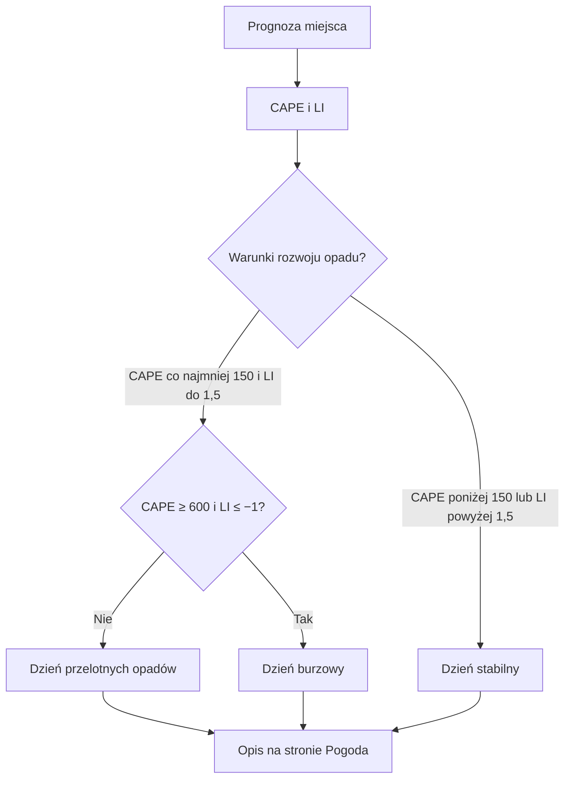

# Charakter dnia

## Co to jest

Charakter dnia to krótki opis, czy pogoda ma być stabilna, przelotna czy burzowa. Pomaga zdecydować, czy wystarczy sprawdzać radar przed wyjściem, czy trzeba liczyć się z nagłym rozwojem chmur.

## Po co

Jeśli opis mówi „dzień przelotnych opadów”, czysty radar rano nie daje pewności suchej jazdy. Jeśli dzień jest stabilny, ryzyko gwałtownych zmian jest mniejsze, ale nadal sprawdzaj prognozę dla planowanej godziny.

## Skąd dane

Opis bazuje na prognozie punktowej dla wskazanej lokalizacji. Dla rozwoju opadów konwekcyjnych uwzględnia energię chwiejności atmosfery ([CAPE](../slowniczek.md#cape)) i wskaźnik stabilności ([LI](../slowniczek.md#li)). To wskaźniki możliwości rozwoju chmur, a nie pomiar opadu przy rowerze.

## Jak liczone

1. Kod pobiera prognozę dla kilku kolejnych dni w wybranym miejscu.
2. Sprawdza warunki rozwoju opadów. Próg przelotnych opadów to CAPE co najmniej 150 oraz LI nie większe niż 1,5.
3. Dzień burzowy jest rozpoznawany przy CAPE co najmniej 600 i LI nie większym niż −1,0. W pozostałych przypadkach kod wybiera dzień przelotny albo stabilny.
4. Dla dnia niestabilnego wskazuje zakres godzin, w których wykryto warunki. Opis uprzedza, że chmury mogą rozwinąć się lokalnie w 20–40 minut.

Próg przelotny i burzowy można odczytać bezpośrednio z kodu. Nie znalazłem zapisanego historycznego rekordu z wartościami tych wskaźników, więc nie podaję przykładu liczbowego z bazy.

Wzór

- Dzień burzowy: CAPE ≥ 600 i LI ≤ −1,0.
- Dzień przelotnych opadów: CAPE ≥ 150 i LI ≤ 1,5.
- W innym przypadku: pogoda stabilna.

4. Dla dnia niestabilnego opis może dodać przybliżone okno, w którym warunki są najbardziej niekorzystne.

> DO SPRAWDZENIA: Brak historycznego rekordu z wartościami CAPE i LI, który pozwoliłby odtworzyć klasyfikację konkretnego dnia.

## Gdzie to widać

Charakter dnia jest częścią informacji o wybranym miejscu na stronie Pogoda. Zrzut głównej strony jest na [przeglądzie Pogody](index.md). W tej samej karcie zobaczysz bieżącą temperaturę i opis warunków; charakter dnia odnosi się do prognozy na dalsze godziny/dni, a nie do bieżącego radaru.

## Jak czytać

„Stabilna pogoda” nie oznacza gwarancji braku deszczu. „Przelotne opady” oznaczają możliwość opadów rozwijających się lokalnie. Przy „Dniu burzowym” kod ostrzega, że czysty radar nie wyklucza rozwoju chmur w ciągu 20–40 minut; w opisie wymienione są też ulewy, grad i porywy.

## Ograniczenia i pułapki

Klasyfikacja zależy od modelu i lokalizacji. Jest skrótem prognozy, a nie ostrzeżeniem służb meteorologicznych. Pełnych progów burzowych nie potwierdziłem.

## Wpływa na

Opis dnia na stronie Pogoda i decyzję o częstszym sprawdzaniu radaru.

## Zależy od

Prognozy punktowej oraz wskaźników rozwoju opadów konwekcyjnych.

## Powiązane hasła

- [Prognoza](prognoza.md)
- [Radar](radar.md)
- [Ostrzeżenia](ostrzezenia.md)
- [Slowniczek](../slowniczek.md)

## Zrodla

- `/opt/qbot/app/qbot_pogoda.py` — `charakter_dni`, `CH_PRZELOT`.
- `/opt/qbot/app/web_public/pogoda.html` — karta „Teraz i dziś”.
