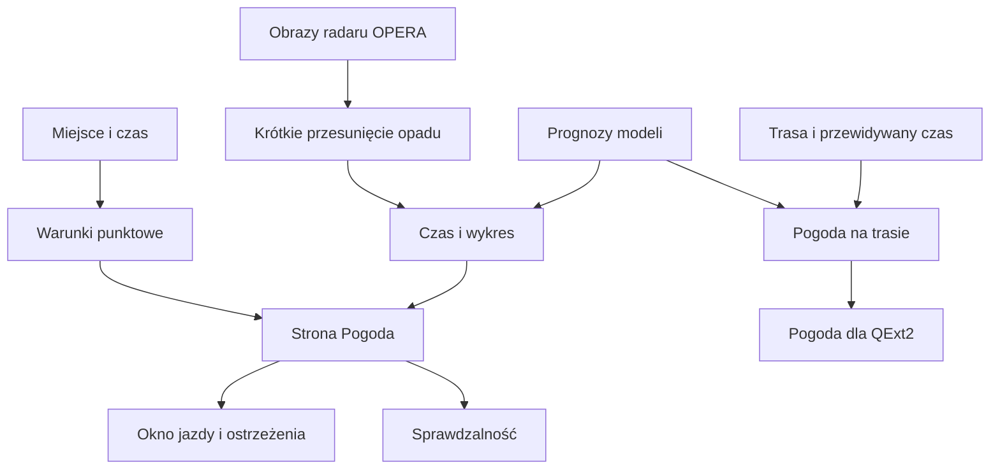
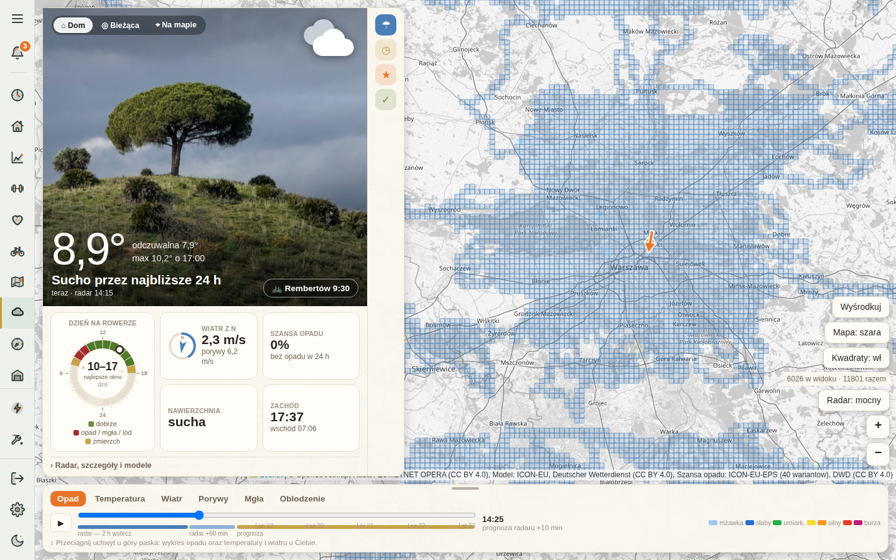
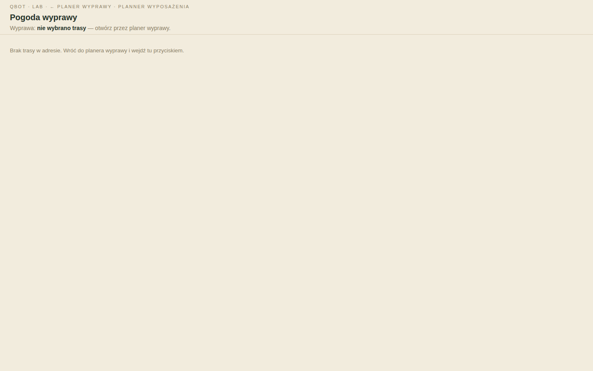

# Pogoda

## Co to jest

To dział, który łączy aktualny obraz radaru, prognozę dla wybranego miejsca oraz prognozę dopasowaną do zaplanowanej trasy. Pokazuje też, skąd pochodzi prognoza i jak wypadała w porównaniu z późniejszymi obserwacjami.

## Po co

Otwórz go, gdy chcesz wybrać porę jazdy, sprawdzić deszcz w okolicy albo ocenić wiatr i temperaturę na konkretnej trasie. Ekran nie zastępuje obserwacji pogody w terenie: radar pokazuje opad, który już został zarejestrowany, a prognoza opisuje możliwy przebieg warunków.

## Skąd dane

Prognozy pochodzą z Open-Meteo. Wybór modelu może różnić się między temperaturą, wiatrem i opadem. Krótki obraz opadu pochodzi z radaru [OPERA](../slowniczek.md#opera) (europejskiego kompozytu radarowego). Pomiary IMGW służą do oceny wcześniejszych prognoz. Pogoda na zapisanej trasie uwzględnia jej przebieg i przewidywany czas przejazdu.

## Jak liczone

1. Wybierz miejsce na mapie albo skorzystaj z ustawionego miejsca domowego. Punktowe warunki pobierają między innymi temperaturę, wiatr, opad i porywy.
2. Oś czasu łączy historię radaru, krótką prognozę przesunięcia obrazu i dalszą prognozę modelową. Wykres poniżej mapy pozwala przełączać opad, temperaturę, wiatr, porywy i mgłę.
3. Przy planowanej trasie pogoda jest przypisywana do przewidywanej godziny przejazdu przez kolejne odcinki.
4. Osobne widoki oceniają pogodę na dany dzień, podpowiadają okno startu oraz porównują stare prognozy z obserwacjami.

Przykład z bazy: 18.10.2026 o 14:40 w próbie oceny radaru dla wyprzedzenia 30 minut odnotowano 0 trafień, 0 fałszywych alarmów, 2 przeoczone opady i 958 poprawnych wskazań braku opadu. To jedna próbka z jednego czasu; nie jest oceną typowej skuteczności. Wyjaśnienie: [sprawdzalność prognoz](sprawdzalnosc.md).

## Gdzie to widać

| Co widzisz na ekranie | Gdzie szukać wyjaśnienia |
|---|---|
| Temperatura, temperatura odczuwalna i opis dnia | [Warunki punktowe](warunki-punktowe.md), [charakter dnia](charakter-dnia.md) |
| Tarcza „dzień na rowerze” | [Okno jazdy](okno-jazdy.md) |
| Wiatr z kierunkiem i porywami | [Wiatr](wiatr.md) |
| Szansa opadu | [Prognoza](prognoza.md), [sprawdzalność](sprawdzalnosc.md) |
| Nawierzchnia i wschód/zachód słońca | [Warunki punktowe](warunki-punktowe.md) |
| Mapa i niebieska siatka kwadratów | [Mapa modeli](mapa-modeli.md), [kwadraty mapy](../trasy/kwadraty-mapy.md) |
| „Radar, szczegóły i modele” | [Radar](radar.md), [mapa modeli](mapa-modeli.md) |
| „Wysokość”, „Mapa”, „Kwadraty” | [Profil trasy](../trasy/profil-trasy.md), [kwadraty mapy](../trasy/kwadraty-mapy.md) |
| Dolne zakładki: Opad, Temperatura, Wiatr, Porywy, Mgła, Oblodzenie | [Radar](radar.md), [wiatr](wiatr.md), [warunki punktowe](warunki-punktowe.md) |
| Panel „Gdzie w weekend” | [Gdzie w weekend](weekend.md) |
| Pogoda wyprawy bez wybranej trasy | [Pogoda na trasie](pogoda-na-trasie.md) |

Przycisk odtwarzania i suwak zmieniają czas pokazywany na mapie i wykresie. Legenda objaśnia aktualnie wybraną warstwę.

Poniższy zrzut pokazuje stronę Pogoda: po lewej kartę warunków bieżących i kafelki, po prawej mapę z obszarem prognozy, na dole zakładki wykresu. Na mapie są kontrolki wyboru miejsca, rodzaju mapy i widocznych pól. Przyciski „Radar, szczegóły i modele” oraz „Wysokość”, „Mapa” i „Kwadraty” odsłaniają dodatkowe widoki. Przy dolnym wykresie wybiera się Opad, Temperatura, Wiatr, Porywy, Mgła albo Oblodzenie.

Na tym konkretnym zrzucie karta pokazuje 8,9°C, odczuwalne 7,9°C i maksimum 10,2°C o 17:00; opis mówi „Sucho przez najbliższe 24 h”. Kafelek wiatru pokazuje 2,3 m/s i porywy 6,2 m/s, szansa opadu wynosi 0%, nawierzchnia jest opisana jako sucha, a zachód słońca jako 17:37. Tarcza rowerowa wskazuje 10–17. To wartości widoczne na obrazie; nie są przykładem odczytu z bazy ani aktualną prognozą. Na mapie licznik kwadratów pokazuje 6026 w widoku i 11801 razem — to licznik mapy, nie pomiar pogody. Oś wykresu pokazuje 14:25 i prognozę radaru +10 minut.

Na zrzucie z Pogodą wyprawy nie ma wybranej trasy. Strona mówi wprost, że brak trasy w adresie, i odsyła do planera. To stan pusty, a nie błąd prognozy.

## Jak czytać

- Liczba przy temperaturze to warunki dla wskazanego miejsca i godziny. „Odczuwalna” uwzględnia więcej niż samą temperaturę powietrza.
- Wiatr na stronie jest podawany w m/s. Prędkość ruchu plamy opadu na radarze jest opisana w km/h i nie jest prędkością wiatru.
- Szansa opadu opisuje prawdopodobieństwo według prognozy zespołowej. Nie oznacza, że w każdym punkcie wskazanego obszaru będzie padać.
- Dalsze godziny i dni są prognozą. Przy każdej decyzji patrz na czas aktualizacji, horyzont i liczbę przypadków w ocenie sprawdzalności.

## Decyzje i historia

Kod jest aktualniejszy niż datowany na 01.07.2026 opis silnika meteo: dziś ten sam silnik trasowy jest wywoływany także dla QExt2. Starszy opis radaru nie obejmuje całego bieżącego układu strony. Szczegóły i zakres rozjazdu są w hasłach niżej.

## Ograniczenia i pułapki

Radar nie wykryje opadu, który dopiero powstanie. Przesunięcie ostatniego obrazu zakłada, że widoczne opady będą nadal poruszać się podobnie. Dalsza część osi korzysta z modeli, a nie z radaru. Brak trasy oznacza, że nie ma danych do prognozy wyprawy.

## Wpływa na

Okno jazdy, alerty o deszczu, plan Trenera, analizę trasy, rekomendację ubioru i pogodę wysyłaną do QExt2.

## Zależy od

Prognoz Open-Meteo, obrazów OPERA, pomiarów IMGW do ocen, lokalizacji oraz — przy trasie — geometrii i przewidywanego czasu przejazdu.

## Powiązane hasła
- [Ostrzeżenia pogodowe](ostrzezenia.md)
- [Dobór ubioru](ubior.md)

- [Prognoza](prognoza.md)
- [Radar](radar.md)
- [Wiatr](wiatr.md)
- [Okno jazdy](okno-jazdy.md)
- [Pogoda na trasie](pogoda-na-trasie.md)
- [Pogoda w QExt2](qext2.md)
- [Slowniczek](../slowniczek.md)

## Zrodla

- `/opt/qbot/app/qbot_pogoda.py` — warunki punktowe i charakter dnia.
- `/opt/qbot/app/qbot_radar.py` — obrazy, ruch opadu i krótkie przesunięcie.
- `/opt/qbot/app/qbot_web.py` — strona i punkty API Pogody.
- `/opt/qbot/app/web_public/pogoda.html` — aktualny układ strony i wykresu.
- `/opt/qbot/app/web_public/pogoda-wyprawy.html` — strona pogody wyprawy.
- `qbot_v2.pogoda_radar_verif` — odczyt 18.10.2026 14:40, wyprzedzenie 30 minut.
- `/opt/qbot/app/docs/POGODA_SILNIK.md`, `/opt/qbot/app/docs/POGODA_RADAR.md` — historia i opis techniczny.
