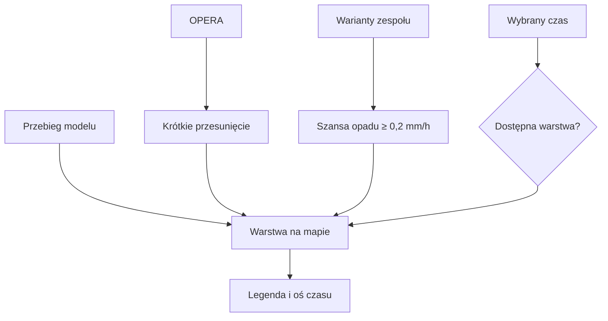

# Mapa modeli i zespołu

## Co to jest

Mapa modeli pokazuje prognozowane obszary opadu na mapie dla wybranego czasu. Dla krótkiego horyzontu można zobaczyć radar, jego przesunięcie oraz dalszą prognozę modelową. Przy opadzie może pojawić się także mapa szansy z wielu wariantów prognozy.

## Po co

Użyj mapy, gdy chcesz sprawdzić, czy opad jest lokalny, czy obejmuje większy obszar. Zespół modeli pomaga zobaczyć rozrzut możliwych scenariuszy; nie rozstrzyga, który wariant na pewno się wydarzy.

## Skąd dane

Mapa modeli pobiera przebieg prognozy z serwisu meteorologicznego. Warstwa zespołowa jest wyliczana z wariantów [ICON-EU-EPS](../slowniczek.md#icon-eu-eps). Radar pochodzi z [OPERA](../slowniczek.md#opera). Bieżąca strona opisuje na mapie model, przebieg prognozy i — gdy dostępna — szansę opadu.

## Jak liczone

1. Serwer sprawdza najnowszy dostępny przebieg modelu i buduje warstwy mapy.
2. Wybierz czas na osi. Oś opadu przechodzi od obrazów radaru przez krótkie przesunięcie obrazu do prognozy modelowej.
3. Warstwa prognozy mapowej wykorzystuje ICON-EU, DWD, o siatce około 7 km. Oś tej mapy sięga do 120 godzin. Osobna warstwa szansy opadu wykorzystuje 40 wariantów ICON-EU-EPS i jest dostępna do 60 godzin.
4. Warstwa zespołu pokazuje odsetek wariantów przekraczających próg opadu 0,2 [mm/h](../slowniczek.md#mmh). Przykładowo 20 z 40 wariantów to 50%.
5. Deterministyczna mapa opadu może być korygowana względem radaru; niepewność warstwy zespołowej jest pokazywana jako prawdopodobieństwo, bez takiego przygaszania.

Przykład z bazy: w ocenie radaru z 18.10.2026 20:30 dla prognozy +120 minut zapisano 1 przeoczony przypadek opadu i 959 poprawnych wskazań braku opadu. To nie jest „trafność modelu zespołowego”, tylko ocena krótkiego przesuwania radaru w jednym kroku czasu.

## Gdzie to widać

Na mapie głównej przełącz warstwę lub rozwiń szczegóły i modele. Legenda pojawia się w dolnym prawym obszarze mapy. Oś czasu jest u dołu ekranu. Zrzut pokazuje siatkę niebieskich komórek na mapie: to widok kwadratów, a nie mapa szansy opadu.

## Jak czytać

Legenda mapy opadu podaje progi 0,1, 0,5, 1, 2,5, 5, 10 i 20 mm/h. Temperatura ma progi od −20°C do 25°C, wiatr i porywy od 3 do 16 m/s. Kolor przechodzi płynnie pomiędzy punktami skali; nie każdy kolor oznacza osobną klasę o ostrym brzegu. Lód ma trzy opisy: niskie, możliwe i wysokie; mgła ma poziom „rosa/mgła możliwa” oraz „mgła prawdopodobna”.

„Szansa opadu” oznacza udział wariantów zespołu przekraczających próg, a nie udział czasu, w którym będzie padać. Jeśli mapa modelu jest opisana jako rozbieżna z radarem, traktuj ją ostrożniej w najbliższej godzinie.

## Ograniczenia i pułapki

Brak warstwy może wynikać z niedostępnego przebiegu lub poza horyzontem zespołu. Kwadraty na ekranie głównym mają osobny cel i nie należy czytać ich jako intensywności opadu. Nie udało się w tej rundzie odczytać legendy wszystkich skal ani potwierdzić każdego dostępnego modelu.

Odczyt metadanych mapy w tej rundzie nie potwierdził aktualnie wybranego przebiegu ani legendy widocznej na żywo. Zakresy progów są odczytane z palet kodu; nie dowodzą, że każda warstwa jest dostępna w danym momencie.

## Wpływa na

Interpretację opadu w punkcie, Okno jazdy i ostrzeżenia o deszczu.

## Zależy od

Aktualnego przebiegu modelu, wariantów zespołu i dostępnych obrazów radaru.

## Powiązane hasła

- [Radar](radar.md)
- [Prognoza](prognoza.md)
- [Sprawdzalność prognoz](sprawdzalnosc.md)
- [Slowniczek](../slowniczek.md)

## Zrodla

- `/opt/qbot/app/qbot_pogoda_map.py` — `latest_run`, `build`, `eps_build`.
- `/opt/qbot/app/web_public/pogoda.html` — wybór warstw, legenda, oś czasu.
- `/opt/qbot/app/qbot_web.py` — `api_pogoda_mapa_meta`, `api_pogoda_mapa_png`.
- `qbot_v2.pogoda_radar_verif` — odczyt 18.10.2026 20:30.
