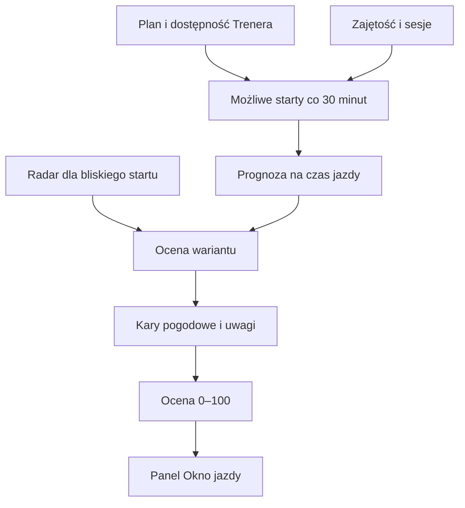

# Okno jazdy

## Co to jest

Okno jazdy porównuje pogodę dla możliwych godzin startu i pokazuje ocenę warunków na jazdę. Można analizować wybraną jazdę z kalendarza albo podać dzień, godzinę i czas samodzielnie.

## Po co

Pomaga zdecydować, czy warto przesunąć start, biorąc pod uwagę deszcz, wiatr, zimno, upał, śliskość i zmrok.

## Skąd dane

Widok bierze dostępność i plan jazdy z Trenera, warunki dla punktu, szansę opadu z zespołu [ICON-EU-EPS](../slowniczek.md#icon-eu-eps) oraz — dla najbliższej godziny — [krótką prognozę radarową](radar.md). Można porównać kilka kolejnych dni i zmienić czas lub długość jazdy.

## Jak liczone

1. Tworzy warianty startu co 30 minut w dostępnych oknach rowerowych Trenera.
2. Usuwa warianty kolidujące z zajętością i innymi sesjami.
3. Dla każdego wariantu sprawdza prognozę na czas jazdy; dla najbliższej godziny uwzględnia radar.
4. Nakłada kary za opad i jego szansę, porywy, oblodzenie, mgłę, mokrą nawierzchnię, zmrok oraz odczuwalny chłód lub upał.
5. Pokazuje ocenę od 0 do 100 i tekstowe uwagi.

Ocena zaczyna się od 100 punktów i spada o 10 punktów za każdą jednostkę naliczonej kary. Wynik nie wychodzi poza zakres 0–100. Progi planowania pochodzą z ustawień Trenera. Osobna ocena komfortu służy do porównania wygody i nie jest tym samym co progi planowania.

## Gdzie to widać

Strona Pogoda, panel „Okno jazdy — przesunąć czy moknąć?”. Można zmienić dzień, start i czas. Widoczny jest też tryb czasu albo dystansu z przyjętą średnią prędkością.

## Jak czytać

Wyższa liczba oznacza mniej naliczonych kar w modelu, nie gwarancję dobrej jazdy. Porównuj warianty dla tego samego czasu i dystansu. Kolor wyniku w obecnym interfejsie: od 80 zielony, od 50 akcentowy, niżej czerwony.

## Decyzje i historia

Starszy opis okna jazdy podaje krok 30 minut. Bieżący panel pozwala również wskazać konkretny plan. Oceny komfortu i planowania mają osobne kary oraz progi.

## Ograniczenia i pułapki

Wynik zależy od prognozy dla jednego punktu (dom lub pozycja wskazana przez użytkownika), nie od pełnej trasy. Radar jest przydatny tylko dla krótkiego horyzontu. Ocena nie zastępuje ostrzeżenia silnika trasy ani obserwacji warunków.

## Wpływa na

Porównanie godzin startu w dziale Pogoda; nie zmienia samoczynnie planu treningowego.

## Zależy od

Dostępności Trenera, danych prognozy, danych zespołu, radaru oraz podanego czasu trwania lub dystansu jazdy.

## Powiązane hasła

- [Prognoza](prognoza.md)
- [Radar](radar.md)
- [Sprawdzalność prognoz](sprawdzalnosc.md)
- [Trener](../trener/index.md)

## Zrodla

- `/opt/qbot/app/qbot_pogoda_okno.py` — `STEP_MIN`, generowanie i ocena startów.
- `/opt/qbot/app/qbot_pogoda.py` — warunki punktowe i `kara_komfort`.
- `/opt/qbot/web/public/pogoda.html` — panel Okna jazdy, kolory i sterowanie.
- `/opt/qbot/app/docs/POGODA_OKNO.md` — założenia i dane wejściowe.
