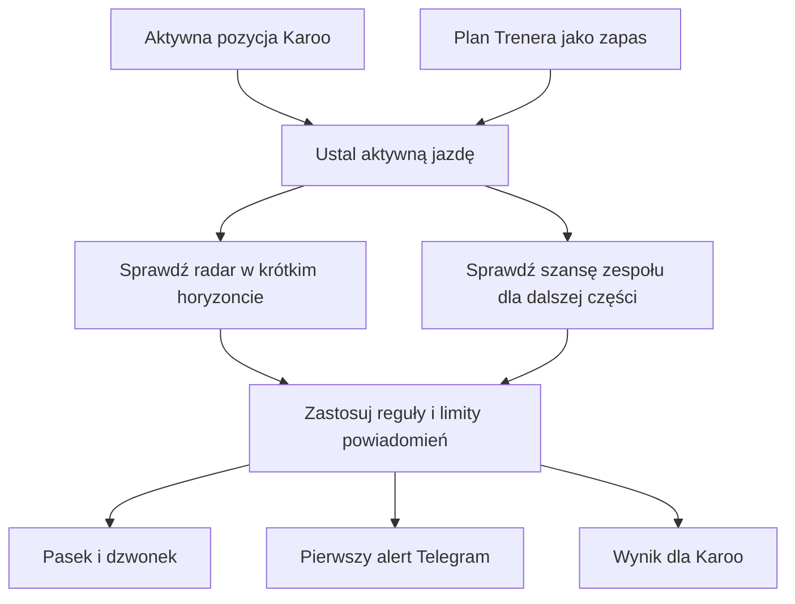

# Ostrzeżenie o deszczu podczas jazdy

## Co to jest

QBOT sprawdza, czy deszcz radarowy lub prognozowany może spotkać planowaną albo trwającą jazdę. Ostrzeżenie pokazuje się na stronie, a pierwsze ostrzeżenie dla jazdy może zostać wysłane przez Telegram.

## Po co

Pomaga zauważyć opad przed wyjazdem lub podczas jazdy, także gdy rzeczywisty start różni się od planu.

## Skąd dane

Podczas jazdy Karoo/QExt2 przekazuje sygnał bieżącej pozycji. Kod używa ostatniej pozycji do sprawdzenia radaru. Gdy aktywnego sygnału Karoo nie ma, automat może wykorzystać plan rowerowy Trenera. Dla dalszego horyzontu planu używana jest szansa opadu z zespołu ICON-EU-EPS.

## Jak liczone

1. Aktywna jazda z Karoo ma pierwszeństwo. Jeśli jej nie ma, kod sprawdza rowerowy plan Trenera od 60 minut przed startem do końca jazdy.
2. Dla jazdy z Karoo sprawdzana jest ostatnia zgłoszona pozycja. Otwarta jazda bez znanego końca korzysta tylko z radaru.
3. Dla obu rodzajów jazdy radar obejmuje do 60 minut naprzód; punkt opadu jest uznawany przy udziale co najmniej połowy badanego obszaru. Dalsza część planu Trenera może użyć zespołu ICON-EU-EPS; powiadomienie prognozowe wymaga szansy co najmniej 40%.
4. Radar rozróżnia siłę: poniżej 1 mm/h słaby, od 1 do poniżej 4 umiarkowany, od 4 do poniżej 10 silny, od 10 mm/h ulewa.
5. Dzwonek może pokazać najwyżej trzy ostrzeżenia na jazdę; kolejne radarowe dotyczą nowego epizodu lub przesunięcia czasu o ponad 15 minut. Telegram dostaje tylko pierwsze ostrzeżenie w danej jeździe.

Dokument źródłowy podaje, że sygnał jazdy przychodzi około co 5 minut, a brak sygnału przez 15 minut zamyka jazdę. Pętla sprawdzająca ostrzeżenia działa po otrzymaniu nowej klatki radarowej, więc wynik może być opóźniony do około 5 minut.

## Gdzie to widać

Strona Pogoda ma pasek aktywnego ostrzeżenia. Powiadomienie może mieć źródło „Radar: deszcz w czasie jazdy”. Karoo może otrzymać sygnał o deszczu w odpowiedzi na kontrolę gotowości do jazdy.

Odczyt bazy 18.10.2026 zwrócił zero zapisanych alertów. Nie ma więc przykładu konkretnej wysłanej wiadomości z tej daty. Reguły są sprawdzone w kodzie, ale brak wierszy nie potwierdza rzeczywistego doręczenia Telegrama.

## Jak czytać

Ostrzeżenie radarowe podaje przewidywany czas, intensywność oraz przybliżony czas trwania opadu. To prognoza, która może się zmienić wraz z kolejnymi klatkami radaru. Telegram ma ograniczenie do pierwszego ostrzeżenia w danej jeździe; kolejne aktualizacje mogą być widoczne w innych kanałach.

## Decyzje i historia

Reguły alertu ograniczają się do deszczu i obsługują jazdę z Karoo oraz plan Trenera. Bieżąca pozycja z Karoo ma pierwszeństwo, aby alert nie bazował wyłącznie na zaplanowanej godzinie.

## Ograniczenia i pułapki

Jeśli radar później nie potwierdzi opadu, ostatnia zapowiedź może pozostać do przewidywanego końca epizodu. Jazda z Karoo bez znanego końca korzysta tylko z radaru. Brak pozycji albo nowych obrazów radaru może uniemożliwić obliczenie alertu. Sam zapis próby w bazie nie potwierdza, że telefon wyświetlił powiadomienie.

## Wpływa na

Powiadomienie na stronie Pogoda, dzwonek powiadomień, Telegram i odpowiedź dla QExt2/Karoo.

## Zależy od

Aktywnego sygnału Karoo albo planu Trenera, danych radaru OPERA oraz — dla dalszej prognozy — zespołu ICON-EU-EPS.

## Powiązane hasła

- [Radar](radar.md)
- [Prognoza](prognoza.md)
- [Pogoda w QExt2](qext2.md)
- [Trener](../trener/index.md)

## Zrodla

- `/opt/qbot/app/qbot_pogoda_alert.py` — `check`, `decide`, `current`.
- `/opt/qbot/app/qbot_api.py` — `/ride-readiness`, obsługa QExt2.
- `/opt/qbot/app/qbot_web.py` — pętla radaru i endpoint ostrzeżenia.
- `/opt/qbot/app/docs/POGODA_OSTRZEZENIE.md` — zachowanie i ograniczenia alertów.
- `qbot_v2.pogoda_alert` — tabela historii alertów; brak wierszy w odczycie z 18.10.2026.
