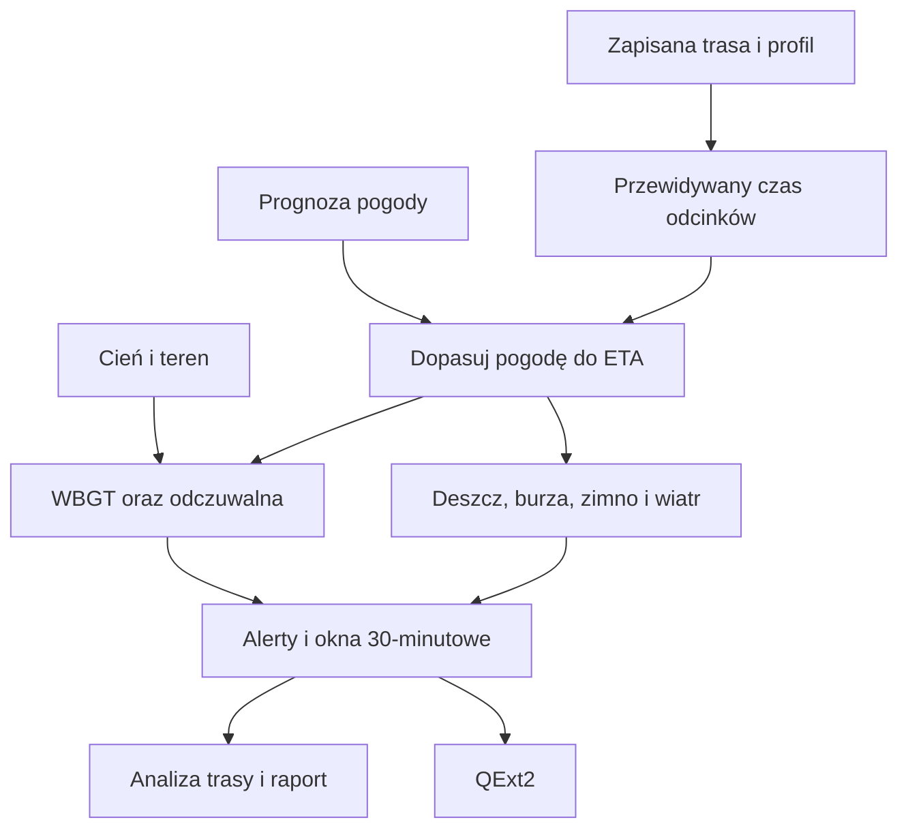

# Pogoda na trasie

## Co to jest

Pogoda na trasie przypisuje warunki do kolejnych odcinków zapisanej trasy i przewidywanych godzin przejazdu. Ten sam silnik jest wywoływany przez analizę i raport trasy oraz pogodę wysyłaną do QExt2.

## Po co

Pozwala zauważyć, gdzie i kiedy mogą wystąpić deszcz, burza, upał lub zimno, a także jak wiatr i mgła zmieniają się wzdłuż przejazdu.

## Skąd dane

Silnik korzysta z geometrii trasy podzielonej na odcinki, przewidywanego czasu przejazdu, profilu wysokości, nachylenia, cienia i danych Open-Meteo. W Polsce dla wybranych parametrów korzysta z wyników sprawdzalności; szansę opadu może brać z zespołu ICON-EU-EPS. Wynik zawiera dane segmentowe, alerty i agregację co 30 minut.

## Jak liczone

1. Silnik pobiera profil trasy i wyznacza odcinki oraz ich przewidywany czas przejazdu.
2. Dla punktów wzdłuż trasy pobiera prognozę i dopasowuje ją do przewidywanego czasu dotarcia ([ETA](../slowniczek.md#model-czasu-przejazdu)).
3. Oblicza odczuwalną temperaturę, [UTCI](../slowniczek.md#utci) i [WBGT](../slowniczek.md#wbgt); dla WBGT uwzględnia promieniowanie i warunki cienia.
4. Ocenia opad, ryzyko burzy, zimno, porywy i składowe wiatru względem kierunku jazdy.
5. Łączy ciągłe odcinki ryzyka w alerty i zestawia warunki w oknach 30-minutowych.

Nie znaleziono zachowanego przykładu segmentowej prognozy, który można powiązać z datą i trasą. Pamięć podręczna Plannera zawiera 33 wiersze, ale żaden nie ma listy pogody segmentów; zrzut Pogody wyprawy pokazuje stan bez wybranej trasy.

## Gdzie to widać

W analizie trasy pogoda jest jedną z sekcji raportu. Na stronie Pogoda można otworzyć prognozę dla zaplanowanej jazdy. QExt2 otrzymuje skrócone punkty prognozy dla dalszej części trasy.

## Jak czytać

Alert opisuje warunki prognozowane na konkretnym fragmencie i czasie. Poziomy „uwaga”, „alarm” i „nie jedź” pochodzą z reguł silnika; nie sterują mocą. QBOT podaje informacje i ostrzeżenia, a rozpiska mocy należy do QExt2/Karoo.

## Decyzje i historia

Opis architektury z 01.07.2026 twierdzi, że silnik nie jest wpięty w ścieżki użytkowe. Kod z 18.10.2026 przeczy temu ograniczeniu: silnik jest używany przez stronę i połączenie z QExt2. Nie jest to równoznaczne z udostępnieniem go jako narzędzia rozmowy Alberta.

## Ograniczenia i pułapki

ETA zależy od modelu czasu trasy. Prognoza pozostaje prognozą, a nie pomiarem w terenie. Dalsze horyzonty mają większą niepewność. Warto uwzględnić listę zastrzeżeń zwracaną przez silnik.

## Wpływa na

Raport i analizę trasy, panel pogody zaplanowanej jazdy oraz pogodę przekazywaną QExt2.

## Zależy od

Geometrii i profilu trasy, estymaty ETA, prognozy Open-Meteo, danych o cieniu i terenie oraz reguł silnika meteo.

## Powiązane hasła

- [Prognoza](prognoza.md)
- [Wiatr](wiatr.md)
- [Pogoda w QExt2](qext2.md)
- [Analiza trasy](../trasy/analiza-trasy.md)

## Zrodla

- `/opt/qbot/app/qbot3/routes/route_meteo_engine.py` — `run_meteo_engine`, reguły ryzyk.
- `/opt/qbot/app/qbot3/routes/route_weather_models.py` — zestaw modeli i ich zasięg.
- `/opt/qbot/app/qbot_web.py` — budowa raportu i `/api/report/plan`.
- `/opt/qbot/app/qbot_api.py` — `_qext2_weather_route`.
- `/opt/qbot/app/docs/POGODA_SILNIK.md` — historia wspólnego silnika.
- `/opt/qbot/app/docs/METEO_ENGINE.md` — kontrakt z 01.07.2026, częściowo nieaktualny.
- `qbot_v2.planer_pogoda_cache` — kontrola obecności wyniku segmentowego, 18.10.2026.
