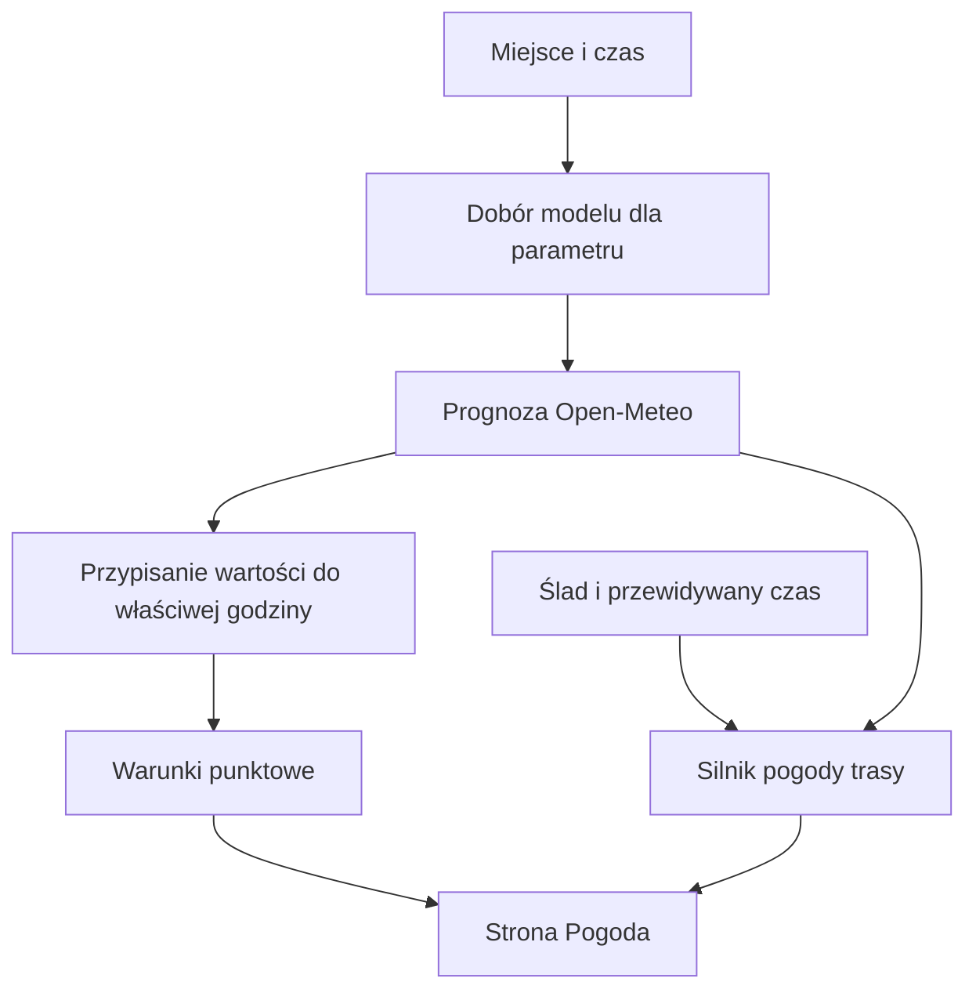

# Prognoza pogody

## Co to jest

Prognoza opisuje spodziewane warunki dla punktu i godzin albo dla odcinków zapisanej trasy. QBOT pobiera dane z Open-Meteo; wybór modelu zależy od funkcji i horyzontu.

## Po co

Pozwala porównać warunki w kolejnych godzinach i dniach, a na trasie przypisać pogodę do przewidywanej godziny przejazdu.

## Skąd dane

Zapytania używają czasu lokalnego Warszawy i prędkości wiatru w m/s. Prognoza dla punktu dobiera modele według wcześniejszej sprawdzalności osobno dla parametrów i horyzontu. Prognoza opadu korzysta z tego samego rodzaju doboru. Silnik trasy wybiera model bazowy, a dla Polski w krótkim horyzoncie może dobrać część parametrów według sprawdzalności oraz użyć zespołu [ICON-EU-EPS](../slowniczek.md#icon-eu-eps) do wyliczenia szansy opadu.

## Jak liczone

1. Moduł wybiera punkt lub punkty wzdłuż trasy.
2. Dla punktu pobiera potrzebne wielkości pogodowe. Odpowiedź jest przechowywana w pamięci podręcznej; domyślnie przez 10 minut.
3. Dla danego parametru może użyć innego modelu niż dla pozostałych. Dobór prognozy punktowej wynika z porównania z pomiarami [IMGW](../slowniczek.md#imgw).
4. Na trasie silnik dopasowuje pogodę do przewidywanego czasu przejazdu każdego odcinka ([ETA](../slowniczek.md#model-czasu-przejazdu)).
5. Opad, jego szansa i porywy mają specjalną obsługę godzin: znacznik w źródle może opisywać poprzednią godzinę, więc wartość jest przypisywana do właściwego przedziału.

Przykład z bazy: 18.10.2026 o 14:40 zapis sprawdzalności radaru dla prognozy wyprzedzonej o 30 minut miał 0 trafień, 0 fałszywych alarmów, 2 przeoczone opady i 958 poprawnych wskazań braku opadu. To pojedynczy zapis, a nie miara jakości prognozy ogółem; szczegóły są w [sprawdzalności](sprawdzalnosc.md).

## Gdzie to widać

Strona Pogoda pokazuje radar i prognozę dla wskazanego miejsca. Sekcja godzinowa obejmuje warunki, a dolny pasek może prezentować dalszy horyzont. Prognoza na trasie jest widoczna w analizie trasy oraz w panelu pogodowym dla zaplanowanej jazdy.

## Jak czytać

Wartość dotyczy wskazanego czasu i miejsca. Drobniejsza siatka modelu nie oznacza automatycznie większej pewności; ważny jest też zasięg modelu i jego sprawdzalność. Szansa opadu z zespołu opisuje odsetek wariantów, które przekraczają próg opadu, a nie pewność, że deszcz wystąpi dokładnie w punkcie.

## Decyzje i historia

Opis wspólnego pobierania prognoz i poprawki przypisywania danych do godzin jest starszy od bieżącego działania. Opis z 01.07.2026 przedstawia silnik jako osobny element raportu trasy. Bieżący kod wywołuje go także na stronie Pogoda, w Planerze i dla QExt2; starszy opis jest w tym zakresie nieaktualny.

## Ograniczenia i pułapki

Brak odpowiedzi modelu może dać błąd albo brak danych. Horyzont dalszy ma zwykle większą niepewność. Prognoza dla trasy nie jest pomiarem rzeczywistej pogody podczas jazdy. Część wartości w odpowiedzi Open-Meteo opisuje godzinę poprzedzającą znacznik; niewłaściwe przesunięcie o godzinę było już naprawiane w kilku modułach.

## Wpływa na

Okno jazdy, ostrzeżenia o deszczu, prognozę Trenera, pogodę na trasie, raport trasy i QExt2.

## Zależy od

Open-Meteo, wcześniejszego porównania modeli oraz — w zależności od funkcji — zespołu [ICON-EU-EPS](../slowniczek.md#icon-eu-eps) i silnika trasy.

## Powiązane hasła

- [Wiatr](wiatr.md)
- [Sprawdzalność prognoz](sprawdzalnosc.md)
- [Radar](radar.md)
- [Pogoda na trasie](pogoda-na-trasie.md)

## Zrodla

- `/opt/qbot/app/qbot_wx.py` — `forecast`, `ens_prob`, `get_url`.
- `/opt/qbot/app/qbot_pogoda.py` — `conditions_point`, `model_point`.
- `/opt/qbot/app/qbot_pogoda_verif.py` — `przydzial`.
- `/opt/qbot/app/qbot3/routes/route_meteo_engine.py` — `run_meteo_engine`.
- `/opt/qbot/app/docs/POGODA_SILNIK.md` — etapy wspólnego silnika.
- `/opt/qbot/app/docs/METEO_ENGINE.md` — kontrakt z 01.07.2026; częściowo nieaktualny względem bieżących wywołań.
- `qbot_v2.pogoda_radar_verif` — odczyt przykładu z bazy, 18.10.2026 14:40.
