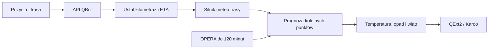

# Pogoda w QExt2

## Co to jest

QExt2 może otrzymać z QBota pogodę dla bieżącej trasy od aktualnego kilometra do jej końca. QBOT liczy ją tym samym silnikiem meteo trasowym, który jest używany w analizie trasy.

## Po co

Podczas jazdy pozwala pokazać prognozowane warunki na dalszych odcinkach bez czekania na oddzielne obliczenie po stronie urządzenia.

## Skąd dane

QBot rozpoznaje trasę przekazaną w trybie jazdy i wybiera kolejne punkty od bieżącego kilometra. Korzysta z prognozy Open-Meteo, przebiegu trasy i przewidywanego czasu dotarcia. Dla odcinków w najbliższych 120 minutach opad z modelu może zostać zastąpiony krótką prognozą przesunięcia ostatniego obrazu [OPERA](../slowniczek.md#opera).

## Jak liczone

1. QExt2 przekazuje nazwę lub identyfikator trasy oraz bieżący kilometr w trybie jazdy.
2. QBOT uruchamia silnik bazowo, aby oszacować czas dotarcia do aktualnego miejsca, a następnie liczy ponownie z dopasowaną godziną startu.
3. Z dalszej części trasy wybiera najwyżej 250 punktów, z kilometrem i minutami do przejazdu.
4. Do punktów dodaje odczuwalną temperaturę, opad, jego prawdopodobieństwo, wiatr czołowy/tylny i porywy.
5. Dla punktów do 120 minut może użyć radaru zamiast prognozy opadu. Wynik jest buforowany przez 10 minut; automat odświeżający tryb jazdy sprawdza stan co minutę i odświeża pogodę co 15 minut.

W podsumowaniu jazdy z 18.10.2026 zapisano 8743 próbki kontroli wiatru, medianę 2,4 m/s i 11,4% czasu pod wiatr. To dane z odbytej jazdy, nie przykładowa odpowiedź bieżącej prognozy QExt2.

## Gdzie to widać

Dane trafiają do odpowiedzi pogodowej API QBot dla wybranej trasy. Dostarczone zrzuty wiki pokazują stronę Pogoda oraz pusty widok Pogody wyprawy bez wybranej trasy; nie pokazują ekranu urządzenia QExt2. Nie opisuję więc wyglądu poszczególnych pól na liczniku.

## Jak czytać

Składowa wzdłużna wiatru jest wyrażona w m/s: wartość dodatnia w odpowiedzi QBot oznacza wiatr czołowy, ujemna — wiatr w plecy. Porywy także są w m/s. Czas przy punkcie oznacza liczbę minut do przewidywanego przejazdu. Informacja o pochodzeniu opadu rozróżnia radar i prognozę modelową.

## Decyzje i historia

Wpis projektu z 16.10.2026 opisuje tryb jazdy, odświeżanie co 15 minut i użycie radaru do 120 minut; bieżąca implementacja potwierdza te elementy. Pogoda nie wyznacza rozpiski mocy: jej właścicielem pozostaje QExt2/Karoo.

## Ograniczenia i pułapki

Brak rozpoznanej trasy lub danych dla kolejnych odcinków zwraca odpowiedź o błędzie. Radar jest stosowany tylko, gdy dostępna jest świeża klatka; poza krótkim horyzontem pozostaje model. Odczyt opiera się na implementacji API — nie potwierdza aktualnego ekranu urządzenia ani tego, jak jego oprogramowanie zaokrągla i układa poszczególne pola. W 33 zapisach pamięci podręcznej Plannera nie znaleziono listy warunków dla kolejnych odcinków; dlatego nie udało się odtworzyć przykładowej odpowiedzi punkt po punkcie.

## Wpływa na

Prognozę dalszej części trasy przekazywaną z QBota do QExt2.

## Zależy od

Nazwy i przebiegu trasy, aktualnego kilometra, przewidywanego czasu przejazdu, prognozy i dostępności radaru.

## Powiązane hasła

- [Pogoda na trasie](pogoda-na-trasie.md)
- [Radar](radar.md)
- [Wiatr](wiatr.md)
- [QExt2](../qext2/index.md)

## Zrodla

- `/opt/qbot/app/qbot_api.py` — `_qext2_weather_route`, `_qext2_radar_overlay`, `_qext2_live_loop`.
- `/opt/qbot/app/qbot3/routes/route_meteo_engine.py` — prognoza segmentowa.
- `/opt/qbot/app/docs/CONTEXT.md` — wpis 16.10.2026 o pogodzie QExt2.
- `qbot_v2.fitmodel_qext2_ride` — podsumowanie wiatru dla jazdy 24766557671, 18.10.2026.
- `qbot_v2.planer_pogoda_cache` — 33 wpisy; żaden nie miał pola `per_segment` w krótkim odczycie 18.10.2026.
- `/opt/qbot/app/docs/POGODA_OSTRZEZENIE.md` — powiązany sygnał jazdy i ostrzeżenie radarowe.
