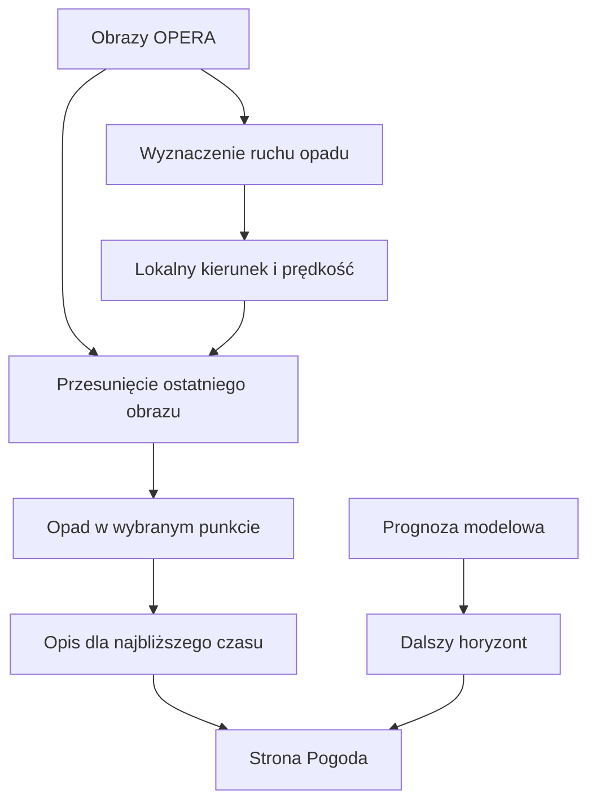

# Radar i krótka prognoza opadu

## Co to jest

Radar pokazuje zarejestrowany opad nad Polską i jego przybliżony ruch. QBOT przesuwa ostatni obraz, aby oszacować, gdzie opad może dotrzeć w najbliższych minutach.

## Po co

Pozwala sprawdzić, czy opad zbliża się do wybranego miejsca i jak zmienia się jego zasięg.

## Skąd dane

QBot pobiera kompozyt radarowy EUMETNET [OPERA](../slowniczek.md#opera). Według dokumentacji źródłowej obrazy są dostępne co 5 minut. Strona Pogoda przechowuje ostatnie obrazy i wyznacza lokalny ruch opadu dla punktu.

## Jak liczone

1. Kod porównuje kolejne obrazy radarowe w kafelkach, by oszacować przesunięcie opadu.
2. Dla miejsca wybiera lokalny ruch z kafelków w pobliżu.
3. Najnowszy obraz przesuwa wstecz wzdłuż tego ruchu, aby oszacować opad w przyszłości.
4. Ocena punktu opiera się na udziale obszaru wokół punktu, który przekracza próg odbiciowości.
5. Wynik jest łączony z prognozą modelową dla dalszego horyzontu na stronie.

W bazie sprawdzalności 18.10.2026 o 14:40, dla wyprzedzenia 30 min, zapisano 0 trafień, 0 fałszywych alarmów, 2 przeoczone opady i 958 poprawnych wskazań braku opadu. Razem to 960 przypadków. Poprawne wskazania braku opadu dominują, dlatego same w sobie nie dowodzą, że radar dobrze wykrywa deszcz. To jedna próbka czasu, nie typowa skuteczność.

## Gdzie to widać

Na stronie Pogoda radar jest główną warstwą mapy. Panel punktu pokazuje historię i przewidywany opad. Kod QExt2 może nakładać radar na prognozę trasy dla odcinków w najbliższych dwóch godzinach.

## Jak czytać

Radar opisuje opad widziany przez urządzenia, a prognoza z przesuwania obrazu zakłada, że układ opadu zachowa się podobnie. Wzrost lub zanik chmur nie da się przewidzieć samym przesuwaniem obrazu.

## Decyzje i historia

Opis radaru z 14.10.2026 nie obejmuje całego obecnego interfejsu. Bieżąca strona zawiera dodatkowo Okno jazdy, wybór miejsca, pogodę na zaplanowanej trasie i panel sprawdzalności.

## Ograniczenia i pułapki

Im dalszy horyzont, tym większy obszar niepewności. Radar nie widzi opadu, który dopiero powstanie. Dalszy przebieg osi strony korzysta z prognozy modelowej. Ruch obrazu opadu jest wyrażany w km/h i nie oznacza prędkości wiatru przy gruncie.

## Wpływa na

Panel radarowy strony Pogoda, krótką ocenę opadu w Okienku jazdy, alerty deszczowe oraz nakładkę radarową w QExt2.

## Zależy od

Dostępności klatek OPERA i lokalnego oszacowania ruchu opadu.

## Powiązane hasła

- [Sprawdzalność prognoz](sprawdzalnosc.md)
- [Ostrzeżenie o deszczu](ostrzezenia.md)
- [Okno jazdy](okno-jazdy.md)
- [Pogoda w QExt2](qext2.md)

## Zrodla

- `/opt/qbot/app/qbot_radar.py` — `sync`, `motion`, `local_motion`, `nowcast_point`.
- `/opt/qbot/app/qbot_web.py` — `/api/radar/*`, pętla radaru i sprawdzalności.
- `/opt/qbot/web/public/pogoda.html` — mapa, oś czasu i wybór miejsca.
- `/opt/qbot/app/docs/POGODA_RADAR.md` — źródło OPERA i opis algorytmu.
- `qbot_v2.pogoda_radar_verif` — przykład wpisu z 18.10.2026 14:40.
