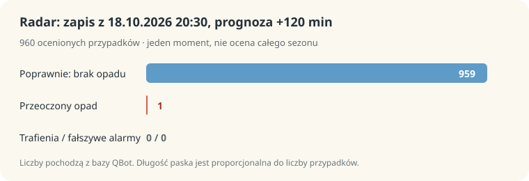
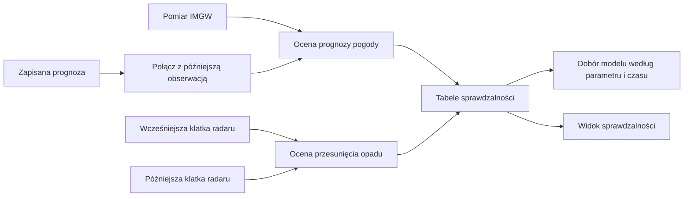

# Sprawdzalność prognoz

## Co to jest

Sprawdzalność to porównanie wcześniejszej prognozy z późniejszym pomiarem lub obrazem radaru. QBOT prowadzi osobne oceny prognoz pogody i krótkiego przesuwania opadu radarowego.

## Po co

Dzięki porównaniu można pokazać, jak trafiały wcześniejsze prognozy, i wybierać modele dla niektórych parametrów i horyzontów.

## Skąd dane

Ocena prognoz punktowych korzysta z pomiarów IMGW i wcześniejszych prognoz Open-Meteo. Ocena radaru porównuje poprzednie przewidywanie przesunięcia z późniejszym obrazem OPERA. Osobna ocena dotyczy szansy opadu z zespołu.

## Jak liczone

Dla temperatury, wiatru i porywów obliczane są [średni błąd bezwzględny (MAE)](../slowniczek.md#mae) i odchylenie średnie ([bias](../slowniczek.md#bias-prognozy)). Opad jest oceniany jako trafienie, fałszywy alarm lub przeoczony opad. Wyniki są dzielone według modelu i wyprzedzenia.

Przykład z bazy: 18.10.2026 20:30, ocena radaru z wyprzedzeniem 120 minut: trafienia 0, fałszywe alarmy 0, przeoczenia 1, poprawne wskazania braku opadu 959. Razem 960 przypadków. Jedna chwila nie wystarcza do oceny typowej jakości.

1. Dodaj cztery kategorie z tego wpisu: 0 + 0 + 1 + 959 = 960 ocenionych przypadków.
2. Radar nie trafił opadu ani razu i nie ogłosił fałszywego deszczu; jeden opad został przeoczony.
3. CSI wynosi 0/(0+0+1)=0. Poprawne wskazania braku opadu nie wchodzą do tego wskaźnika.

Wzór

CSI (wskaźnik trafności opadu) = trafienia / (trafienia + fałszywe alarmy + przeoczenia). Dla +120 min: 0 / (0 + 0 + 1) = 0. Poprawne wskazania braku opadu nie wchodzą do tego wzoru.

## Gdzie to widać

Strona Pogoda ma panel sprawdzalności. Serwis udostępnia osobne wyniki dla modeli, radaru i szansy opadu. Wcześniejsza ocena wybranych prognoz wpływa na dobór modelu dla pogody punktowej i trasowej.

## Jak czytać

[MAE](../slowniczek.md#mae) pokazuje przeciętną wielkość błędu; [bias](../slowniczek.md#bias-prognozy) pokazuje, czy prognozy przeciętnie zawyżały czy zaniżały wynik. [CSI](../slowniczek.md#csi) opadu uwzględnia trafienia, fałszywe alarmy i przeoczenia; poprawne wskazania braku opadu nie zwiększają tego wskaźnika. Zawsze patrz na liczbę przypadków i okres danych. Wpisy z jednego dnia nie są stabilną oceną sezonu.

## Decyzje i historia

Dokumentacja projektu opisuje pomiary IMGW, wcześniejsze prognozy oraz osobne oceny radaru i zespołu. Bieżący kod wykorzystuje część wyników do doboru modeli.

## Ograniczenia i pułapki

Archiwum IMGW może pojawiać się z opóźnieniem. Bieżące pomiary API nie zawierają wszystkich pól archiwum. Porównanie godzinowych modeli z pomiarem stacyjnym ma ograniczenia przestrzenne i czasowe. Dla radaru wynik zależy od liczby przypadków z opadem.

## Wpływa na

Dobór modeli prognozy dla części funkcji punktowych i trasowych oraz widok sprawdzalności na stronie Pogoda.

## Zależy od

Archiwum i API IMGW, Previous Runs Open-Meteo, archiwizowanych klatek OPERA oraz działających automatów zapisu wyników.

## Powiązane hasła

- [Prognoza](prognoza.md)
- [Radar](radar.md)
- [Okno jazdy](okno-jazdy.md)

## Zrodla

- `/opt/qbot/app/qbot_pogoda_verif.py` — `score`, `score_cached`, `tick`, `przydzial`.
- `/opt/qbot/app/qbot_radar_verif.py` — `evaluate`, `summary`.
- `/opt/qbot/app/qbot_eps_verif.py` — ocena prognozy zespołowej.
- `/opt/qbot/app/qbot_web.py` — endpointy `/api/pogoda/sprawdzalnosc*`.
- `qbot_v2.pogoda_radar_verif` — odczyt wpisu z 18.10.2026 20:30.
- `/opt/qbot/app/docs/POGODA_SPRAWDZALNOSC.md` — definicje i zakres pomiarów.
