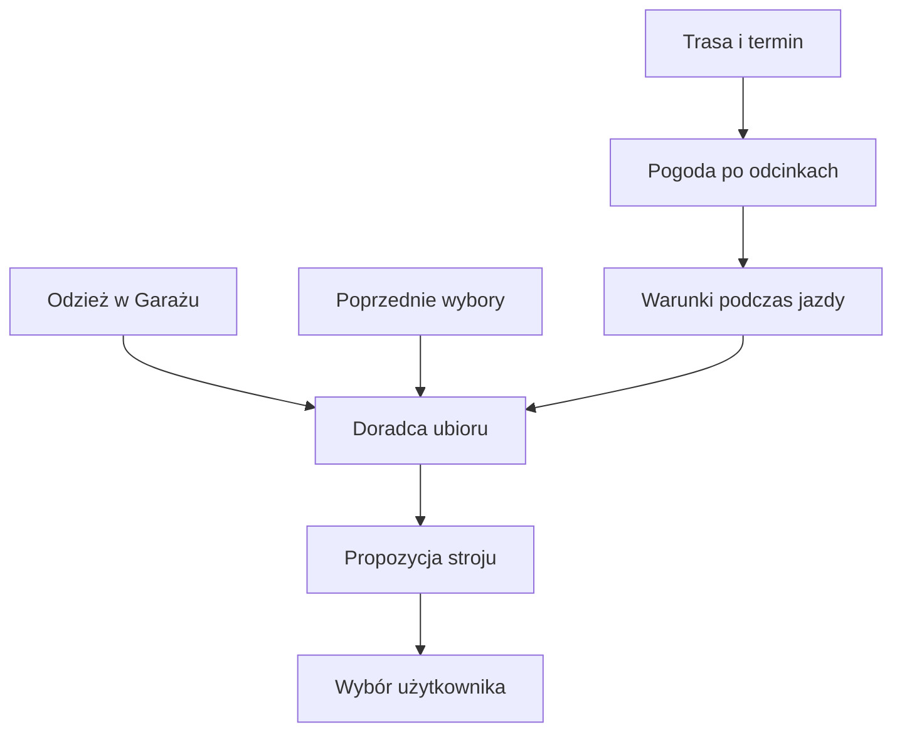

# Pogoda a ubiór

## Co to jest

Prognoza pogody jest jednym z wejść doradcy ubioru dla zaplanowanej trasy. Doradca zestawia przewidywane warunki z odzieżą zapisaną w Garażu i może wykorzystać wcześniejsze wybory.

## Po co

Przed dłuższą jazdą sprawdź, czy zestaw ubrań odpowiada temperaturze odczuwalnej, deszczowi i wiatrowi na trasie. Jeśli prognoza zmienia się w ciągu dnia, ważny jest czas przejazdu przez dany odcinek, nie sama pogoda w chwili startu.

## Skąd dane

Warunki pochodzą z analizy pogody trasy i przewidywanej godziny przejazdu. Lista ubrań i historia użycia są danymi Garażu. Reguły doradcy są osobną warstwą i nie zmieniają prognozy.

## Jak liczone

1. Wskaż zaplanowaną trasę i termin. Silnik prognozy przypisuje warunki do odcinków oraz przewidywanego czasu.
2. Doradca odczytuje dostępne ubrania i porównuje je z warunkami: temperaturą, deszczem, wiatrem i innymi sygnałami udostępnionymi w raporcie.
3. Historia jazd może pomóc w opisie wyboru, ale nie jest pomiarem komfortu dla przyszłej pogody.
4. Wynik jest rekomendacją; użytkownik nadal wybiera zestaw.

Nie znaleziono w tej rundzie sprawdzonego przykładu rekomendacji z bazy ani kodu całej punktacji cieplnej doradcy. Dlatego nie podaję przykładowego zestawu ani liczbowych progów ubioru.

## Gdzie to widać

Doradca ubioru jest dostępny przy analizie zaplanowanej trasy. Zrzut głównej strony Pogoda pokazuje prognozę, z której można przejść do ogólnych warunków; nie przedstawia panelu rekomendacji stroju.

## Jak czytać

To propozycja oparta na dostępnych rzeczach i przewidywanych warunkach. Sprawdź ostrzeżenia dla trasy i własne doświadczenie. Nie należy utożsamiać jej z gwarancją komfortu ani bezpieczeństwa.

## Ograniczenia i pułapki

Brak konkretnej rekomendacji w tym etapie uniemożliwia potwierdzenie sposobu prezentacji i progów. Dane ubraniowe mogą być niepełne. Prognoza może się zmienić.

> DO SPRAWDZENIA: Aktualny widok doradcy dla zapisanej trasy, przykładowy wynik oraz dokładne pola pogodowe użyte przy doborze.

## Wpływa na

Proponowany ubiór w analizie zaplanowanej trasy.

## Zależy od

Prognozy na trasie, terminu, danych Garażu i dostępności zapisanej historii ubioru.

## Powiązane hasła

- [Pogoda na trasie](pogoda-na-trasie.md)
- [Doradca ubioru](../garaz/doradca-ubioru.md)
- [Garaż](../garaz/index.md)
- [Slowniczek](../slowniczek.md)

## Zrodla

- `/opt/qbot/app/qbot3/routes/outfit_advisor.py` — doradca i użycie danych Garażu.
- `/opt/qbot/app/qbot3/routes/route_meteo_engine.py` — prognoza na odcinkach.
- `/opt/qbot/app/web_public/pogoda.html` — dane pogodowe strony.
