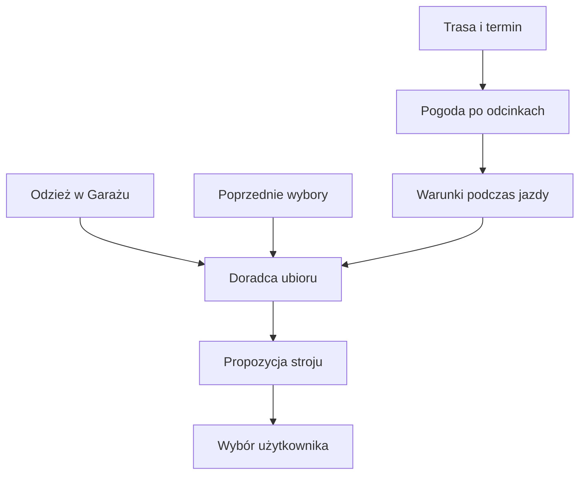

# Pogoda a ubiór

## Co to jest

Prognoza pogody jest jednym z wejść doradcy ubioru dla zaplanowanej trasy. Doradca zestawia przewidywane warunki z odzieżą zapisaną w Garażu i może wykorzystać wcześniejsze wybory.

## Po co

Przed dłuższą jazdą sprawdź, czy zestaw ubrań odpowiada temperaturze odczuwalnej, deszczowi i wiatrowi na trasie. Jeśli prognoza zmienia się w ciągu dnia, ważny jest czas przejazdu przez dany odcinek, nie sama pogoda w chwili startu.

## Skąd dane

Warunki pochodzą z analizy pogody trasy i przewidywanej godziny przejazdu. Lista ubrań i historia użycia są danymi Garażu. Reguły doradcy są osobną warstwą i nie zmieniają prognozy.

## Jak liczone

1. Wskaż trasę, dzień i godzinę. Prognoza przypisuje warunki do etapów jazdy, uwzględniając przewidywane godziny dotarcia.
2. Doradca wybiera temperaturę do ubioru jako najzimniejszy z kilku sprawdzanych wariantów: prognozy „na rowerze”, chłodnego wariantu z historii podobnych jazd oraz odczuwalnej z wiatrem.
3. Ubrania z Garażu są grupowane w warstwy. Przy dopasowaniu bierze się pod uwagę m.in. zakres temperatury z audytu, stan rzeczy, ich używanie, deszcz, wiatr oraz preferencje warstwowania.
4. Reguły ubioru mogą wymusić wymagane warstwy w określonych warunkach. Następnie część tekstowa tworzy dokładnie dwie propozycje: spokojniejszą i szybszą jazdę. Kontrola sprawdza, czy propozycja zawiera wymagane warstwy.
5. Jeśli Garaż nie zawiera pasujących rzeczy albo brakuje wymaganych danych, wynik może nie powstać. Wybór stroju nadal należy do rowerzysty.

Nie znaleziono w bazie zachowanego wyniku rekomendacji, który można powiązać z konkretną trasą i datą. Nie przedstawiam więc przykładowego stroju jako wyniku historycznego.

## Gdzie to widać

Doradca jest wywoływany z analizy zaplanowanej trasy i korzysta z danych Garażu. Zrzut „Pogoda wyprawy” pokazuje wyłącznie stan bez trasy i komunikat o powrocie do planera; nie przedstawia rekomendacji ubioru. Nie należy szukać na nim gotowego zestawu.

## Jak czytać

To propozycja oparta na dostępnych rzeczach i przewidywanych warunkach. Sprawdź ostrzeżenia dla trasy i własne doświadczenie. Nie należy utożsamiać jej z gwarancją komfortu ani bezpieczeństwa.

## Ograniczenia i pułapki

Zrzut nie pokazuje widoku doradcy, a historia rekomendacji nie została znaleziona w bazie. Progi doboru są częścią kodu i reguł odzieży; nie oznaczają obiektywnego pomiaru komfortu. Prognoza i lista rzeczy mogą się zmienić.

## Wpływa na

Proponowany ubiór w analizie zaplanowanej trasy.

## Zależy od

Prognozy na trasie, terminu, danych Garażu i dostępności zapisanej historii ubioru.

## Powiązane hasła

- [Pogoda na trasie](pogoda-na-trasie.md)
- [Doradca ubioru](../garaz/doradca-ubioru.md)
- [Garaż](../garaz/index.md)
- [Slowniczek](../slowniczek.md)

## Zrodla

- `/opt/qbot/app/qbot3/routes/outfit_advisor.py` — doradca i użycie danych Garażu.
- `/opt/qbot/app/qbot3/routes/route_meteo_engine.py` — prognoza na odcinkach.
- `/opt/qbot/app/qbot3/routes/outfit_advisor.py` — temperatura do ubioru, selekcja warstw i dwie propozycje.
- `/opt/qbot/app/web_public/pogoda.html` — dane pogodowe strony.
