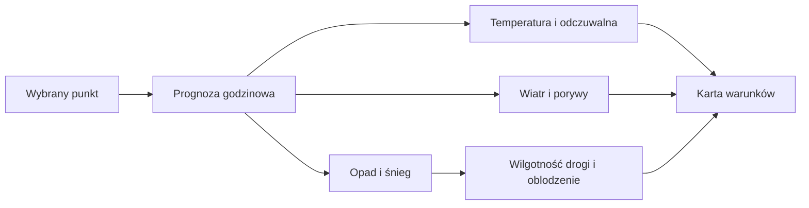

# Warunki dla wybranego miejsca

## Co to jest

To prognoza dla jednego punktu na mapie. Pokazuje warunki w wybranym miejscu i godzinie, a także sygnały o mgle, oblodzeniu i stanie nawierzchni.

## Po co

Przed wyjściem kliknij miejsce, w którym będziesz jechać. Wartość z domu nie musi opisywać pogody na trasie oddalonej o kilkadziesiąt kilometrów.

## Skąd dane

Temperatura, wilgotność, ciśnienie, wiatr, porywy, opad, śnieg i zachmurzenie pochodzą z prognoz pobranych przez wspólny moduł pogodowy. Część warunków jest dobierana według wcześniejszej sprawdzalności modelu. Szansa opadu może pochodzić z prognozy zespołowej.

## Jak liczone

1. Wybierz punkt na mapie; serwer pobiera dla niego prognozę godzinową.
2. Wiatr jest podawany w m/s. Opad i śnieg są przypisane do właściwej godziny; dla części pól źródło opisuje godzinę poprzedzającą znacznik, więc kod pobiera następną wartość godzinową.
3. Dla nawierzchni suma opadu z około 6 godzin wynosząca co najmniej 0,3 mm daje status wilgotny; od 2 mm — mokry lub błotnisty.
4. Sygnał oblodzenia wymaga temperatury gruntu do 0,5°C oraz niedawnego opadu/śniegu albo warunku rosy opisanym w kodzie.
5. Kafelek odczuwalnej temperatury jest osobnym wyliczeniem: uwzględnia wiatr i promieniowanie słoneczne. Brak wymaganych danych może pozostawić wynik pusty.

Przykład historyczny z bazy: 04.10.2026 zapis warunków dla punktu zawierał 15,8°C, 0,0 mm opadu i wiatr 2,6 m/s. 0,0 mm jest poniżej progu 0,3 mm dla wilgotnej nawierzchni. To zapis dla konkretnego punktu/czasu; brak współrzędnych w zachowanym podsumowaniu nie pozwala przypisać go do lokalizacji.

Wzór

Suma opadu z okna około 6 godzin: poniżej 0,3 mm — bez sygnału wilgotnej nawierzchni; od 0,3 mm — wilgotna; od 2 mm — mokra/błotnista. To progi uproszczone w kodzie, nie pomiar wilgotności asfaltu.

## Gdzie to widać

Na zrzucie głównej strony Pogoda karta po lewej zawiera temperaturę, odczuwalną i opis dnia. Niżej widoczne są kafelki wiatru, szansy opadu, nawierzchni i wschodu/zachodu. Wybór miejsca na mapie zmienia punkt prognozy.

## Jak czytać

Odczuwalna temperatura nie jest temperaturą zmierzoną termometrem. „Sucha nawierzchnia” oznacza klasyfikację na podstawie prognozowanego opadu; nie wyklucza wody z kałuż, cienia ani lokalnych warunków. Sygnał oblodzenia jest ostrzeżeniem obliczonym, nie bezpośrednim pomiarem drogi.

## Ograniczenia i pułapki

Punktowa prognoza opisuje siatkę modelu i może nie uchwycić lokalnej różnicy terenu. Nie wszystkie modele dostarczają wszystkie pola. Przykład bazy nie ma lokalizacji zachowanej w podsumowaniu, dlatego nie wolno utożsamiać go ze zrzutem.

## Wpływa na

Kafelek warunków, charakter dnia, alerty oraz Okno jazdy.

## Zależy od

Wybranego punktu, prognozy godzinowej i dostępności danych o gruncie/opadzie.

## Powiązane hasła

- [Prognoza](prognoza.md)
- [Wiatr](wiatr.md)
- [Okno jazdy](okno-jazdy.md)
- [Sprawdzalność prognoz](sprawdzalnosc.md)
- [Slowniczek](../slowniczek.md)

## Zrodla

- `/opt/qbot/app/qbot_pogoda.py` — `conditions_point`, `road_flags`, `odczucie_calc`.
- `/opt/qbot/app/qbot_wx.py` — pobieranie prognozy i ustawienia godzin.
- `/opt/qbot/app/web_public/pogoda.html` — karta punktu i kafelki.
- `_DO_SPRAWDZENIA.md` — historyczny odczyt warunków 04.10.2026.
