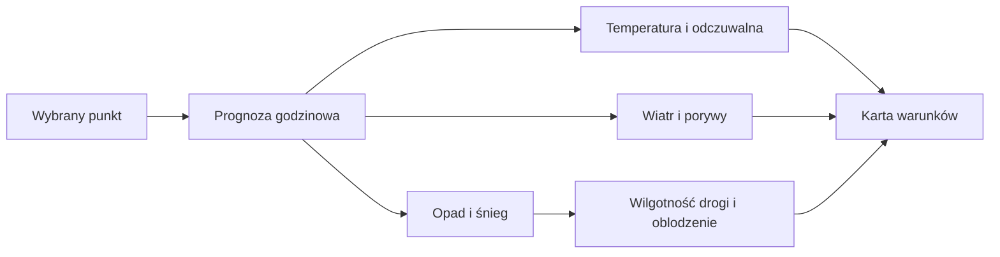

# Warunki dla wybranego miejsca

## Co to jest

To prognoza dla jednego punktu na mapie. Pokazuje warunki w wybranym miejscu i godzinie, a także sygnały o mgle, oblodzeniu i stanie nawierzchni.

## Po co

Przed wyjściem kliknij miejsce, w którym będziesz jechać. Wartość z domu nie musi opisywać pogody na trasie oddalonej o kilkadziesiąt kilometrów.

## Skąd dane

Temperatura, wilgotność, ciśnienie, wiatr, porywy, opad, śnieg i zachmurzenie pochodzą z prognoz pobranych przez wspólny moduł pogodowy. Część warunków jest dobierana według wcześniejszej sprawdzalności modelu. Szansa opadu może pochodzić z prognozy zespołowej.

## Jak liczone

1. Wybierz punkt na mapie; prognoza jest pobierana dla wskazanych współrzędnych i kolejnych godzin.
2. Wiatr i porywy są wyświetlane w m/s. Opad, śnieg i prawdopodobieństwo są przypisywane do właściwej godziny; dla pól opisujących godzinę poprzednią kod przesuwa odczyt o jedną godzinę.
3. Suma opadu z około sześciu godzin od 0,3 mm oznacza sygnał wilgotnej nawierzchni, a od 2 mm — mokrej lub błotnistej. Nie jest to czujnik drogi.
4. Wskazanie możliwego oblodzenia pojawia się, gdy temperatura gruntu nie przekracza 0,5°C. Poziom rośnie przy wilgoci z ostatnich 12 godzin lub szronie; mokry grunt poniżej −0,5°C daje najwyższy poziom.
5. Mgła jest oceniana z widzialności: poniżej 4 km pojawia się sygnał, a poniżej 1 km mocniejszy sygnał. Brak widzialności oznacza brak tej oceny.
6. Odczuwalna temperatura jest liczona oddzielnie z temperatury, wilgotności, wiatru i promieniowania. Jeżeli brakuje niezbędnego wejścia, pole może być puste.

Nie znaleziono w bieżącej bazie archiwalnego zapisu warunków punktowych, który pozwoliłby przejść od prognozy do klasyfikacji drogi dla konkretnej daty. Wartości na zrzucie ekranu są migawką wyświetlonej prognozy i nie zastępują przykładu z tabeli danych.

Wzór

Suma opadu z okna około 6 godzin: poniżej 0,3 mm — bez sygnału wilgotnej nawierzchni; od 0,3 mm — wilgotna; od 2 mm — mokra/błotnista. To progi uproszczone w kodzie, nie pomiar wilgotności asfaltu.

## Gdzie to widać

Na zrzucie głównej strony Pogoda karta po lewej zawiera temperaturę 10,1°C, odczuwalną 8,7°C i maksimum 10,2°C o 17:00. Niżej szukaj wiatru 2,6 m/s, porywów 6,5 m/s, szansy opadu 0%, suchej nawierzchni oraz zachodu słońca 17:37. Zrzut jest migawką ekranu, nie przykładem bazy ani bieżącą prognozą. Wybór punktu na mapie zmienia lokalizację prognozy.

## Jak czytać

Odczuwalna temperatura nie jest temperaturą zmierzoną termometrem. „Sucha nawierzchnia” oznacza klasyfikację na podstawie prognozowanego opadu; nie wyklucza wody z kałuż, cienia ani lokalnych warunków. Sygnał oblodzenia jest ostrzeżeniem obliczonym, nie bezpośrednim pomiarem drogi.

## Ograniczenia i pułapki

Punktowa prognoza opisuje siatkę modelu i może nie uchwycić lokalnej różnicy terenu. Nie wszystkie modele dostarczają wszystkie pola. Zrzut jest migawką ekranu; nie zawiera śladu lokalizacji ani danych źródłowych, więc nie można go użyć do odtworzenia reguł.

## Wpływa na

Kafelek warunków, charakter dnia, alerty oraz Okno jazdy.

## Zależy od

Wybranego punktu, prognozy godzinowej i dostępności danych o gruncie/opadzie.

## Powiązane hasła

- [Prognoza](prognoza.md)
- [Wiatr](wiatr.md)
- [Okno jazdy](okno-jazdy.md)
- [Sprawdzalność prognoz](sprawdzalnosc.md)
- [Slowniczek](../slowniczek.md)

## Zrodla

- `/opt/qbot/app/qbot_pogoda.py` — `conditions_point`, `road_flags`, `odczucie_calc`.
- `/opt/qbot/app/qbot_wx.py` — pobieranie prognozy i ustawienia godzin.
- `/opt/qbot/app/web_public/pogoda.html` — karta punktu i kafelki.
- `qbot_v2.meteo_point_cache` — pamięć podręczna prognoz punktowych; zawartość nie stanowi archiwum obserwacji historycznej.
