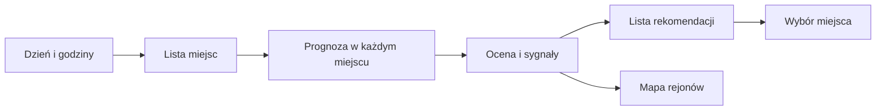

# Gdzie w weekend

## Co to jest

„Gdzie w weekend” porównuje prognozę dla kilku miejsc i podpowiada te, w których wybrany przedział dnia wygląda korzystniej. To porównanie prognozy, nie gwarancja pogody na całej trasie.

## Po co

Jeśli w miejscu startu zapowiadany jest deszcz, widok może pomóc porównać pobliskie regiony. Przed zmianą planu sprawdź dojazd, wiatr oraz pogodę na samej trasie.

## Skąd dane

Serwer pobiera prognozę dla zestawu miejsc i okresu godzinowego. Ocenia m.in. opad, wiatr, porywy i temperaturę. Warstwa weekendowa rysuje wyróżnione rejony na mapie; w tym trybie radar i model na mapie są ukryte.

## Jak liczone

1. Wybierz dzień i przedział godzin. Domyślna funkcja oceny dnia w kodzie używa godzin 08–19.
2. Dla każdego miejsca zbierane są warunki z przedziału, w tym suma opadu, prędkość wiatru, porywy oraz temperatura.
3. Miejsca dostają ocenę 0–100 i listę warunków. Widok sortuje propozycje, a mapa zaznacza rejony.
4. Kliknięcie propozycji ustawia ten punkt jako miejsce prognozy.

Dokładne wagi składowych oceny nie są opisane w tym haśle, ponieważ nie zostały zweryfikowane w całości. Nie traktuj różnicy kilku punktów jako pewnej przewagi pogodowej.

## Gdzie to widać

Na stronie Pogoda wybierz panel z gwiazdką „Gdzie w weekend”. Lista pokazuje nazwę miejsca, ocenę na 100, opad, wiatr, porywy i temperaturę. Mapa w tym widoku nie pokazuje radaru ani kolorowej warstwy modelu.

## Jak czytać

Ocena jest porównaniem miejsc w ramach tego samego zestawu prognoz. Oprócz liczby czytaj opis opadu i wiatru. W kodzie pojawiają się sygnały: opad co najmniej 1 mm jako deszcz, od 0,2 mm jako przelotny; wiatr od 5 m/s jako uwaga. Są to flagi interfejsu widoku weekendowego, nie uniwersalne granice bezpieczeństwa.

## Ograniczenia i pułapki

Prognoza dla punktu nie pokrywa całej trasy dojazdu. Wybór innego miejsca może oznaczać dodatkowy dojazd, którego ekran nie ocenia. Brak miejsca na liście nie dowodzi, że będzie tam zła pogoda.

> DO SPRAWDZENIA: Pełne wagi oceny 0–100, komplet miejsc wejściowych oraz historyczny wynik rekomendacji weekendowej.

## Wpływa na

Listę rekomendacji, warstwę weekendową mapy i wybrane miejsce w prognozie.

## Zależy od

Prognozy dla punktów, okresu godzinowego i konfiguracji listy miejsc.

## Powiązane hasła

- [Warunki dla wybranego miejsca](warunki-punktowe.md)
- [Okno jazdy](okno-jazdy.md)
- [Pogoda na trasie](pogoda-na-trasie.md)
- [Slowniczek](../slowniczek.md)

## Zrodla

- `/opt/qbot/app/qbot_pogoda_map.py` — `ocena_dnia`, `rejony`.
- `/opt/qbot/app/web_public/pogoda.html` — panel weekendowy `weekend`, `wkFlags`.
- `/opt/qbot/app/qbot_web.py` — endpoint mapy weekendowej.
