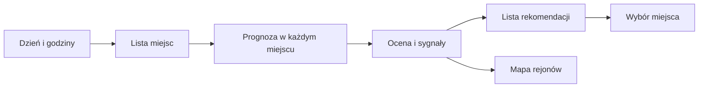

# Gdzie w weekend

## Co to jest

„Gdzie w weekend” porównuje prognozę dla kilku miejsc i podpowiada te, w których wybrany przedział dnia wygląda korzystniej. To porównanie prognozy, nie gwarancja pogody na całej trasie.

## Po co

Jeśli w miejscu startu zapowiadany jest deszcz, widok może pomóc porównać pobliskie regiony. Przed zmianą planu sprawdź dojazd, wiatr oraz pogodę na samej trasie.

## Skąd dane

Serwer pobiera prognozę dla zestawu miejsc i okresu godzinowego. Ocenia m.in. opad, wiatr, porywy i temperaturę. Warstwa weekendowa rysuje wyróżnione rejony na mapie; w tym trybie radar i model na mapie są ukryte.

## Jak liczone

1. Wybierz datę i godziny. W domyślnym wywołaniu kod liczy okno 08:00–19:00. Prognoza mapy korzysta z ICON-EU o siatce około 7 km.
2. Dla każdego punktu mapy sumuje opad w milimetrach, liczy średnią temperaturę i wiatr oraz bierze maksymalną temperaturę i porywy.
3. Naliczana jest wspólna kara za chłód, wiatr i porywy, a także kara za opad i upał. Wynik to 100 minus dziesięciokrotność sumy kar; jest ograniczony do zakresu 0–100.
4. Lista propozycji wybiera najwyższe wyniki z miejscowościami, rozstawiając je co najmniej 60 km od siebie. Kod pomija punkty, którym nie można przypisać miejscowości w odległości do 15 km.
5. Kliknięcie propozycji ustawia ten punkt jako miejsce prognozy.

Przykład przeliczenia wyniku dla konkretnego miejsca wymaga historycznej mapy z jej plikami prognozy. Takiego zapisu w dostępnej bazie nie znaleziono, dlatego nie przypisuję przykładowej oceny do zrzutu ekranu.

Wzór

Kara = opad w oknie × 1,5 + kara za odczuwalny chłód + kara za wiatr ponad 4 m/s + kara za porywy ponad 9 m/s + kara za temperaturę maksymalną ponad 28°C. Wynik = ograniczone do 0–100: 100 − 10 × kara. Chłód, wiatr i porywy korzystają ze wspólnych współczynników komfortu opisanych w kodzie; nie jest to ocena bezpieczeństwa.

## Gdzie to widać

Na stronie Pogoda wybierz panel z gwiazdką „Gdzie w weekend”. Lista pokazuje nazwę miejsca, ocenę na 100, opad, wiatr, porywy i temperaturę. Mapa w tym widoku nie pokazuje radaru ani kolorowej warstwy modelu.

## Jak czytać

Na mapie względnej zielony oznacza miejsce powyżej górnego progu dla danego dnia, pomarańczowy — poniżej dolnego progu, a ciemnoczerwony — wynik poniżej 50/100. Progi zieleni i pomarańczu są wyznaczane z rozkładu wyników w Polsce dla wybranego dnia, więc nie są stałą oceną między datami. W liście odczytuj równolegle opad i wiatr. Flagi tekstowe widoku oznaczają opad od 0,2 mm jako przelotny, od 1 mm jako deszcz oraz wiatr od 5 m/s jako uwagę; nie są to progi bezpieczeństwa.

## Ograniczenia i pułapki

Prognoza dla punktu nie pokrywa całej trasy dojazdu. Wybór innego miejsca może oznaczać dodatkowy dojazd, którego ekran nie ocenia. Brak miejsca na liście nie dowodzi, że będzie tam zła pogoda.

Historyczna rekomendacja nie jest archiwizowana w tabeli bazy, więc nie ma przykładu liczbowego dla dnia z przeszłości.

## Wpływa na

Listę rekomendacji, warstwę weekendową mapy i wybrane miejsce w prognozie.

## Zależy od

Prognozy dla punktów, okresu godzinowego i konfiguracji listy miejsc.

## Powiązane hasła

- [Warunki dla wybranego miejsca](warunki-punktowe.md)
- [Okno jazdy](okno-jazdy.md)
- [Pogoda na trasie](pogoda-na-trasie.md)
- [Slowniczek](../slowniczek.md)

## Zrodla

- `/opt/qbot/app/qbot_pogoda_map.py` — `ocena_dnia`, `rejony`.
- `/opt/qbot/app/web_public/pogoda.html` — panel weekendowy `weekend`, `wkFlags`.
- `/opt/qbot/app/qbot_web.py` — endpoint mapy weekendowej.
- `/opt/qbot/app/qbot_pogoda.py` — wspólna kara komfortu `KOMFORT`.
