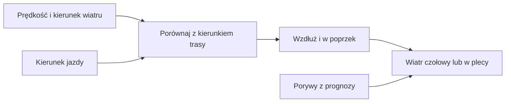

# Wiatr

## Co to jest

Prognoza wiatru opisuje prędkość wiatru, jego kierunek oraz porywy. QBOT pokazuje prędkość wiatru w m/s.

## Po co

Wiatr pomaga ocenić warunki jazdy. Na trasie można odróżnić wiatr wzdłużny od poprzecznego, a w QExt2 także wiatr czołowy od wiatru w plecy.

## Skąd dane

Prognoza pochodzi z Open-Meteo i używa m/s. Dla wskazanego miejsca pobierane są kierunek i porywy. Silnik trasy wyznacza także składową wzdłużną i poprzeczną wiatru; QExt2 otrzymuje wzdłużną składową oraz porywy.

## Jak liczone

Dla trasy silnik porównuje kierunek wiatru z kierunkiem jazdy i rozkłada wiatr na składową wzdłużną oraz poprzeczną. W QExt2 dodatnia wartość składowej wzdłużnej oznacza wiatr czołowy, a ujemna — wiatr w plecy. Porywy są również podawane w m/s.

Przykład z bazy z 04.10.2026: w wybranym punkcie prognoza podawała wiatr 2,6 m/s. Zapis nie zawiera w zachowanym podsumowaniu kierunku, więc nie da się na jego podstawie wyliczyć składowej względem trasy.

Przykładowy rekord danych sprawdzalności radaru z 18.10.2026 10:05 dotyczy opadu, nie zawiera pomiaru wiatru. Nie używam go jako przykładu prędkości wiatru.

## Gdzie to widać

Kierunek i siła wiatru są pokazywane w warunkach pogodowych strony Pogoda. Prognoza trasy i QExt2 mogą pokazać składową względem kierunku jazdy.

## Jak czytać

Wartość w m/s to prędkość wiatru; większa wartość oznacza silniejszy wiatr. Składowa czołowa utrudnia jazdę, a składowa w plecy pomaga. Są to prognozowane składowe względem trasy, nie niezależny pomiar na rowerze.

## Decyzje i historia

Kod wspólnego transportu wymusza m/s. Starsze dokumenty mogą opisywać inne jednostki dla ruchu chmur na mapie radaru; prędkość przesuwania się opadu nie jest wiatrem przy ziemi.

## Ograniczenia i pułapki

Prognoza modelowa może różnić się od wiatru lokalnego, zwłaszcza za przeszkodami terenowymi. Nie należy utożsamiać prędkości przemieszczania się obrazu opadu z prędkością wiatru przy gruncie.

## Wpływa na

Ocena pogody na trasie, odczuwalna temperatura i dane pogodowe pokazywane QExt2.

## Zależy od

Prognozy kierunku i prędkości wiatru oraz geometrii trasy i przewidywanego kierunku jazdy.

## Powiązane hasła

- [Prognoza](prognoza.md)
- [Pogoda na trasie](pogoda-na-trasie.md)
- [Pogoda w QExt2](qext2.md)

## Zrodla

- `/opt/qbot/app/qbot_wx.py` — `forecast`, jednostka `ms`.
- `/opt/qbot/app/qbot_pogoda.py` — wybór wiatru i porywów w `conditions_point`.
- `/opt/qbot/app/qbot3/routes/route_meteo_engine.py` — `wind_tail_ms`, `wind_cross_ms`.
- `/opt/qbot/app/qbot_api.py` — `_qext2_weather_route`, `head`, `gust`.
- `/opt/qbot/app/docs/POGODA_RADAR.md` — prędkość ruchu opadu w km/h, odróżniona od wiatru.
