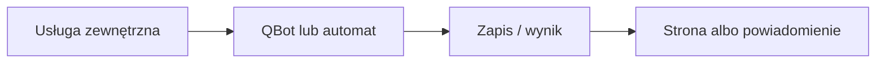

# Garmin

## Co to jest

Garmin przesyła do QBota jazdy i dane wellness, między innymi sen i pomiary serca. QBot używa ich w raportach i ekranach zdrowia; nie każdy wskaźnik Garmina jest bezpośrednio przyjmowany jako wynik QBota.

## Po co

Pomaga przenieść dane między usługą a QBotem i sprawdzić, czy przepływ działa.

## Skąd dane

Garmin Connect; kod pobierania wellness korzysta z biblioteki garminconnect. Import wellness zapisuje dane ze źródłem `garmin`; pełna odpowiedź snu i HRV trafia także do `qbot_v2.garmin_daily_raw`.

## Jak liczone

Strażnik sprawdza zmiany co 10 minut. Import następuje po wykryciu zmiany albo najpóźniej w cyklu bezpieczeństwa co 3 godziny. Status kontroluje osobno świeżość strażnika i ostatniego importu.

docs/GARMIN_DANE.md opisuje zmiany z 14.10.2026, zaś STATUS.md ma datę 15.10.2026. Podstawowe interwały zgadzają się z bieżącym `qbot_status_checks.py`. Nie porównano wszystkich pól dokumentu z API Garmina.

## Gdzie to widać

SETUP > Połączenia zawiera ramki Stravy, Komoot i Hammerhead/Karoo. Wybrane stany integracji pokazuje SETUP > Połączenia > Status. Szczegóły danego przepływu podano powyżej.

## Jak czytać

Status opisuje świeżość i powodzenie pracy automatu, a nie gwarantuje kompletności wszystkich danych u dostawcy. Brak osobnego checku nie przesądza o braku integracji.

## Decyzje i historia

docs/GARMIN_DANE.md opisuje zmiany z 14.10.2026, zaś STATUS.md ma datę 15.10.2026. Podstawowe interwały zgadzają się z bieżącym `qbot_status_checks.py`. Nie porównano wszystkich pól dokumentu z API Garmina.

## Ograniczenia i pułapki

Nie zakładaj, że każda pozycja oznacza bieżący, poprawny import. Częstotliwości wymagają potwierdzenia w aktywnym harmonogramie.

## Wpływa na

- [Połączenia i dane](index.md)
- [Status i automaty](../system/automaty.md)

## Zależy od

- Dostępu do wskazanej usługi oraz uruchomienia automatu.
- Zapisów w tabelach/plikach wymienionych poniżej.

## Powiązane hasła

- [Garmin](garmin.md)
- [Harmonogram importów](harmonogram-importow.md)
- [Raport jazdy](../raport-jazdy/index.md)

## Zrodla

- `qbot_wellness_store.py` — `_garmin_fetch_wellness`, `_garmin_import_wellness`; `scripts/garmin_watch.py`; `qbot_status_checks.py` — `garmin_import`
- `qbot_v2.qbot_wellness_daily`, `qbot_v2.garmin_daily_raw`
