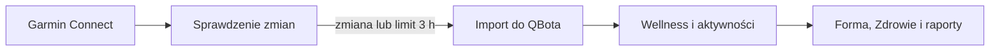
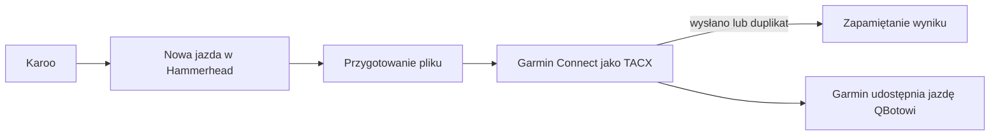

# Garmin

## Co to jest

Garmin przesyła do QBota jazdy i dane wellness, między innymi sen i pomiary serca. QBot używa ich w raportach i ekranach zdrowia; nie każdy wskaźnik Garmina jest bezpośrednio przyjmowany jako wynik QBota.

## Po co

Pomaga przenieść dane między usługą a QBotem i sprawdzić, czy przepływ działa.

## Skąd dane

Garmin Connect; kod pobierania wellness korzysta z biblioteki garminconnect. Import wellness zapisuje dane ze źródłem `garmin`; pełna odpowiedź snu i HRV (zmienność rytmu serca; [słowniczek](../slowniczek.md#hrv)) trafia także do surowego archiwum. HRV jest pomiarem, a nie diagnozą.

## Jak liczone

1. Strażnik zagląda do Garmina i sprawdza, czy pojawiły się nowe dane. Crontab uruchamia go co 15 minut; kontrola Status oczekuje częstszego, 10-minutowego odświeżania. To rozjazd między harmonogramem a opisem kontrolnym.
2. Przy wykrytej zmianie uruchamiane są importy. Gdy zmiany nie ma, pełny cykl bezpieczeństwa uruchamia import najpóźniej po 3 godzinach.
3. Przykład z bazy: 18.10.2026 zapis wellness z Garmina zawiera HRV 67 ms, puls spoczynkowy 49 uderzeń/min i sen 344 min. To surowe pomiary, nie ocena gotowości.
4. Tego samego dnia zapis masy ciała wynosi 103,04 kg i ma źródło Garmin. To osobny zapis pomiaru ciała.

Wzór

Tu nie ma jednego wzoru. QBot importuje pomiary, a inne hasła opisują sposób użycia ich w obliczeniach.

Crontab z 18.10.2026 pokazuje strażnika co 15 minut. Kontrola Status sprawdza, czy działał w ciągu 45 minut, ale jej tekst mówi „co 10 min”. Pełny import ma limit 3 godzin. Starsze wpisy harmonogramu importu treningów i snu są zakomentowane; bieżący strażnik jest osobnym mechanizmem.

## Hammerhead/Karoo → Garmin (TACX)

Karoo zapisuje jazdę, a automat Hammerhead przekazuje ją do Garmina Connect jako TACX (rodzaj aktywności używany przez ten mostek; [słowniczek](../slowniczek.md#tacx)). To mostek do przesłania aktywności. W decyzji z 07.07.2026 Michał ustalił, że Hammerhead nie jest osobnym źródłem danych treningowych QBota; treningi QBot pobiera z Garmina.

### Jak przebiega przekazanie

1. Automat sprawdza, czy w Hammerhead czeka nowa aktywność rowerowa.
2. Przygotowuje plik tak, by Garmin mógł go przyjąć, i wysyła go jako TACX.
3. Zapamiętuje wynik, by uniknąć ponownego wysłania tej samej jazdy. Odpowiedź „Duplicate Activity” oznacza, że Garmin już ją ma.
4. Harmonogram odczytany 18.10.2026 zawiera cztery uruchomienia co 10 minut: ogólne i trzy profile.

Na zrzucie Status z 18.10.2026 wiersz Garmin pokazuje czas importu 15:45 i sprawdzenie 15:39. Wiersz Hammerhead pokazuje ostatnie wysłanie o 13:10 oraz sprawdzenie o 15:40. To dwa osobne zegary: kontrola może się odbyć bez nowej jazdy.

### Jak czytać

Jeśli sprawdzenie jest świeże, a nie pojawiła się nowa aktywność, automat może działać prawidłowo. Zielona kropka oznacza, że przeszły kontrole opisane przez Status. Nie gwarantuje, że każda jazda u dostawcy została już pobrana.

Usunięcie aktywności z Garmina nie resetuje lokalnego oznaczenia, że plik został już przetworzony. W przypadku wcześniej wysłanej, poprawionej jazdy historia projektu wskazuje ręczne ponowne wgranie.

**Decyzja z 19.10.2026:** opis Hammerhead/Karoo → Garmin został połączony z tym hasłem, aby pokazać cały ciąg jazdy od licznika przez Garmina do QBota.

## Gdzie to widać

SETUP > Połączenia zawiera ramki Stravy, Komoot i Hammerhead/Karoo. Wybrane stany integracji pokazuje SETUP > Połączenia > Status. Szczegóły danego przepływu podano powyżej.

## Jak czytać

Na zrzucie Status wiersz „Garmin → QBot (import)” pokazuje czas ostatniego importu i osobno ostatnie sprawdzenie zmian. Odczyt na zrzucie z 18.10 pokazuje import o 15:45 i sprawdzenie o 15:39. Zielona kropka mówi o przejściu tych kontroli, nie o tym, że Garmin nie ma późniejszych danych.

## Decyzje i historia

Decyzja z 08.10.2026 opisuje strażnika co 15 minut; kontrola statusu nadal zawiera dawną wartość 10 minut. Opis Garmin w dokumentacji STATUS.md również nie jest dowodem harmonogramu. W tym haśle pierwszeństwo ma odczyt aktywnego crontaba.

## Ograniczenia i pułapki

Garmin może dostarczać pomiary później, niż wskazuje ich data. Przykładowy wiersz z 18.10 został zapisany o 21:15. Źródło pomiaru i czas importu warto czytać razem. Odmienna częstotliwość w checku Status nie oznacza, że w crontabie istnieją dwa strażniki.

> DO SPRAWDZENIA: czy check Status ma zmienić oczekiwane 10 minut na 15 minut zgodnie z aktywnym crontabem.

## Wpływa na

- [Połączenia i dane](index.md)
- [Status i automaty](../system/automaty.md)
- [Gotowość](../forma/gotowosc.md)

## Zależy od

- Dostępu do wskazanej usługi oraz uruchomienia automatu.
- Zapisów w tabelach/plikach wymienionych poniżej.

## Powiązane hasła

- [Harmonogram importów](harmonogram-importow.md)
- [Withings → Garmin](withings.md)
- [Połączenia i dane](index.md)
- [Raport jazdy](../raport-jazdy/index.md)

## Zrodla

- `qbot_wellness_store.py` — `_garmin_fetch_wellness`, `_garmin_import_wellness`; `scripts/garmin_watch.py`; `qbot_status_checks.py` — `garmin_import`
- `qbot_v2.qbot_wellness_daily`, `qbot_v2.garmin_daily_raw`
- `scripts/run_hammerhead_garmin_sync.sh`; `state/processed_hammerhead_activities.json`; `logs/hammerhead-garmin-sync.log`
- `docs/DECISIONS.md` — decyzje z 07.07.2026 i 19.10.2026.
